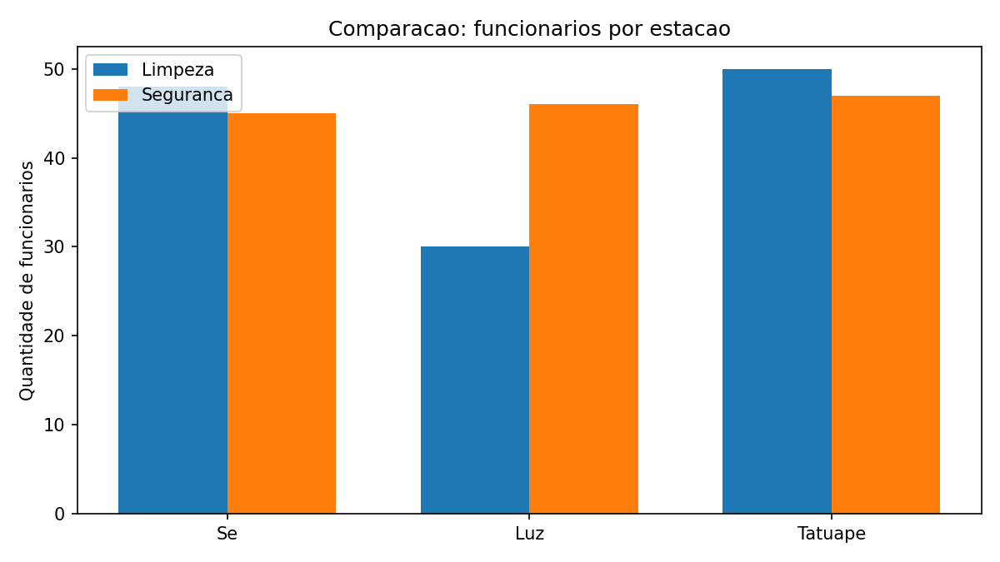
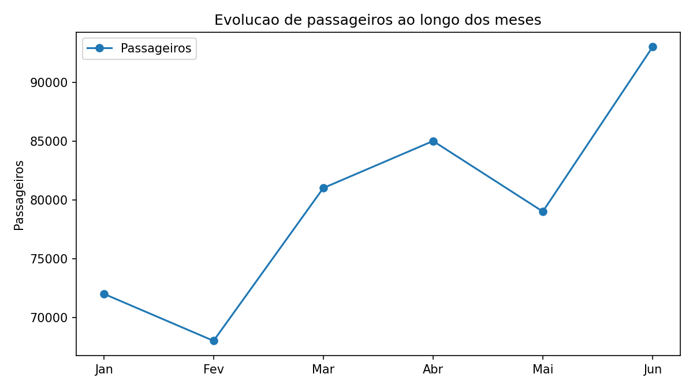
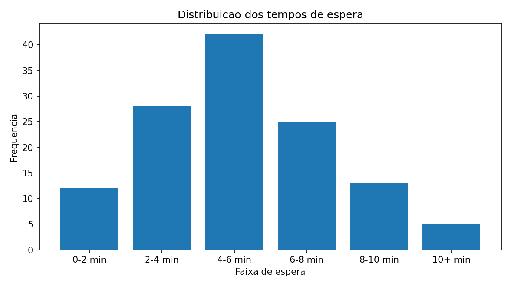
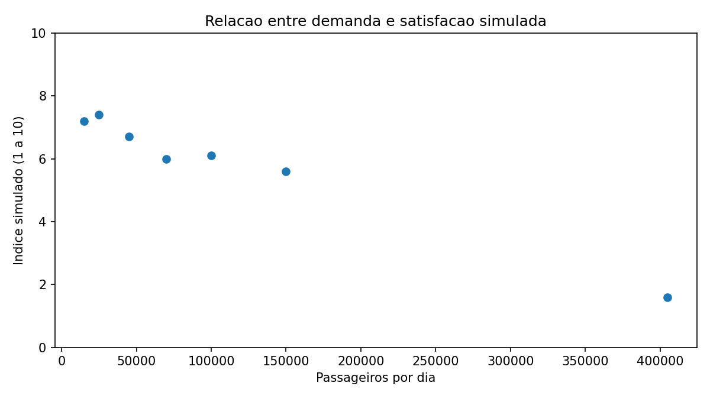
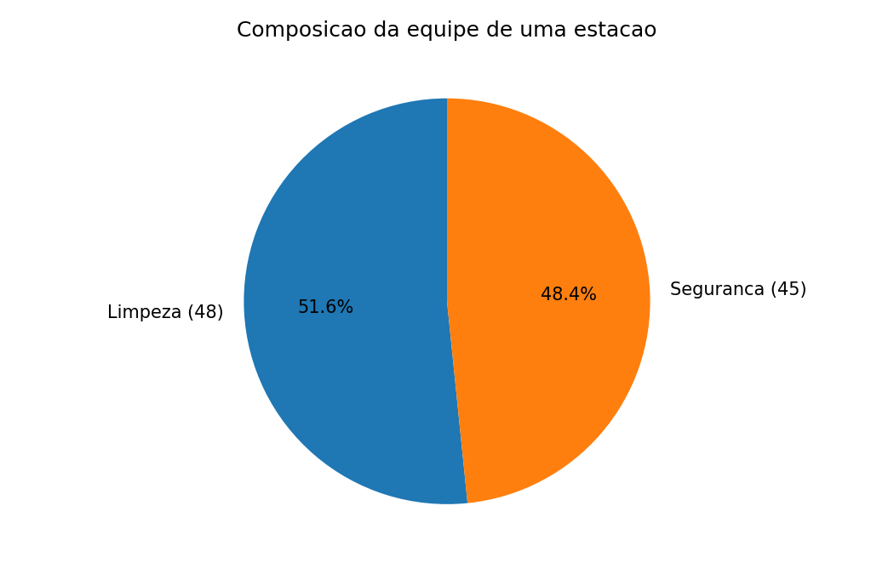
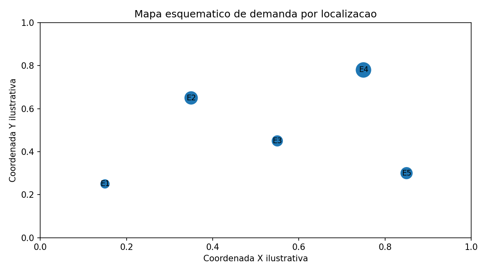
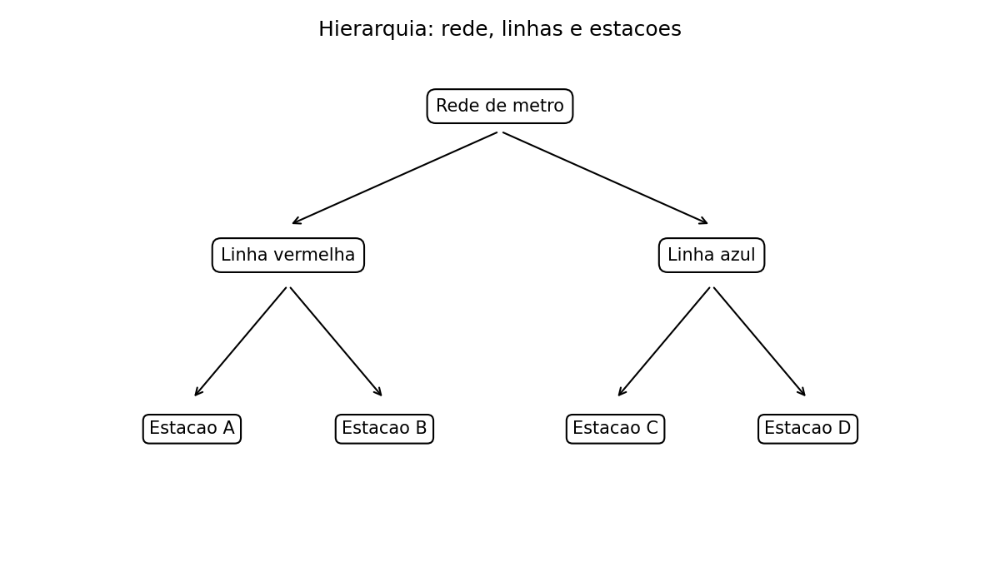
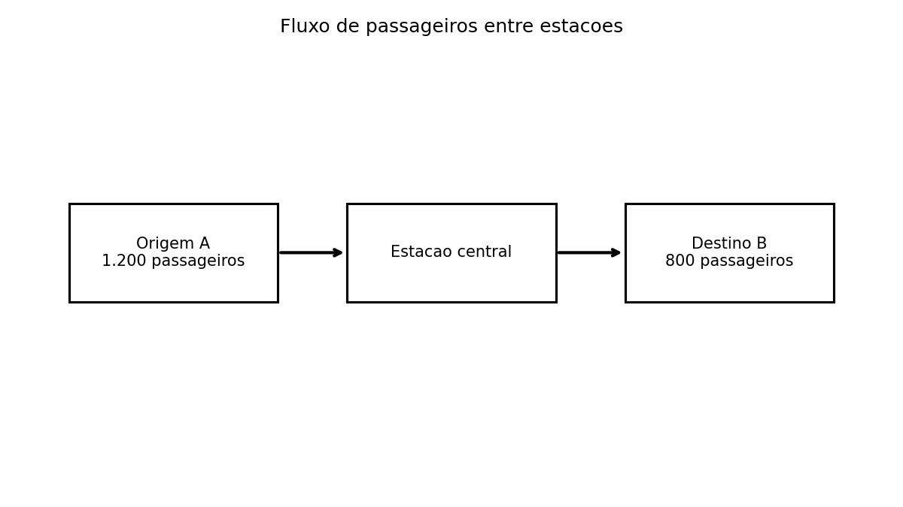
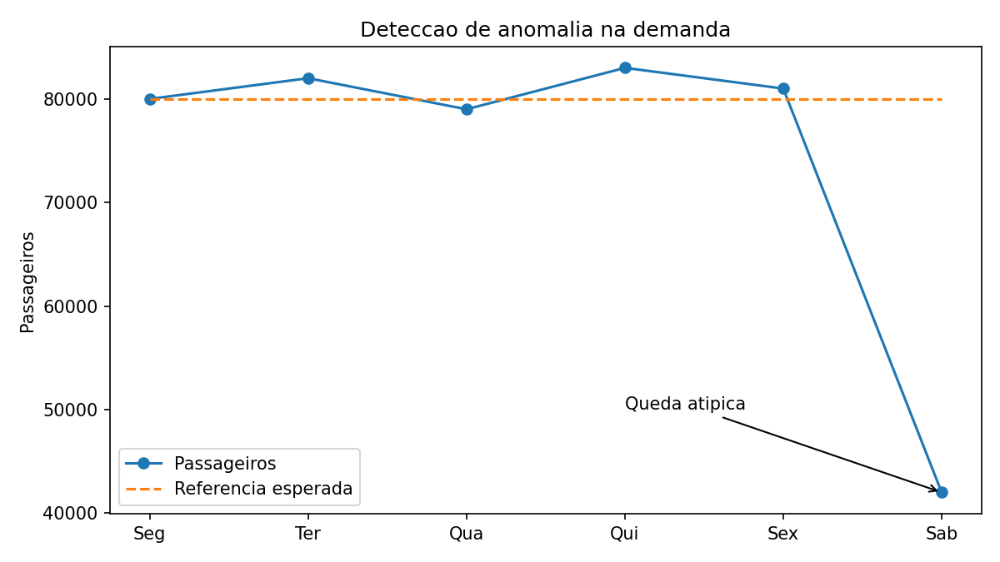

Visualizando Dados
---------------------------
Quando tratamos de visualização de dados, uma das maiores preocupações é em relação aos objetivos da apresentação, começando pelo conhecimento do público alvo, a clareza, o mapeamento e a exatidão dos dados, chegamos as técnicas usadas para determinar qual é a natureza de nossa necessidade de análise, assim, recorremos a tarefas pré estabelecidas que, geralmente, produzirão um resultado que será mais adequado ao contexto que estamos investigando. Chamamos tais recursos de **Tarefas Analíticas**.
# A importância das tarefas analíticas na visualização de dados

As tarefas analíticas são fundamentais para a visualização de dados porque ajudam a definir o que queremos descobrir nos dados e qual representação visual facilita essa descoberta. Antes de escolher um gráfico, precisamos compreender qual pergunta queremos responder, que tipo de informação será analisada e qual interpretação esperamos obter.

Em outras palavras, a visualização de dados não consiste apenas em transformar números em gráficos, mas em utilizar representações visuais para facilitar a compreensão, identificar padrões, produzir insights e apoiar a tomada de decisão.

Cada tarefa analítica responde a uma pergunta específica sobre os dados. A escolha do gráfico deve facilitar a interpretação e evidenciar a informação que se deseja investigar.

## 1. Comparação
**Pergunta:** Qual é maior?

- **Objetivo:** comparar valores entre categorias, elementos ou períodos, identificando diferenças e semelhanças.
- **Gráfico recomendado:** barras ou colunas.
- **Exemplo:** comparar o número de funcionários de limpeza e segurança em diferentes estações de metrô.

## 2. Evolução
**Pergunta:** Como mudou ao longo do tempo?

- **Objetivo:** acompanhar variações temporais e identificar tendências, crescimentos, quedas e sazonalidade.
- **Gráfico recomendado:** linhas ou áreas.
- **Exemplo:** analisar a evolução mensal do número de passageiros de uma estação.

## 3. Distribuição
**Pergunta:** Como os valores estão distribuídos?

- **Objetivo:** compreender a frequência, a concentração, a dispersão e a variabilidade dos valores.
- **Gráfico recomendado:** histograma, boxplot ou gráfico de densidade.
- **Exemplo:** verificar como se distribuem os tempos de espera dos passageiros.

## 4. Relação
**Pergunta:** Existe relação entre variáveis?

- **Objetivo:** investigar associações entre duas ou mais variáveis e identificar padrões de comportamento conjunto.
- **Gráfico recomendado:** dispersão (scatter plot).
- **Exemplo:** investigar se estações com mais passageiros por dia apresentam índices de satisfação menores.

## 5. Composição
**Pergunta:** Como o total é formado?

- **Objetivo:** mostrar como diferentes partes contribuem para um total, destacando proporções e participações relativas.
- **Gráfico recomendado:** barras empilhadas, barras de 100% ou setores (pizza).
- **Exemplo:** demonstrar a participação das equipes de limpeza e segurança no total de funcionários de uma estação.

## 6. Localização
**Pergunta:** Onde acontece?

- **Objetivo:** identificar a distribuição geográfica dos fenômenos e reconhecer concentrações, diferenças regionais e padrões espaciais.
- **Gráfico recomendado:** mapa de pontos, mapa coroplético ou mapa de calor.
- **Exemplo:** localizar as estações de metrô e representar a quantidade de passageiros por região.

*Representação esquemática, não corresponde ao mapa geográfico real.*

## 7. Hierarquia
**Pergunta:** Como os elementos estão organizados?

- **Objetivo:** representar níveis, agrupamentos e relações entre categorias, subcategorias e seus componentes.
- **Gráfico recomendado:** árvore hierárquica, treemap ou diagrama sunburst.
- **Exemplo:** organizar uma rede de transporte por linha, estação e equipes responsáveis.

## 8. Fluxo
**Pergunta:** Como algo se desloca?

- **Objetivo:** demonstrar o movimento de pessoas, recursos, informações ou materiais entre origens e destinos, evidenciando direção, volume e intensidade.
- **Gráfico recomendado:** Sankey, diagrama de fluxo ou mapa de linhas de conexão.
- **Exemplo:** representar os deslocamentos de passageiros entre estações de origem e destino.

## 9. Anomalia
**Pergunta:** Existe algo fora do padrão?

- **Objetivo:** detectar valores ou comportamentos incomuns que se afastam do padrão esperado e podem exigir investigação.
- **Gráfico recomendado:** série temporal com linha de referência, gráfico de controle ou boxplot.
- **Exemplo:** identificar uma queda atípica no número de passageiros ou um aumento inesperado nas ocorrências de segurança.

---

**Princípio fundamental da visualização de dados:** primeiro identifique a pergunta analítica que precisa ser respondida; depois escolha a representação visual que torna a resposta mais clara, precisa e fácil de interpretar.

## Resumindo:

### Por que as tarefas analíticas são importantes?

1\. Definem o objetivo da análise

Cada tarefa analítica corresponde a uma pergunta. Comparar indicadores exige uma abordagem diferente daquela utilizada para investigar tendências ou detectar anomalias.

2\. Orientam a escolha do gráfico

A tarefa analítica ajuda a selecionar a representação mais adequada, como barras para comparação, linhas para evolução e mapas para localização.

3\. Facilitam a percepção de padrões

Uma representação adequada permite reconhecer visualmente diferenças, concentrações, associações, tendências e comportamentos incomuns.

4\. Transformam dados em insights

Os gráficos permitem ir além da observação dos valores, ajudando a formular hipóteses, identificar oportunidades e compreender possíveis problemas.

5\. Apoiam a tomada de decisão

Ao tornar os resultados mais compreensíveis, as visualizações ajudam gestores e analistas a priorizar ações, distribuir recursos e acompanhar indicadores de desempenho.

## Relação entre tarefa analítica, pergunta e gráfico

Cada tarefa analítica direciona a atenção para uma característica específica dos dados.

| Tarefa analítica | O que queremos descobrir                           | Representação comum                   |
| ---------------- | -------------------------------------------------- | ------------------------------------- |
| Comparação       | Quais valores são maiores ou menores?              | Gráfico de barras                     |
| Evolução         | Como os valores mudam ao longo do tempo?           | Gráfico de linhas                     |
| Distribuição     | Como os valores se concentram ou dispersam?        | Histograma ou boxplot                 |
| Relação          | Como duas variáveis se comportam em conjunto?      | Gráfico de dispersão                  |
| Composição       | Como as partes formam o total?                     | Barras empilhadas                     |
| Localização      | Onde os fenômenos acontecem?                       | Mapa temático                         |
| Hierarquia       | Como os elementos se organizam em níveis?          | Árvore ou treemap                     |
| Fluxo            | Como pessoas, recursos ou informações se deslocam? | Diagrama Sankey                       |
| Anomalia         | Quais valores fogem do padrão esperado?            | Gráfico de controle ou série temporal |

É importante observar que uma mesma base de dados pode ser analisada por diferentes perspectivas. A escolha depende da pergunta que orienta a investigação, e não apenas das colunas disponíveis.
