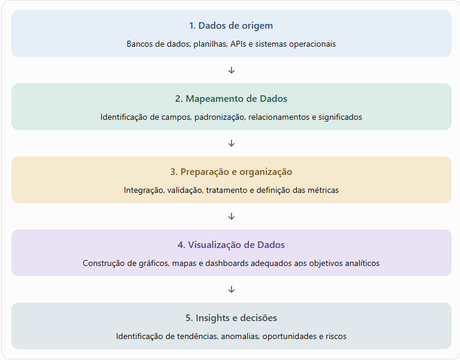
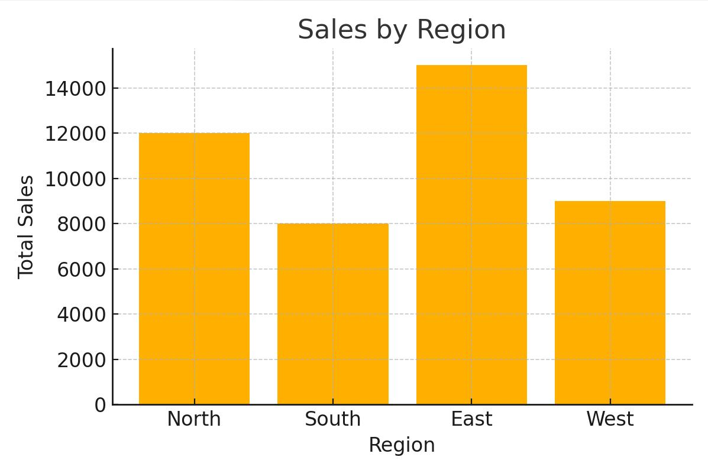
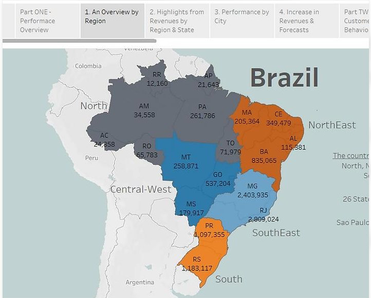
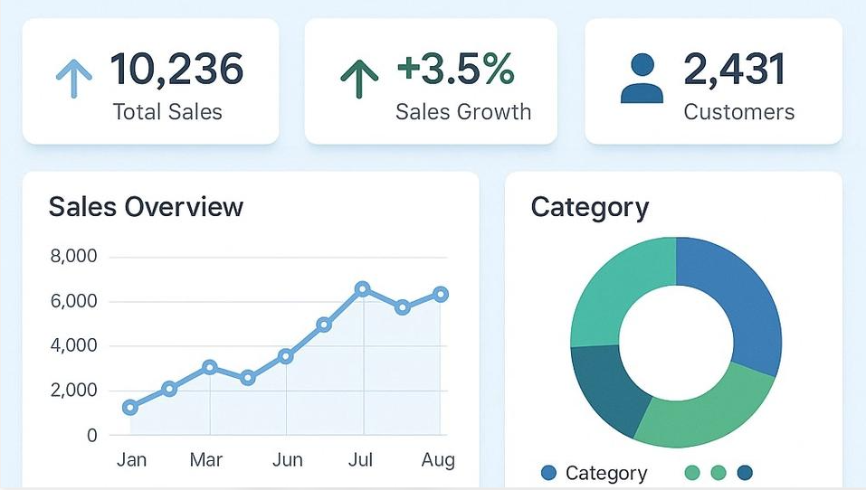

# Relação entre Mapeamento de Dados e Visualização de Dados

## Introdução

O **Mapeamento de Dados** e a **Visualização de Dados** são disciplinas complementares no processo de transformar dados brutos em informações úteis para análise e tomada de decisão. Enquanto o mapeamento identifica, organiza e estabelece relações entre os dados, a visualização representa essas informações graficamente para facilitar sua compreensão e interpretação.

## 1. Conceitos e objetivos

| Aspecto | Mapeamento de Dados | Visualização de Dados |
|---|---|---|
| **Objetivo principal** | Identificar, organizar e relacionar dados. | Representar dados visualmente para facilitar a compreensão. |
| **Foco** | Estrutura, origem, significado e relacionamentos dos dados. | Percepção, interpretação, padrões e comunicação de informações. |
| **Pergunta central** | De onde vêm os dados e como se relacionam? | O que os dados revelam e como podemos compreendê-los? |
| **Técnicas** | Dicionários de dados, metadados, esquemas, linhagem e mapeamento entre campos. | Gráficos, tabelas, mapas geográficos, diagramas e dashboards. |
| **Resultado** | Dados estruturados, relacionados e contextualizados. | Informações visuais que apoiam análises e decisões. |

## 2. Como os dois temas se relacionam?

O mapeamento fornece a base semântica e estrutural necessária para construir visualizações confiáveis. A visualização, por sua vez, permite explorar e comunicar os resultados das relações estabelecidas entre os dados.

O fluxo conceitual pode ser resumido em cinco etapas:

1. **Dados de origem:** bancos de dados, planilhas, APIs e sistemas operacionais.
2. **Mapeamento de Dados:** identificação de campos, padronização, relacionamentos e significados.
3. **Preparação e organização:** integração, validação, tratamento e definição das métricas.
4. **Visualização de Dados:** construção de gráficos, mapas e dashboards adequados aos objetivos analíticos.
5. **Insights e decisões:** identificação de tendências, anomalias, oportunidades e riscos.

Esse fluxo é conceitual. Na prática, o processo é iterativo: a análise visual pode revelar problemas no mapeamento ou indicar a necessidade de novas relações entre os dados.

## 3. Exemplo prático: análise de desempenho de vendas

Imagine uma empresa que deseja descobrir quais regiões apresentam os melhores resultados comerciais. Os dados estão distribuídos em três sistemas:

- **Sistema de vendas:** pedidos, valores e datas.
- **Cadastro de clientes:** identificadores, cidades e regiões.
- **Sistema de produtos:** códigos, categorias e descrições.

### Etapa 1 — Mapeamento de Dados

É necessário estabelecer como os campos se relacionam. Por exemplo, o identificador do cliente conecta os pedidos ao cadastro, enquanto o código do produto permite associar cada venda à sua categoria.

Também é preciso padronizar datas, moedas e identificadores, além de definir métricas como faturamento líquido.

### Etapa 2 — Visualização de Dados

Após integrar e validar os dados, diferentes representações podem responder a perguntas específicas.

#### Gráfico de barras — Comparação

Permite identificar quais regiões apresentam maior faturamento e comparar seus resultados.

#### Mapa — Distribuição espacial

Mostra como o desempenho comercial pode variar entre regiões, desde que os dados estejam associados a localizações geográficas válidas. **A imagem é esquemática e os valores são ilustrativos; não representa um mapa geográfico real.**

#### Dashboard — Monitoramento

Reúne indicadores e gráficos para acompanhar tendências, metas e variações ao longo do tempo. Os valores exibidos são ilustrativos.

### Etapa 3 — Geração de insights

A análise pode revelar que determinada região tem faturamento elevado, mas margem de lucro baixa. Essa conclusão depende tanto da visualização quanto do mapeamento correto dos valores de vendas, custos e localização.

**Sem mapeamento adequado**, os dados podem ser associados incorretamente, gerar duplicidades ou produzir indicadores inconsistentes. **Sem visualização adequada**, relações e padrões relevantes podem permanecer difíceis de identificar.

## 4. Diferentes significados de “mapeamento”

É importante distinguir três usos relacionados, mas não equivalentes:

| Tipo de mapeamento | Relação com a visualização |
|---|---|
| **Mapeamento estrutural ou semântico** | Define como campos, entidades, fontes e conceitos de negócio se relacionam. |
| **Mapeamento visual** | Associa atributos dos dados a elementos gráficos, como posição, tamanho, cor, forma e orientação. |
| **Mapeamento geográfico** | Relaciona dados a coordenadas, regiões ou territórios para representá-los em mapas. |

Por exemplo, em um gráfico de dispersão, o mapeamento visual pode associar faturamento ao eixo horizontal e margem de lucro ao eixo vertical. Em um mapa geográfico, uma região pode receber uma cor conforme seu desempenho.

O mapeamento estrutural organiza o significado dos dados; o visual transforma atributos em elementos perceptíveis; e o geográfico associa os dados ao espaço.

## 5. Resumindo

A relação entre os temas pode ser resumida em três princípios:

1. **O mapeamento prepara e contextualiza os dados:** define relações, significados e correspondências entre fontes.
2. **A visualização torna as relações perceptíveis:** transforma dados organizados em representações que permitem comparar, explorar e interpretar informações.
3. **A qualidade da decisão depende dos dois processos:** dados corretamente relacionados e visualizações apropriadas aumentam a confiabilidade dos insights.

Na atividade de produção Visual de Dados, estudar mapeamento é fundamental porque a escolha de um gráfico não começa pela estética, mas pela compreensão dos dados, de sua estrutura, de seus atributos e da pergunta analítica que se deseja responder.
