Dimensionalidade na Visualização de Dados
--------------------------------------------

Na disciplina de Visualização de Dados, dimensionalidade refere-se à quantidade de variáveis ou atributos utilizados para descrever, caracterizar e analisar um conjunto de dados. Cada dimensão representa uma característica observável de um fenômeno, objeto, indivíduo ou processo, permitindo que diferentes aspectos de uma mesma realidade sejam examinados simultaneamente.

Em uma base de dados, por exemplo, o registro de um município pode ser descrito por dimensões como população, área territorial, renda média, índice de desenvolvimento humano e densidade demográfica. Nesse caso, cada variável representa uma dimensão de análise. Quanto maior o número de atributos considerados, maior será a dimensionalidade do conjunto de dados.

A dimensionalidade está diretamente relacionada à capacidade de uma visualização representar múltiplas características de um fenômeno. Entretanto, o aumento do número de dimensões também amplia a complexidade da análise, exigindo técnicas visuais capazes de organizar, relacionar e comunicar informações sem comprometer sua interpretação.

## Dimensões e variáveis na representação visual

Na visualização de dados, as dimensões podem ser associadas a diferentes propriedades visuais, denominadas variáveis visuais. Entre as mais utilizadas estão:

- Posição: localização de um elemento em um plano ou espaço.
- Comprimento: representação de magnitudes por barras ou segmentos.
- Tamanho: utilização da área ou do volume para expressar valores.
- Cor: diferenciação de categorias ou representação de intensidade.
- Forma: distinção entre classes ou grupos.
- Orientação: representação de direções ou padrões.
- Textura: diferenciação visual de regiões ou categorias.

Essas propriedades permitem incorporar diversas dimensões em uma mesma representação. Um gráfico de dispersão, por exemplo, utiliza a posição horizontal e vertical para representar duas variáveis quantitativas. A inclusão de cores pode acrescentar uma terceira dimensão, enquanto o tamanho dos pontos pode representar uma quarta variável.

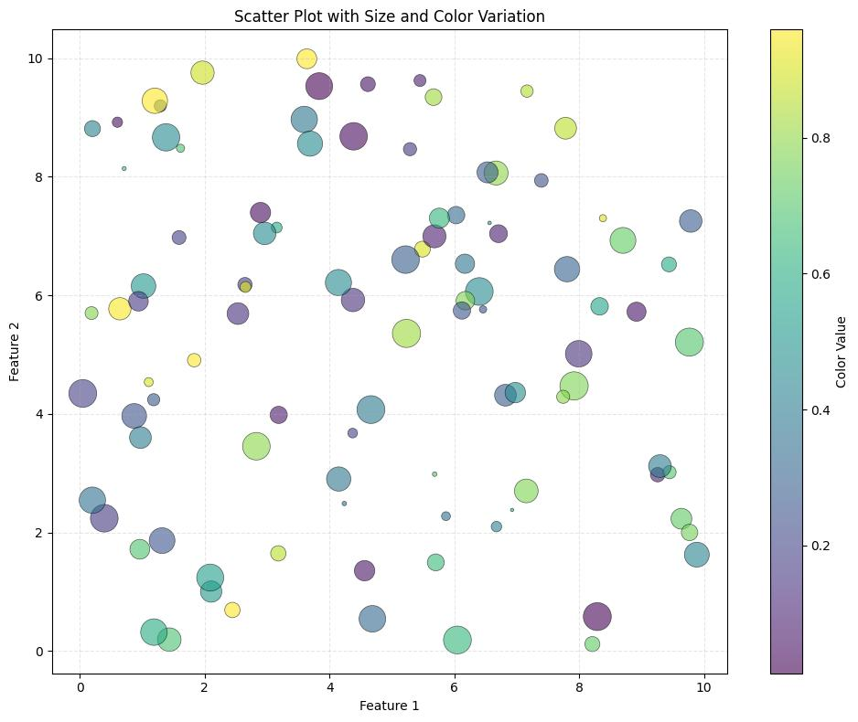

Essa associação, entretanto, não significa que todas as dimensões sejam igualmente fáceis de interpretar. A percepção humana apresenta limitações na identificação simultânea de múltiplos estímulos visuais, especialmente quando diferentes variáveis são representadas por propriedades semelhantes ou quando há excesso de elementos na composição.

## Classificação quanto à dimensionalidade

Para fins didáticos, os conjuntos de dados podem ser classificados conforme a quantidade de dimensões envolvidas:

| Classificação    | Característica           | Exemplo                                                |
| ---------------- | ------------------------ | ------------------------------------------------------ |
| Unidimensional   | Uma variável principal   | Quantidade de vendas                                   |
| Bidimensional    | Duas variáveis           | Preço e quantidade vendida                             |
| Tridimensional   | Três variáveis           | Preço, quantidade e margem de lucro                    |
| Multidimensional | Quatro ou mais variáveis | Preço, quantidade, margem, região, período e categoria |

Essa classificação auxilia na escolha das técnicas de representação. Não significa, porém, que um conjunto de dados com muitas variáveis precise ser apresentado em uma única visualização.

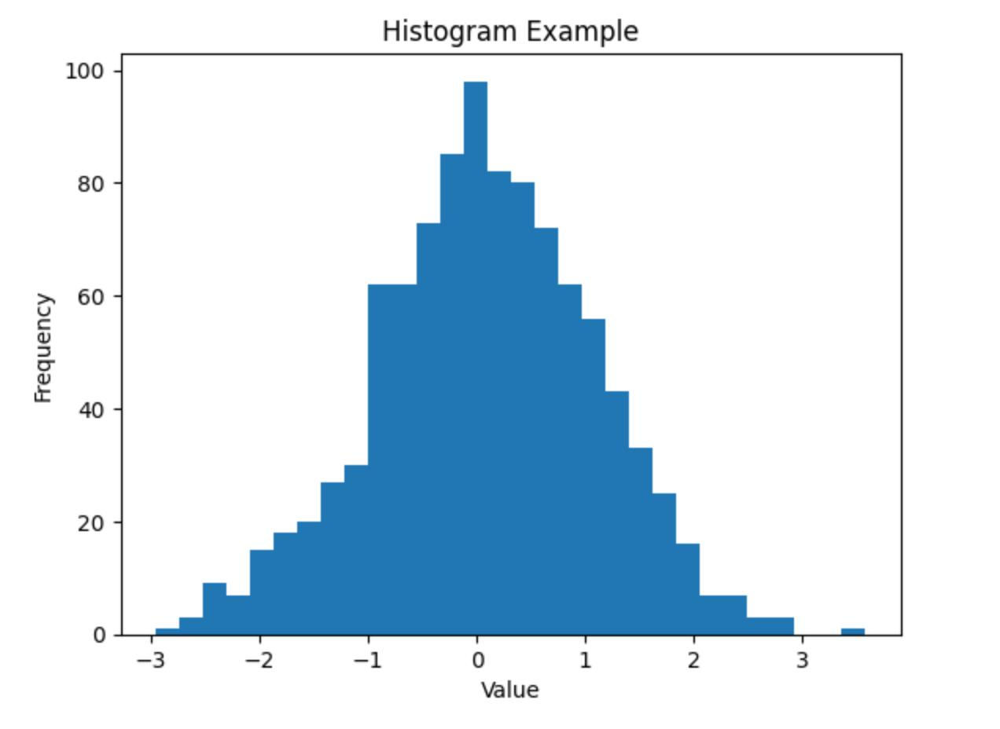

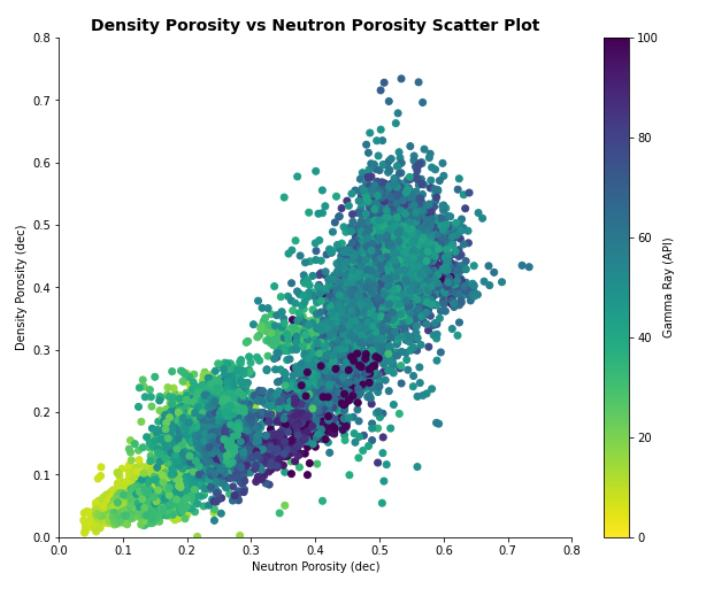

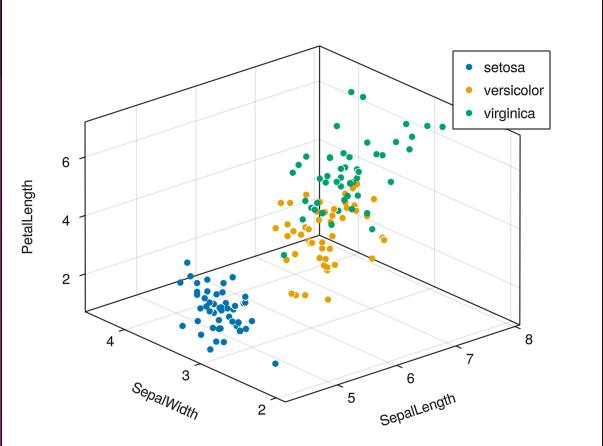

4

## Dimensionalidade e escolha dos gráficos

A quantidade e a natureza das dimensões influenciam diretamente a escolha da representação gráfica.

Algumas técnicas são particularmente adequadas para determinadas configurações:

- Gráficos de barras: comparação de uma variável quantitativa entre categorias.
- Gráficos de dispersão: identificação de relações entre duas variáveis quantitativas.
- Gráficos de bolhas: representação de três ou mais variáveis por meio de posição, tamanho e cor.
- Mapas de calor (Heatmaps): representação de matrizes de valores por intensidade de cor.
- Coordenadas paralelas: análise simultânea de múltiplas variáveis quantitativas.
- Treemaps: representação hierárquica de categorias e proporções.
- Matrizes de dispersão: exploração das relações entre diferentes pares de variáveis.

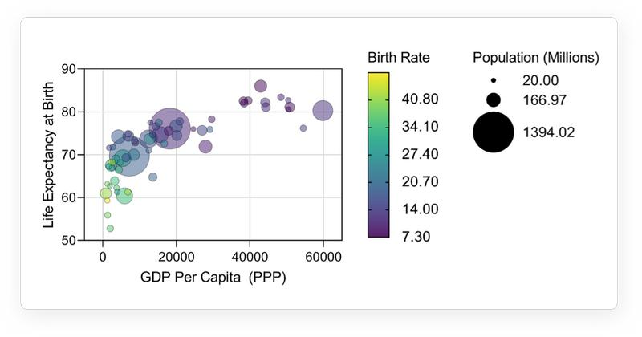

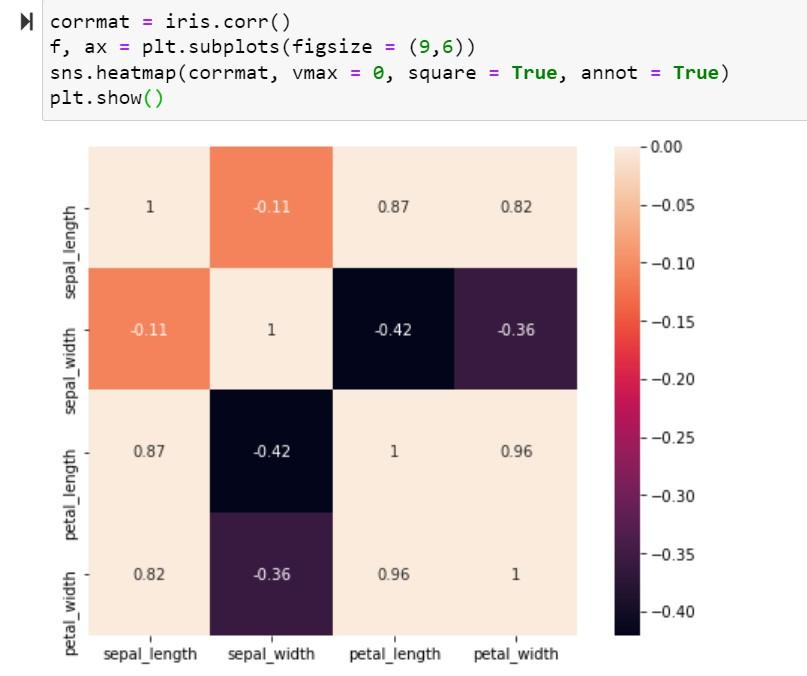

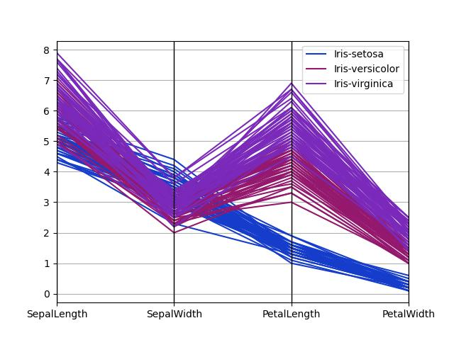

4

A escolha da técnica deve considerar não apenas a quantidade de dimensões, mas também sua natureza — quantitativa, qualitativa, temporal, espacial ou hierárquica — e o objetivo analítico da visualização.

## O desafio da alta dimensionalidade

Um dos principais desafios da visualização de dados é representar conjuntos com muitas dimensões sem produzir sobrecarga cognitiva ou dificultar a identificação de padrões.

Esse problema está relacionado ao conceito de maldição da dimensionalidade (Curse of Dimensionality), amplamente discutido nas áreas de estatística, aprendizado de máquina e mineração de dados.

À medida que o número de dimensões aumenta, o espaço de possibilidades cresce significativamente. Isso pode dificultar a identificação de agrupamentos, relações, similaridades e anomalias. Além disso, muitas técnicas tradicionais de visualização estão limitadas a representações bidimensionais, o que exige estratégias para projetar ou sintetizar informações multidimensionais.

Entre as abordagens utilizadas para lidar com esse desafio estão:

- Redução de dimensionalidade: técnicas como PCA (Principal Component Analysis) e t-SNE procuram representar conjuntos complexos em espaços com menos dimensões.
- Seleção de variáveis: identificação das dimensões mais relevantes para determinado objetivo analítico.
- Coordenadas paralelas: representação simultânea de diversas variáveis em eixos paralelos.
- Múltiplas visualizações coordenadas: utilização de diferentes gráficos relacionados por filtros e seleções.
- Agrupamento e agregação: organização de registros em categorias ou grupos para facilitar a interpretação.

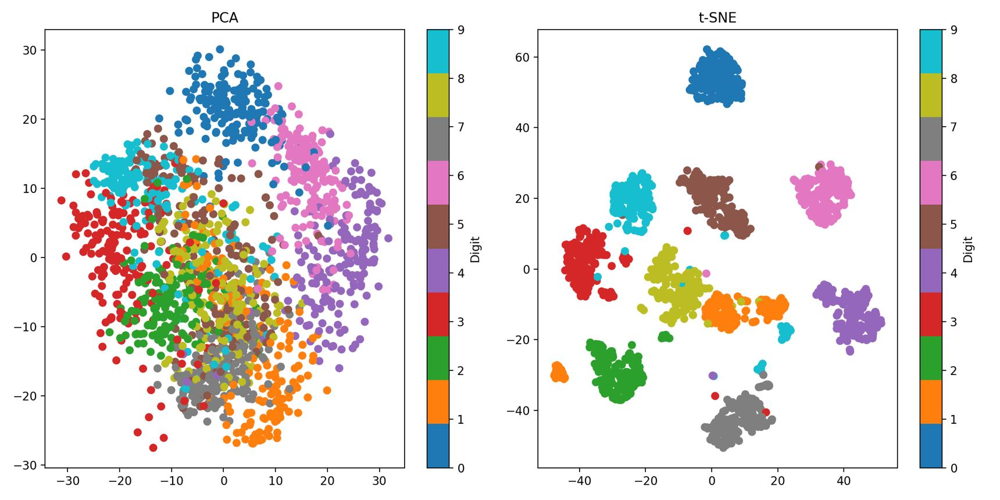


É importante destacar que a redução de dimensionalidade pode provocar perda de informação. Portanto, uma representação simplificada deve ser interpretada considerando quais características dos dados foram preservadas e quais podem ter sido atenuadas.

## Dimensionalidade, percepção e interpretação

A dimensionalidade também possui uma relação fundamental com a percepção humana. Embora seja possível associar diversas variáveis a propriedades visuais, a capacidade de interpretar essas associações depende de fatores como contraste, discriminação visual, memória, familiaridade com os símbolos e complexidade da representação.

Uma visualização multidimensional eficiente deve equilibrar três aspectos:

1. Representatividade: quantidade de informações relevantes que podem ser expressas visualmente.
2. Legibilidade: facilidade de distinguir e compreender as dimensões representadas.
3. Interpretabilidade: capacidade de identificar relações, tendências, agrupamentos e anomalias.

Assim, o objetivo não deve ser simplesmente representar o maior número possível de variáveis em um gráfico, mas construir uma representação que permita responder a perguntas analíticas de maneira clara e consistente.

## Exemplo aplicado: análise de desempenho de estações de metrô

Considere uma base de dados utilizada para analisar o desempenho operacional de estações de metrô. Cada estação pode ser caracterizada por diferentes dimensões:

| Dimensão                   | Tipo de dado        | Possibilidade de análise             |
| -------------------------- | ------------------- | ------------------------------------ |
| Estação                    | Qualitativo nominal | Identificação dos locais             |
| Linha                      | Qualitativo nominal | Comparação entre linhas              |
| Passageiros por dia        | Quantitativo        | Análise de demanda                   |
| Profissionais de limpeza   | Quantitativo        | Avaliação da distribuição de equipes |
| Profissionais de segurança | Quantitativo        | Avaliação da distribuição de equipes |
| NPS                        | Quantitativo        | Análise de percepção dos usuários    |

Essa base apresenta seis dimensões, permitindo diferentes perspectivas analíticas.

Um gráfico de dispersão pode relacionar passageiros por dia e quantidade de profissionais de limpeza. A inclusão da quantidade de profissionais de segurança por meio do tamanho dos pontos e do NPS por meio de uma escala de cores permite construir uma representação com quatro variáveis simultâneas, além da identificação das estações.

O resultado possibilita investigar questões como:

- Estações com maior demanda possuem proporcionalmente mais profissionais?
- Existe relação entre quantidade de profissionais e NPS?
- Há estações com demanda elevada e recursos operacionais relativamente reduzidos?
- Determinadas linhas apresentam padrões semelhantes de distribuição de recursos?

O exemplo demonstra que a dimensionalidade não é apenas uma característica estrutural de uma base de dados: ela também define as possibilidades de investigação e os desafios de representação visual.

## Desafios cognitivos na visualização de muitas variáveis

A visualização de muitas variáveis, também chamada de visualização multidimensional, apresenta desafios relacionados à capacidade humana de perceber, organizar e interpretar informações simultaneamente. Quando um gráfico reúne muitas cores, formas, escalas e elementos, o usuário pode enfrentar sobrecarga cognitiva, dificultando a identificação de padrões e relações relevantes.

Entre os principais desafios estão:

- Sobrecarga de informações: excesso de variáveis dificulta a interpretação. Exemplo: um gráfico de vendas com 15 categorias, 12 meses e várias regiões pode se tornar visualmente confuso.
- Dificuldade de distinção: muitas cores ou símbolos semelhantes dificultam identificar grupos. Exemplo: utilizar 12 cores próximas para representar diferentes categorias de produtos.
- Interferência entre variáveis: a sobreposição de informações pode ocultar relações importantes. Exemplo: em um gráfico de dispersão com milhares de pontos, diferentes observações podem ficar sobrepostas.
- Dificuldade de percepção de padrões: quanto maior a complexidade visual, mais difícil pode ser identificar tendências e anomalias. Exemplo: perceber uma queda nas vendas de uma região específica em meio a dados de dezenas de localidades.
- Limitação da memória de trabalho: comparar muitas informações simultaneamente exige esforço mental. Exemplo: analisar diversos indicadores de desempenho distribuídos em um único gráfico sem agrupamentos ou referências visuais.


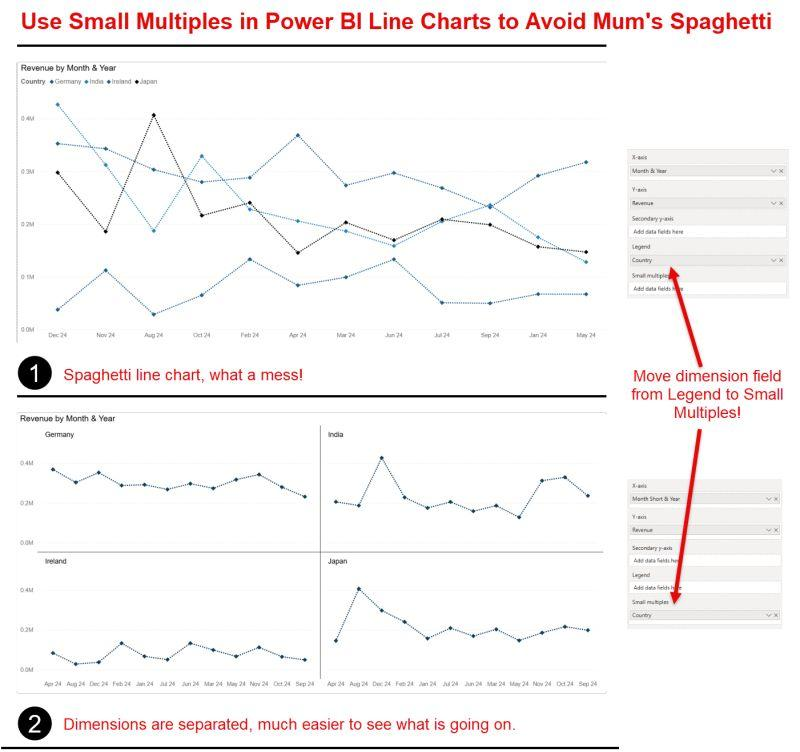

Como minimizar esses desafios?

A utilização de filtros, agrupamentos, cores consistentes, pequenos múltiplos (small multiples) e recursos de interatividade permite apresentar informações gradualmente, reduzindo a sobrecarga cognitiva.

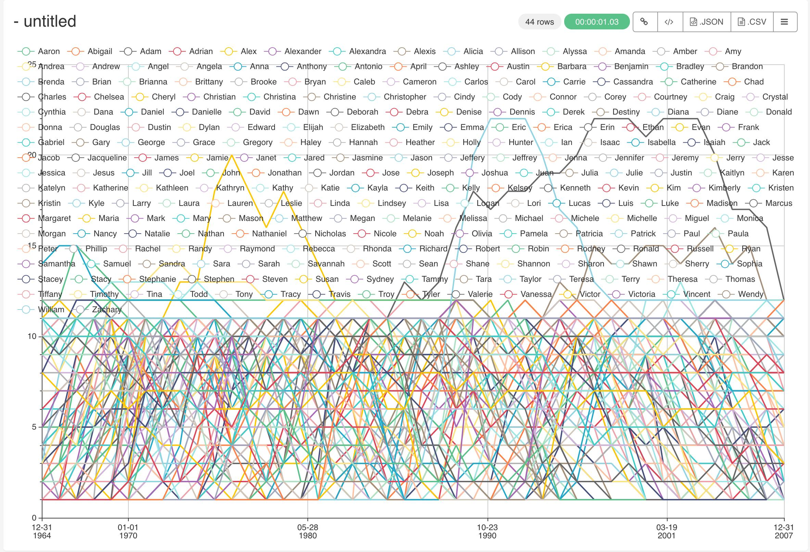

````text

Echarts Time Series Chart Js Scatter Line | Line Chart Alayneabrahams
````


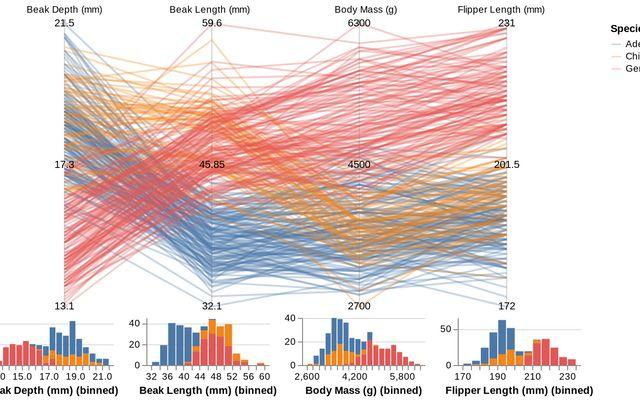
````text
Interactive Parallel Coordinate Plot with Histograms / Michael Deagen | Observable
````
uma boa visualização multidimensional não é aquela que apresenta o maior número possível de variáveis em uma única tela, mas aquela que permite ao observador identificar informações relevantes sem esforço cognitivo desnecessário.