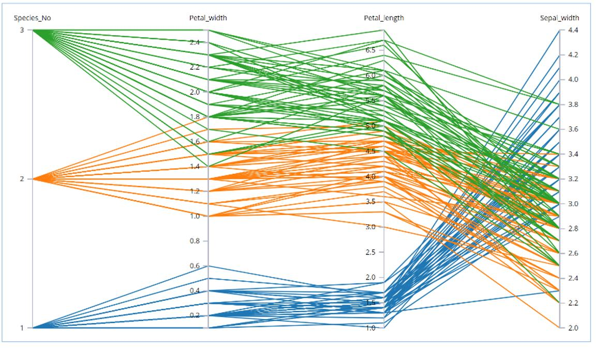
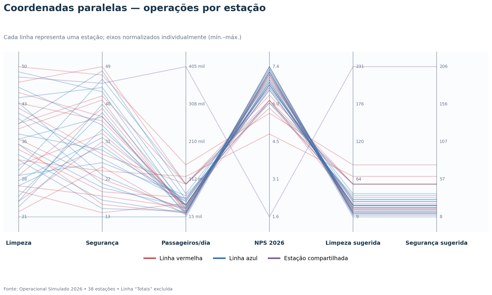
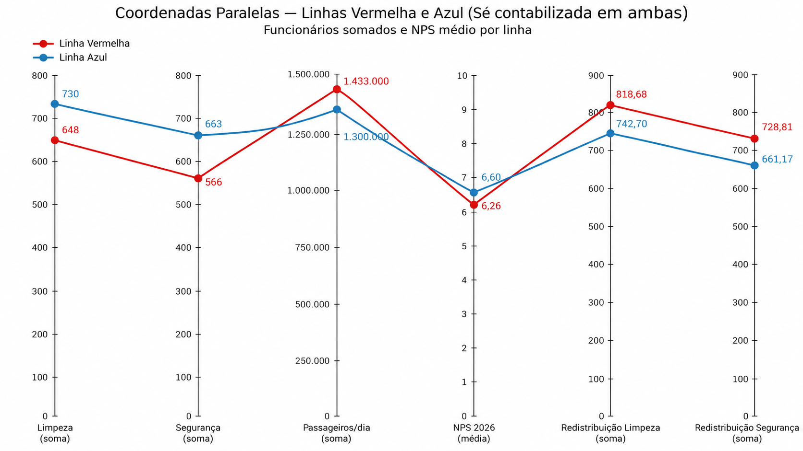
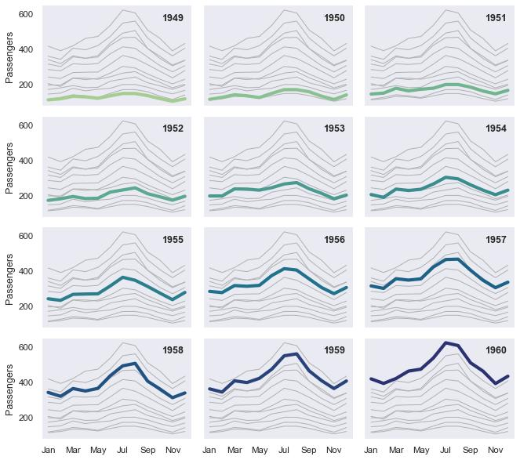
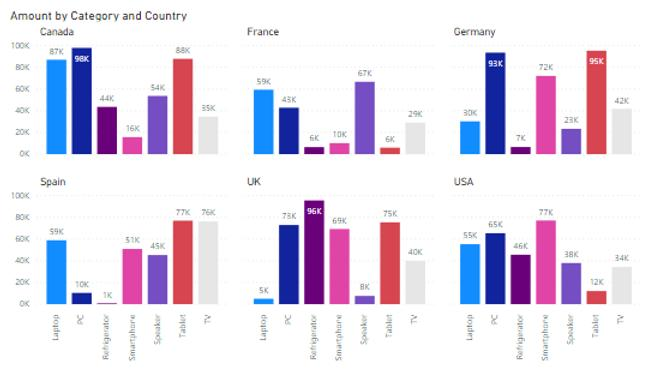
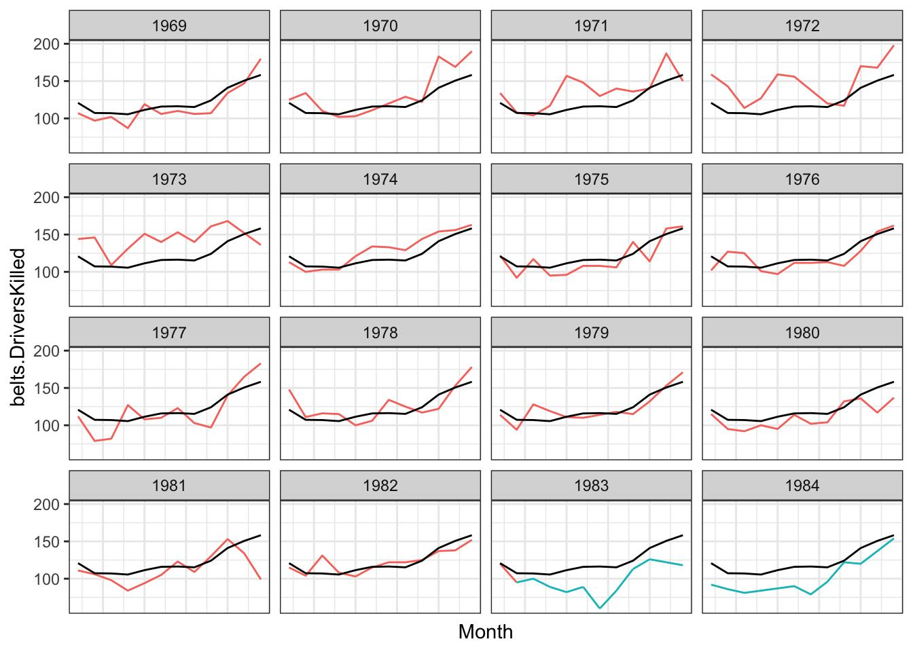
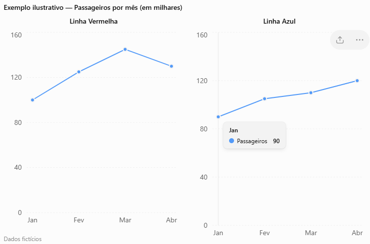
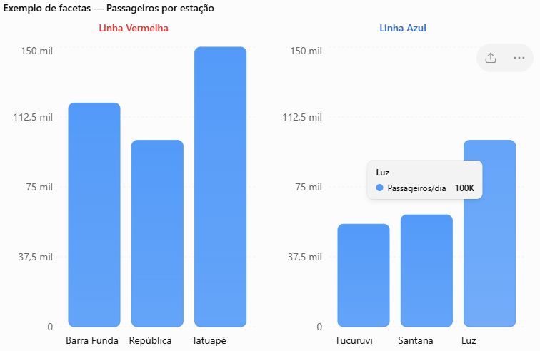
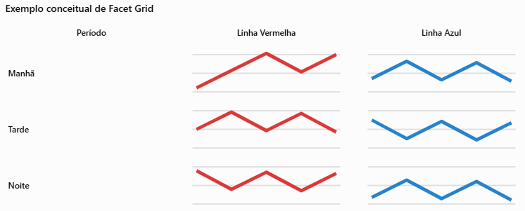

Visualização multidimensional
--------------------------------

## Coordenadas Paralelas: conceito e funcionamento

As coordenadas paralelas (Parallel Coordinates) são uma técnica de visualização utilizada para representar e analisar conjuntos de dados multidimensionais, especialmente quando possuem muitas variáveis. Diferentemente dos gráficos convencionais, que normalmente utilizam dois ou três eixos, essa técnica organiza as dimensões em uma sequência de eixos paralelos, permitindo visualizar simultaneamente diversas características de cada observação.

### Como funcionam?

Cada variável do conjunto de dados é representada por um eixo vertical paralelo aos demais. Os valores de cada variável são posicionados em seu respectivo eixo, considerando uma escala definida. Em seguida, os valores pertencentes à mesma observação são conectados por segmentos de reta, formando uma linha que atravessa todos os eixos.

Dessa forma, cada linha representa um registro da base de dados, enquanto cada eixo representa uma dimensão ou variável.

### Exemplo prático

Imagine uma base de dados que descreve o desempenho de diferentes estações de metrô, considerando quatro variáveis:

- Passageiros/dia: quantidade de passageiros atendidos diariamente.
- Limpeza: indicador de qualidade da limpeza.
- Segurança: indicador de qualidade da segurança.
- NPS: indicador de satisfação dos passageiros.

Cada estação será representada por uma linha que conecta seus valores nos quatro eixos. Ao observar essas linhas, é possível identificar estações com características semelhantes, diferenças de desempenho e possíveis relações entre os indicadores.

### O que podemos identificar?

A interpretação das coordenadas paralelas permite investigar diferentes aspectos:

1. Padrões: linhas com trajetórias semelhantes indicam observações com características próximas.
2. Agrupamentos: conjuntos de linhas com comportamentos parecidos podem indicar grupos de registros.
3. Relações entre variáveis: a disposição das linhas entre dois eixos pode sugerir associações entre dimensões.
4. Anomalias: linhas que apresentam trajetórias muito diferentes das demais podem indicar observações atípicas.
5. Conflitos entre indicadores: podem revelar situações em que uma variável apresenta comportamento diferente das demais.

### Vantagens e limitações

| Vantagens                                              | Limitações                                                   |
| ------------------------------------------------------ | ------------------------------------------------------------ |
| Permite representar muitas dimensões simultaneamente.  | O excesso de linhas pode gerar poluição visual.              |
| Facilita a identificação de padrões multidimensionais. | A interpretação depende da organização e escala dos eixos.   |
| Permite identificar observações atípicas.              | A ordem dos eixos pode influenciar a percepção das relações. |
| Possibilita comparar diferentes registros.             | Muitas observações podem provocar sobreposição de linhas.    |

As coordenadas paralelas são especialmente úteis quando o objetivo é investigar relações entre diversas variáveis sem reduzir inicialmente o conjunto de dados a apenas duas ou três dimensões.

Seu principal valor está na possibilidade de transformar registros multidimensionais em trajetórias visuais, permitindo identificar padrões, agrupamentos e anomalias. Entretanto, para facilitar a interpretação, recomenda-se utilizar normalização das escalas, transparência nas linhas, cores para destacar grupos e filtros interativos.

nas coordenadas paralelas, cada eixo representa uma variável e cada linha representa uma observação. A análise das trajetórias permite compreender como diferentes características se comportam conjuntamente em um conjunto de dados.

## Small Multiples (Múltiplos Pequenos) na Visualização de Dados

O conceito de Small Multiples, também conhecido como Múltiplos Pequenos ou Gráficos de Pequenos Múltiplos, refere-se a uma técnica de visualização de dados que utiliza uma sequência de gráficos semelhantes, organizados em linhas e colunas, para representar diferentes categorias, períodos ou subconjuntos de um conjunto de dados.

Essa técnica foi amplamente difundida por [Edward Tufte](../anexos/Edward-Tufte.md), especialmente na obra Envisioning Information (1990), como uma abordagem eficaz para facilitar comparações visuais.

### Princípio fundamental

O princípio dos Small Multiples consiste em manter uma estrutura visual constante enquanto os dados representados variam.

Cada gráfico apresenta uma parte específica dos dados, utilizando, preferencialmente, os mesmos tipos de representação, escalas, cores e proporções.

Essa padronização permite que o observador identifique rapidamente semelhanças, diferenças, tendências e comportamentos particulares entre os subconjuntos analisados.

### Exemplo prático

Considere um conjunto de dados contendo o número de passageiros transportados mensalmente pelas linhas Vermelha e Azul do Metrô de São Paulo.

Em vez de representar as duas linhas em um único gráfico, podem ser construídos dois gráficos separados, posicionados lado a lado.

Exemplo ilustrativo — Passageiros por mês (em milhares)

Nessa representação, é possível perceber que a Linha Vermelha apresenta crescimento até março, seguido de redução em abril, enquanto a Linha Azul apresenta crescimento contínuo.

### Principais vantagens

- Comparabilidade: facilita a comparação de diferentes categorias ou períodos utilizando representações padronizadas.
- Redução da sobreposição: evita o excesso de linhas, barras ou elementos gráficos em uma única visualização.
- Identificação de padrões: permite reconhecer tendências recorrentes e comportamentos distintos.
- Organização visual: apresenta grandes conjuntos de dados em uma estrutura ordenada e consistente.
- Redução da carga cognitiva: diminui a necessidade de interpretar diferentes estruturas gráficas, permitindo concentrar a atenção nas variações dos dados.

### Boas práticas de utilização

Para garantir a eficácia da técnica, é importante observar alguns princípios:

1. Manter escalas consistentes: gráficos comparáveis devem utilizar preferencialmente os mesmos intervalos nos eixos.
2. Preservar a estrutura visual: utilizar o mesmo tipo de gráfico, orientação e codificação visual.
3. Evitar elementos decorativos: priorizar a informação e reduzir componentes que dificultem a comparação.
4. Organizar os gráficos logicamente: utilizar ordenações cronológicas, geográficas ou baseadas em valores.
5. Identificar claramente cada gráfico: utilizar títulos curtos e objetivos para distinguir as categorias.

### Relação com a dimensionalidade dos dados

Na visualização de dados multidimensionais, os Small Multiples constituem uma estratégia de decomposição visual, na qual uma dimensão dos dados é utilizada para dividir o conjunto em diferentes painéis.

Por exemplo, um conjunto de dados contendo as dimensões estação, linha, mês e quantidade de passageiros pode ser representado por uma coleção de gráficos, na qual cada painel corresponde a uma linha do metrô.

Dessa maneira, a técnica reduz a complexidade visual de cada representação individual, preservando a possibilidade de comparação entre múltiplas dimensões.

Os Small Multiples constituem uma técnica importante para a análise exploratória e a comunicação de informações multidimensionais. Sua principal contribuição está na capacidade de transformar uma visualização complexa em um conjunto de representações simples e comparáveis.

Entretanto, essa abordagem apresenta limitações quando o número de painéis é excessivo ou quando as escalas não são consistentes, podendo dificultar a leitura e a identificação de padrões.

Em termos de percepção visual, a técnica explora a capacidade humana de reconhecer diferenças e semelhanças entre estruturas visuais repetidas, permitindo identificar padrões sem exigir a interpretação simultânea de muitos elementos sobrepostos.

## Utilização de Facetas para Comparação entre Grupos

### Conceito de Facetas (Faceting)

Na Visualização de Dados, o conceito de facetas (faceting) refere-se à técnica de dividir um conjunto de dados em múltiplos gráficos menores, organizados de acordo com uma ou mais variáveis categóricas.

Cada gráfico, denominado painel ou faceta, apresenta um subconjunto dos dados, mantendo uma estrutura visual semelhante à dos demais painéis.

Essa abordagem está diretamente relacionada ao conceito de Small Multiples e permite comparar diferentes grupos sem concentrar todas as informações em uma única representação gráfica.

O principal objetivo das facetas é facilitar a identificação de semelhanças, diferenças, tendências e padrões entre grupos, reduzindo a sobreposição de elementos visuais.

### Funcionamento das Facetas

A técnica consiste em selecionar uma variável categórica que será utilizada para separar os dados em grupos.

Por exemplo, considere um conjunto de dados contendo informações operacionais do Metrô de São Paulo, com as seguintes variáveis:

- Linha: Vermelha ou Azul.
- Estação: identificação da estação.
- Passageiros/dia: quantidade de passageiros.
- Funcionários: equipes de limpeza e segurança.
- NPS: indicador de satisfação dos usuários.

Ao utilizar a variável Linha como faceta, podemos construir dois gráficos separados: um para as estações da Linha Vermelha e outro para as estações da Linha Azul.

Exemplo de facetas — Passageiros por estação

A separação permite analisar o comportamento das estações dentro de cada linha e comparar os padrões de demanda entre os dois grupos.

### Tipos de Facetamento

Existem duas formas principais de organizar facetas:

Facetamento por uma variável (Facet Wrap)

Os dados são divididos em painéis de acordo com uma única variável categórica. Os gráficos podem ser distribuídos automaticamente em linhas e colunas.

Exemplo: um gráfico para cada linha do metrô, representando a quantidade de passageiros por estação.

Facetamento por duas variáveis (Facet Grid)

Os painéis são organizados em uma matriz, na qual as linhas e colunas representam diferentes variáveis categóricas.

Exemplo: linhas do metrô nas colunas e períodos do dia nas linhas.

###  Vantagens para a Comparação entre Grupos

A utilização de facetas oferece benefícios importantes:

- Comparação direta: permite observar diferenças de magnitude e comportamento entre grupos.
- Redução da complexidade visual: evita a sobreposição excessiva de séries ou categorias.
- Identificação de padrões locais: evidencia características específicas de cada grupo.
- Identificação de anomalias: facilita encontrar grupos com comportamentos distintos.
- Consistência visual: mantém a mesma estrutura de representação, tornando a interpretação mais intuitiva.

###  Cuidados na Construção

A eficiência das facetas depende de algumas decisões de projeto:

| Critério              | Recomendação                                                                 |
| --------------------- | ---------------------------------------------------------------------------- |
| Escalas               | Utilizar escalas iguais quando o objetivo for comparar magnitudes absolutas. |
| Tipos de gráficos     | Manter o mesmo tipo de representação entre os painéis.                       |
| Ordenação             | Organizar os grupos segundo critérios lógicos ou analíticos.                 |
| Cores                 | Utilizar cores de forma consistente e com significado.                       |
| Quantidade de facetas | Evitar um número excessivo de painéis que prejudique a leitura.              |
| Rótulos               | Identificar claramente cada grupo, sem sobrecarregar a visualização.         |

###  Relação com a Dimensionalidade

O facetamento representa uma estratégia importante para trabalhar com dados multidimensionais, pois utiliza uma ou mais dimensões categóricas para organizar a informação em diferentes espaços visuais.

Em vez de representar todas as dimensões simultaneamente em um único gráfico, a técnica distribui parte da complexidade entre múltiplos painéis.

Entretanto, as facetas não reduzem necessariamente a dimensionalidade dos dados. Elas reorganizam a representação visual, permitindo analisar separadamente subconjuntos que compartilham uma estrutura comum.

A utilização de facetas constitui uma abordagem eficiente para comparar grupos em conjuntos de dados complexos. Sua principal contribuição está em organizar a informação visual de maneira estruturada, preservando a consistência gráfica e facilitando a identificação de padrões.

Na análise exploratória de dados, essa técnica é especialmente útil quando se deseja compreender tanto o comportamento individual de cada grupo quanto as diferenças existentes entre eles.

Em síntese: as facetas permitem transformar uma visualização sobrecarregada em um conjunto de gráficos menores e comparáveis, favorecendo a percepção de padrões e a geração de insights.

