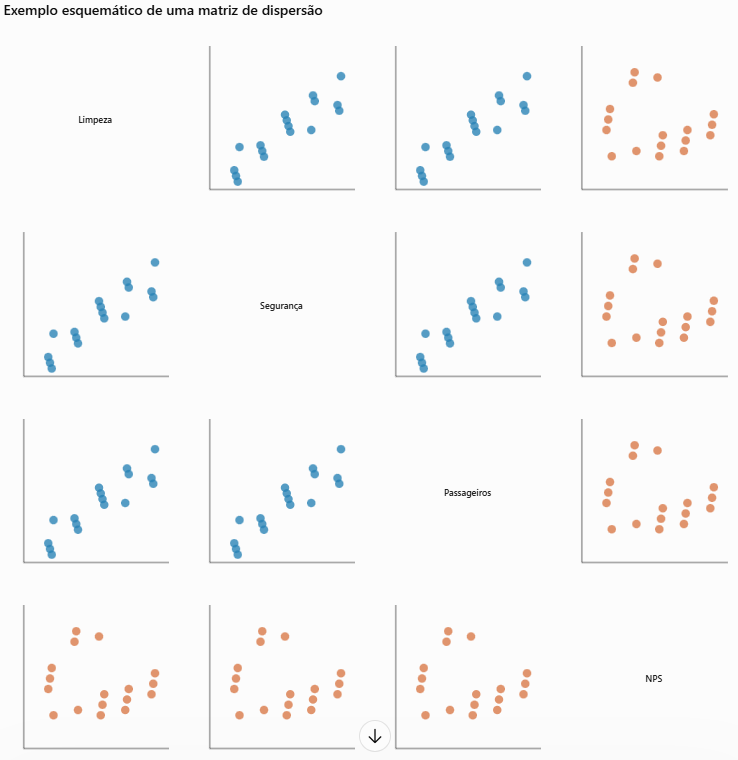
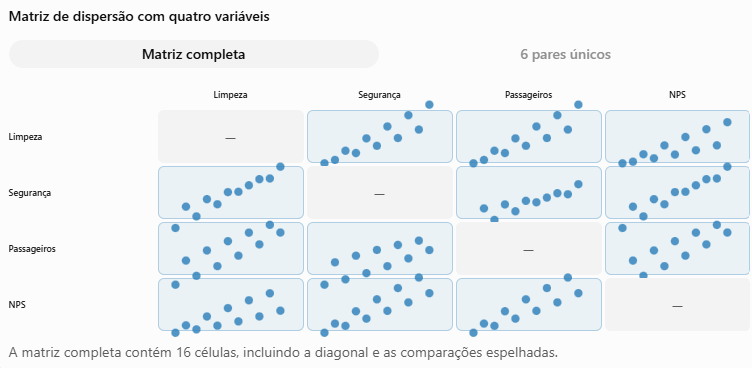
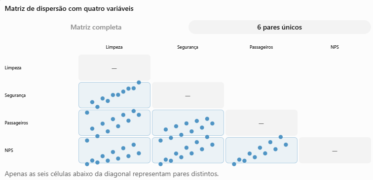

Padrões Visuais
----------------------

## Compreensão de Matrizes de Dispersão (Scatterplot Matrix – SPLOM)

### Conceito de Matriz de Dispersão

Uma matriz de dispersão, conhecida como Scatterplot Matrix (SPLOM), é uma técnica de visualização de dados multidimensionais que organiza diversos gráficos de dispersão em uma estrutura matricial, permitindo analisar simultaneamente as relações entre múltiplas variáveis quantitativas.

Cada célula da matriz representa a relação entre duas variáveis, enquanto as linhas e colunas correspondem às variáveis presentes no conjunto de dados.

Essa abordagem permite identificar correlações, tendências, agrupamentos, valores atípicos (outliers) e possíveis relações não lineares entre diferentes atributos.

As matrizes de dispersão são especialmente úteis na Análise Exploratória de Dados (AED), pois permitem investigar visualmente como as variáveis se relacionam antes da aplicação de modelos estatísticos mais complexos.

### Estrutura e Funcionamento

Considere um conjunto de dados operacionais das estações do Metrô de São Paulo, contendo quatro variáveis quantitativas:

- Limpeza: quantidade de funcionários responsáveis pela limpeza.
- Segurança: quantidade de funcionários de segurança.
- Passageiros/dia: volume diário de passageiros.
- NPS: indicador de satisfação dos usuários.

Uma matriz de dispersão pode representar todas as combinações dessas variáveis em uma grade de gráficos.

Com quatro variáveis, teremos uma matriz de 4 × 4, contendo 16 células. Dessas, 12 representam combinações entre variáveis diferentes, mas apenas seis pares são únicos, pois as relações aparecem de maneira espelhada em torno da diagonal principal.

A diagonal pode apresentar os nomes das variáveis ou gráficos de distribuição, como histogramas.

Representação didática com pontos ilustrativos, sem vínculo com dados reais. Cada célula fora da diagonal apresenta uma comparação entre duas variáveis.

### Como Interpretar uma Matriz de Dispersão

A interpretação depende principalmente da distribuição e do posicionamento dos pontos em cada gráfico.

| Padrão visual                             | Interpretação                                    |
| ----------------------------------------- | ------------------------------------------------ |
| Pontos formando uma tendência ascendente  | Possível correlação positiva entre as variáveis. |
| Pontos formando uma tendência descendente | Possível correlação negativa.                    |
| Pontos dispersos sem direção definida     | Ausência de relação linear evidente.             |
| Pontos formando grupos distintos          | Possível existência de agrupamentos (clusters).  |
| Pontos isolados dos demais                | Possíveis valores atípicos (outliers).           |
| Pontos formando curvas                    | Possível relação não linear.                     |

É importante observar que correlação não implica causalidade. Duas variáveis podem apresentar associação estatística sem que uma seja necessariamente responsável pelo comportamento da outra.

### Aplicação na Análise de Dados Operacionais

No exemplo do Metrô de São Paulo, uma matriz de dispersão poderia apoiar a investigação de diferentes questões:

- Passageiros × Limpeza: estações com maior demanda possuem proporcionalmente mais funcionários de limpeza?
- Passageiros × Segurança: existe associação entre fluxo de passageiros e dimensionamento das equipes de segurança?
- Passageiros × NPS: estações mais movimentadas apresentam níveis diferentes de satisfação?
- Limpeza × Segurança: as equipes dessas duas áreas apresentam padrões semelhantes de distribuição?
- Funcionários × NPS: existe alguma associação entre disponibilidade de profissionais e satisfação dos passageiros?

Essas análises podem fornecer indícios de desequilíbrios operacionais e apoiar decisões relacionadas à distribuição de recursos.

### Relação com a Dimensionalidade

As matrizes de dispersão permitem visualizar dados com múltiplas dimensões por meio da decomposição em comparações bidimensionais.

Embora cada gráfico represente apenas duas variáveis, sua organização conjunta possibilita examinar diversas relações em uma única estrutura visual.

Entretanto, à medida que aumenta a quantidade de variáveis, a matriz cresce quadraticamente:

$$
 M{\text{células}} = n^2 
$$

Onde (n) representa o número de variáveis analisadas.

Por exemplo:

| Variáveis | Células da matriz | Pares únicos |
| --------- | ----------------- | ------------ |
| 3         | 9                 | 3            |
| 4         | 16                | 6            |
| 5         | 25                | 10           |
| 8         | 64                | 28           |
| 10        | 100               | 45           |

Essa característica demonstra uma limitação importante: quanto maior a dimensionalidade, maior será o espaço necessário para apresentar e interpretar a matriz.

### Boas Práticas de Utilização

Para garantir uma visualização eficiente, recomenda-se:

1. Selecionar variáveis relevantes: evitar a inclusão de atributos que não contribuam para o objetivo analítico.
2. Utilizar transparência nos pontos: reduzir os problemas de sobreposição em conjuntos de dados extensos.
3. Identificar grupos por cores: distinguir categorias, como linhas do metrô, sem prejudicar a leitura.
4. Manter escalas consistentes: preservar a interpretação dos valores de cada variável.
5. Explorar a diagonal principal: utilizar histogramas ou distribuições para apresentar o comportamento individual de cada variável.
6. Avaliar padrões com cautela: investigar possíveis associações sem assumir relações de causa e efeito.

A matriz de dispersão constitui uma ferramenta importante para a exploração de dados multidimensionais, permitindo identificar simultaneamente diferentes padrões de relacionamento entre variáveis quantitativas.

Sua principal vantagem está na capacidade de organizar múltiplas análises bivariadas em uma única representação visual, facilitando a identificação de correlações, agrupamentos e comportamentos atípicos.

Entretanto, a técnica apresenta limitações em conjuntos de dados com muitas variáveis ou grande concentração de observações, exigindo cuidados com a organização visual e a seleção dos atributos.

No contexto da Visualização de Dados, as matrizes de dispersão representam uma estratégia fundamental para compreender relações entre múltiplas dimensões e apoiar a formulação de hipóteses durante a análise exploratória.

