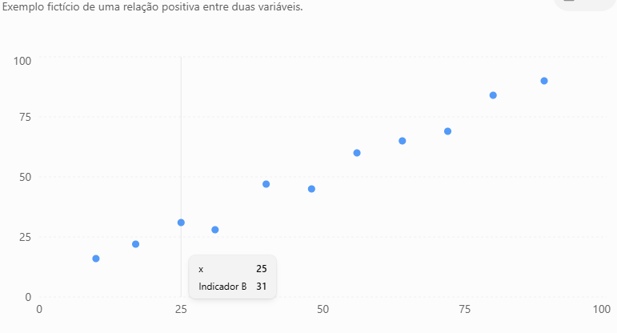
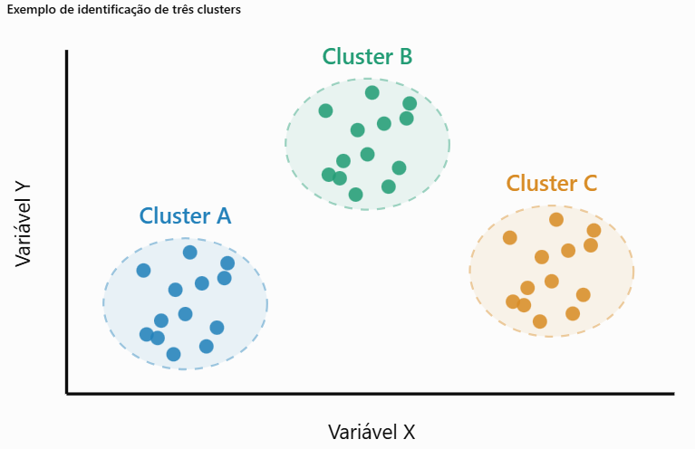
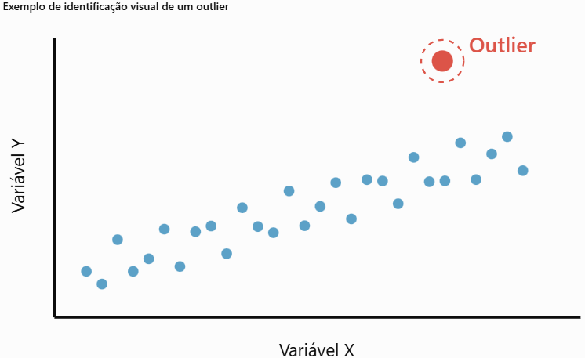
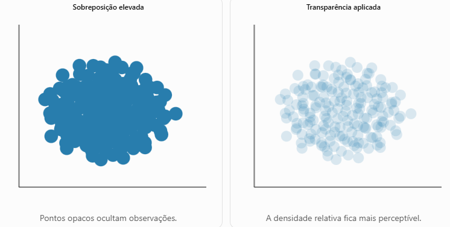
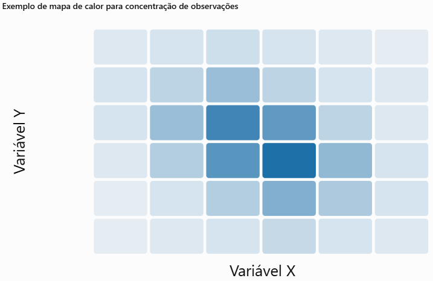
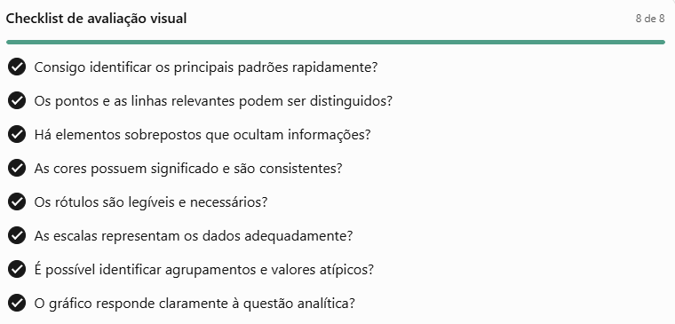

Tendencias e Padrões
-----------------------------

# Identificação Visual de Padrões, Clusters e Outliers

A identificação visual de padrões, agrupamentos (clusters) e valores atípicos (outliers) constitui uma das principais atividades da Análise Exploratória de Dados (AED) e representa uma aplicação fundamental das técnicas de Visualização de Dados.

Por meio de representações gráficas, é possível reconhecer comportamentos recorrentes, identificar grupos de observações com características semelhantes e detectar valores que se diferenciam significativamente dos demais.

Essa abordagem explora a capacidade do sistema visual humano de reconhecer formas, proximidades, tendências e contrastes, permitindo transformar grandes conjuntos de dados em informações interpretáveis.

A análise visual é especialmente importante durante as etapas iniciais da exploração de dados, pois permite formular hipóteses, identificar possíveis anomalias e orientar investigações estatísticas posteriores.

## Identificação Visual de Padrões

Um padrão corresponde a uma regularidade, tendência ou estrutura recorrente observada nos dados.

A identificação de padrões permite compreender como determinadas variáveis se comportam e como suas relações se manifestam.

Entre os principais padrões identificáveis visualmente, destacam-se:

- Tendências: crescimento, redução ou estabilidade de uma variável ao longo do tempo.
- Correlações: relações positivas ou negativas entre duas variáveis quantitativas.
- Sazonalidades: comportamentos que se repetem em intervalos regulares.
- Distribuições: concentração, dispersão, simetria ou assimetria dos valores.
- Padrões não lineares: relações representadas por curvas ou estruturas mais complexas.

Exemplo de padrão — Tendência de crescimento

A distribuição ascendente dos pontos sugere uma relação positiva entre as variáveis.

Em um gráfico de dispersão, por exemplo, pontos distribuídos próximos de uma linha ascendente sugerem uma correlação positiva. Já uma distribuição descendente pode indicar uma correlação negativa.

É importante destacar que um padrão visual não constitui, isoladamente, evidência suficiente de causalidade. Sua interpretação deve considerar o contexto dos dados e, quando necessário, métodos estatísticos complementares.

## Identificação Visual de Clusters

Um cluster é um agrupamento de observações que apresentam características semelhantes entre si e diferenças em relação a outros grupos.

Na visualização de dados, os clusters podem ser percebidos por meio de regiões de maior concentração de pontos, proximidade espacial ou similaridade de comportamentos.

Representação conceitual de três agrupamentos com características distintas.

### Características dos agrupamentos

A identificação visual de clusters depende de algumas propriedades:

- Proximidade: observações semelhantes tendem a ocupar regiões próximas em determinados gráficos.
- Densidade: áreas com grande concentração de pontos podem indicar agrupamentos.
- Separação: regiões relativamente distintas podem sugerir a existência de diferentes grupos.
- Homogeneidade: elementos pertencentes ao mesmo grupo apresentam características semelhantes nas variáveis analisadas.

### Exemplo aplicado

Considere uma base de dados com informações das estações do Metrô de São Paulo, contendo quantidade de passageiros, funcionários de limpeza, segurança e NPS.

Uma análise visual poderia sugerir grupos como:

- Estações de alta demanda e maior quantidade de funcionários.
- Estações de demanda intermediária e equipes proporcionais ao fluxo.
- Estações de baixa demanda e equipes relativamente numerosas.

Esses agrupamentos poderiam indicar diferentes perfis operacionais, auxiliando a análise da distribuição de recursos.

Entretanto, os grupos identificados visualmente constituem hipóteses iniciais. Técnicas como K-Means, DBSCAN e agrupamento hierárquico podem ser utilizadas posteriormente para investigar e formalizar essas estruturas.

## Identificação Visual de Outliers

Um outlier, ou valor atípico, é uma observação que apresenta comportamento significativamente diferente do padrão predominante de um conjunto de dados.

Essas observações podem representar situações excepcionais, erros de medição, problemas de registro ou fenômenos relevantes que merecem investigação.

a observação destacada apresenta comportamento distinto da tendência predominante.

### Tipos de outliers

| Tipo       | Característica                                    | Exemplo                                        |
| ---------- | ------------------------------------------------- | ---------------------------------------------- |
| Global     | Valor extremamente diferente dos demais           | Estação com fluxo muito superior ao das outras |
| Contextual | Valor atípico em determinado contexto             | Demanda excepcional em um domingo              |
| Coletivo   | Conjunto de observações com comportamento incomum | Sequência de quedas inesperadas no NPS         |

### Técnicas de visualização

Diversas representações gráficas auxiliam na identificação de outliers:

- Boxplots: destacam observações além dos limites definidos pelo critério estatístico adotado.
- Gráficos de dispersão: evidenciam pontos isolados ou afastados dos padrões predominantes.
- Histogramas: permitem identificar valores nas extremidades da distribuição.
- Séries temporais: revelam picos e quedas inesperadas.
- Matrizes de dispersão: possibilitam identificar observações atípicas em diferentes combinações de variáveis.

A identificação de um outlier não significa necessariamente que exista um erro. Muitas vezes, essas observações representam situações relevantes que não devem ser eliminadas automaticamente.

## Relação entre Padrões, Clusters e Outliers

Embora relacionados, esses conceitos representam aspectos diferentes da estrutura dos dados.

| Conceito | O que representa                    | Principal questão analítica                        |
| -------- | ----------------------------------- | -------------------------------------------------- |
| Padrão   | Regularidade ou tendência nos dados | Qual comportamento se repete?                      |
| Cluster  | Grupo de observações semelhantes    | Quais elementos apresentam características comuns? |
| Outlier  | Observação ou comportamento atípico | O que se diferencia significativamente dos demais? |

Esses três elementos podem coexistir em uma mesma visualização.

Por exemplo, um gráfico de dispersão pode apresentar uma tendência geral positiva, três agrupamentos distintos e uma observação isolada que não acompanha o comportamento dos demais pontos.

## Relação com a Visualização Multidimensional

Em conjuntos de dados multidimensionais, padrões, clusters e outliers nem sempre são evidentes quando as variáveis são analisadas isoladamente.

Uma estação do metrô pode apresentar quantidade de funcionários considerada normal e demanda de passageiros também dentro dos valores esperados. Entretanto, ao analisar a relação entre esses dois indicadores, pode-se identificar uma distribuição de profissionais muito diferente daquela observada em estações semelhantes.

Por isso, técnicas como matrizes de dispersão, coordenadas paralelas, mapas de calor e facetas são importantes para investigar relações entre múltiplas dimensões.

A análise multidimensional permite identificar comportamentos que poderiam permanecer ocultos em representações univariadas ou bidimensionais simples.

Um cuidado importante é que a normalização das variáveis, a escolha das escalas e a seleção das dimensões podem modificar a percepção visual de proximidade e separação entre observações.

## Boas Práticas de Análise Visual

Para identificar corretamente padrões, agrupamentos e valores atípicos, recomenda-se:

1. Compreender o contexto dos dados: conhecer o significado das variáveis e as características do fenômeno analisado.
2. Selecionar representações adequadas: escolher gráficos compatíveis com o tipo de relação investigada.
3. Avaliar escalas e normalizações: evitar distorções na percepção das diferenças.
4. Utilizar cores criteriosamente: destacar grupos e anomalias sem introduzir ambiguidades.
5. Investigar valores extremos: verificar se representam erros, exceções ou fenômenos reais.
6. Complementar a análise visual: utilizar estatística descritiva e métodos analíticos para validar hipóteses.

A identificação visual de padrões, clusters e outliers constitui uma competência essencial na Visualização de Dados, pois permite compreender a estrutura e o comportamento de conjuntos de dados complexos.

Enquanto os padrões revelam regularidades, os clusters evidenciam semelhanças entre observações e os outliers destacam comportamentos excepcionais.

Essas informações contribuem para a descoberta de relações, a formulação de hipóteses e a identificação de oportunidades de melhoria em processos operacionais e de negócios.

No contexto da análise exploratória, a visualização não substitui os métodos estatísticos, mas funciona como uma ferramenta complementar capaz de orientar investigações, revelar estruturas relevantes e apoiar a tomada de decisão fundamentada em dados.

# Avaliação de Problemas de Sobreposição e Sobrecarga Visual na Visualização de Dados

A sobreposição (overplotting) e a sobrecarga visual (visual clutter) representam dois dos principais desafios na construção e interpretação de visualizações de dados, especialmente quando trabalhamos com conjuntos de dados extensos ou multidimensionais.

Esses problemas ocorrem quando a quantidade, a densidade ou a organização dos elementos gráficos dificulta a percepção de padrões, tendências, agrupamentos e valores atípicos.

Embora estejam relacionados, possuem características distintas:

- Sobreposição: ocorre quando diferentes elementos gráficos ocupam posições iguais ou próximas, dificultando sua identificação individual.
- Sobrecarga visual: ocorre quando a quantidade ou complexidade dos elementos apresentados excede a capacidade de interpretação eficiente do observador.

A avaliação desses problemas é fundamental para garantir que uma visualização cumpra seu objetivo principal: comunicar informações de maneira clara, precisa e eficiente.

##  Como identificar problemas de sobreposição

A sobreposição é particularmente comum em gráficos de dispersão, coordenadas paralelas e visualizações de redes.

Em um gráfico de dispersão, por exemplo, centenas de observações podem ocupar regiões próximas ou idênticas, ocultando a quantidade real de registros.

Comparação visual: com e sem tratamento de sobreposição

Exemplo esquemático com o mesmo conjunto de pontos em ambos os gráficos.

### Principais indicadores de sobreposição

Uma visualização pode apresentar problemas quando:

- Muitos pontos se concentram em pequenas regiões.
- Linhas se cruzam frequentemente, dificultando o acompanhamento individual.
- Elementos gráficos ocultam outros elementos relevantes.
- Grupos distintos tornam-se visualmente indistinguíveis.
- A distribuição aparente não representa adequadamente a concentração real dos dados.

##  Técnicas para reduzir a sobreposição

###  Transparência (Alpha Blending)

Consiste em reduzir a opacidade dos elementos gráficos, permitindo identificar regiões com diferentes concentrações de observações.

Em gráficos de dispersão, pontos com baixa opacidade tornam as regiões mais densas visualmente perceptíveis.

Aplicação prática: utilizar valores de transparência, por exemplo, entre 0,1 e 0,4, ajustando-os conforme a densidade e o tamanho dos pontos. Não existe um valor universalmente ideal.

###  Deslocamento (Jittering)

O jittering consiste na aplicação de pequenos deslocamentos aos pontos que possuem coordenadas iguais ou muito próximas.

Essa técnica permite revelar observações que estariam completamente sobrepostas.

É particularmente útil para variáveis discretas ou categóricas representadas em gráficos de dispersão.

Entretanto, o deslocamento deve ser pequeno e claramente identificado, pois modifica a posição visual original dos dados.

### Agregação e redução de densidade

Quando a quantidade de observações é muito grande, pode ser mais adequado substituir pontos individuais por representações agregadas.

células mais escuras representam regiões com maior concentração de observações.

Entre as técnicas disponíveis, destacam-se:

- Mapas de calor: representam concentrações por intensidade de cor.
- Hexbin: agrupam observações em células hexagonais.
- Histogramas bidimensionais: contabilizam observações em regiões retangulares.
- Curvas de densidade: apresentam estimativas da distribuição dos dados.

Essas técnicas são úteis quando o objetivo analítico é compreender a distribuição geral, e não examinar cada observação individualmente.

##  Como identificar problemas de sobrecarga visual

A sobrecarga visual ocorre quando a representação contém elementos excessivos ou apresenta uma organização que dificulta o processamento da informação.

Entre os principais fatores estão:

- Excesso de cores sem significado analítico.
- Grande quantidade de rótulos e legendas.
- Uso desnecessário de linhas de grade, bordas e elementos decorativos.
- Representação simultânea de muitas variáveis.
- Escalas inconsistentes ou difíceis de interpretar.
- Excesso de categorias ou séries em um único gráfico.

Uma consequência importante é o aumento da carga cognitiva, pois o observador precisa dedicar mais esforço para localizar, distinguir e interpretar as informações relevantes.

##  Técnicas para reduzir a sobrecarga visual

| Técnica               | Aplicação                                                | Benefício                              |
| --------------------- | -------------------------------------------------------- | -------------------------------------- |
| Simplificação gráfica | Remover bordas e elementos decorativos desnecessários    | Reduz interferências visuais           |
| Destaque seletivo     | Utilizar cor para enfatizar informações relevantes       | Direciona a atenção                    |
| Facetamento           | Separar grupos em gráficos menores                       | Reduz a concentração de elementos      |
| Filtragem             | Exibir apenas subconjuntos relevantes                    | Diminui a complexidade                 |
| Agregação             | Representar valores resumidos                            | Facilita a identificação de tendências |
| Interatividade        | Permitir seleção e detalhamento sob demanda              | Evita apresentar tudo simultaneamente  |
| Hierarquia visual     | Diferenciar informações por posição, contraste e tamanho | Facilita a leitura                     |

### Exemplo: coordenadas paralelas

Em um gráfico de coordenadas paralelas com dezenas de estações, cada observação é representada por uma linha que atravessa diversos eixos.

O resultado pode ser uma grande quantidade de cruzamentos, dificultando a identificação dos comportamentos individuais.

Algumas estratégias são:

1. Aplicar transparência às linhas.
2. Destacar apenas as estações selecionadas.
3. Agrupar estações por linha do metrô.
4. Reduzir a quantidade de variáveis exibidas simultaneamente.
5. Utilizar filtros interativos para explorar subconjuntos.

## Como avaliar a qualidade visual de um gráfico

A avaliação não deve considerar apenas aspectos estéticos. É necessário verificar se o gráfico permite responder às questões analíticas propostas.

Uma abordagem prática consiste em aplicar uma lista de verificação.

### Avaliação quantitativa complementar

Também é possível utilizar medidas complementares, como:

- Taxa de sobreposição: proporção de símbolos gráficos que se interceptam, segundo um critério definido.
- Densidade visual: quantidade de marcas gráficas em determinada área.
- Tempo de interpretação: tempo necessário para o usuário responder a uma questão sobre o gráfico.
- Taxa de acerto: proporção de respostas corretas em tarefas de leitura e comparação.

Essas medidas podem ser utilizadas para comparar versões de uma mesma visualização e avaliar empiricamente quais escolhas de projeto produzem melhores resultados.

##  Aplicação em uma Atividade Prática

Considerando uma base operacional simulada das estações do Metrô de São Paulo, pode-se desenvolver uma atividade de avaliação visual com os seguintes objetivos.

Etapa 1 — Construção: elaborar um gráfico de dispersão relacionando passageiros/dia e quantidade de funcionários, utilizando cores para diferenciar as linhas do metrô.

Etapa 2 — Diagnóstico: identificar regiões com sobreposição de pontos, dificuldades de leitura e possíveis interferências visuais.

Etapa 3 — Tratamento: aplicar transparência, reduzir o tamanho dos marcadores e criar facetas para as linhas Vermelha e Azul.

Etapa 4 — Comparação: confrontar as versões original e modificada, verificando qual permite identificar mais facilmente padrões, clusters e outliers.

Etapa 5 — Avaliação: utilizar o checklist e registrar quais modificações contribuíram efetivamente para melhorar a interpretação.

A avaliação de sobreposição e sobrecarga visual constitui uma etapa essencial no desenvolvimento de visualizações de dados eficientes.

O problema não está necessariamente na quantidade de dados apresentados, mas na relação entre a complexidade da representação, as características perceptivas do observador e o objetivo analítico.

Técnicas como transparência, agregação, facetamento, filtragem e simplificação gráfica permitem reduzir dificuldades de leitura e tornar as informações mais acessíveis.

O princípio fundamental é preservar a informação relevante, reduzindo os elementos visuais que dificultam sua interpretação.

A qualidade de uma visualização deve ser avaliada principalmente por sua capacidade de permitir comparações corretas, revelar padrões e apoiar a interpretação dos dados.

