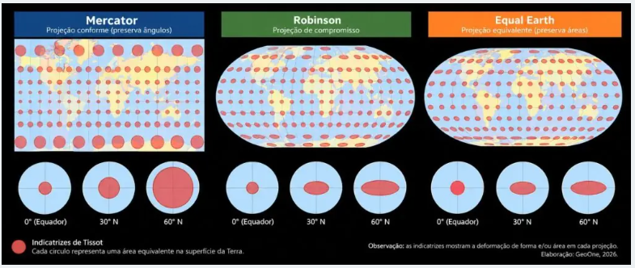
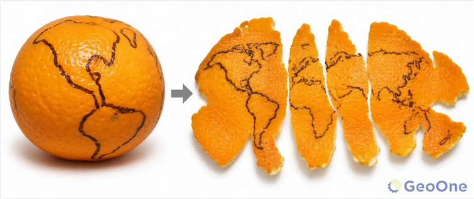

Visualização Geolocalizada/Geoespacial
--------------------------------------------

## Dados Geoespaciais

Dados geoespaciais, ou geodados, são dados que contêm informações relacionadas a locais na superfície terrestre. É possível mapear objetos, eventos e outros fenômenos do mundo real de uma área geográfica específica identificada por coordenadas de latitude e longitude. Os dados geoespaciais combinam informações de localização com características ou atributos de outros conjuntos de dados comerciais durante um período. Por exemplo, os dados geoespaciais podem representar onde um carro está estacionado e também rastrear a localização quando ele começa a se mover. 

## Visualização de dados Geoespaciais

A visualização geoespacial ocorre quando usamos dados geoespaciais para criar visualizações (como mapas e modelos 3D). Cientistas geralmente combinam dados de várias fontes para criar uma imagem completa de um local. Por exemplo, eles combinam dados sobre a qualidade do solo, a qualidade da água e a temperatura para localizar áreas agrícolas com o potencial de produção mais significativo. 

A visualização geoespacial desenvolve uma compreensão de alto nível sobre temas, padrões e tendências específicas na superfície terrestre. Esse tipo de visualização traz insights sobre o meio ambiente, revelando seu impacto nas pessoas e na natureza. A visualização geoespacial geralmente implica o uso de tecnologia geoespacial para criar mapas e gráficos 3D interativos, é o processo de transformar dados numéricos e textuais associados a uma localização geográfica em representações visuais gráficas. Em vez de analisar coordenadas (latitude e longitude) ou nomes de cidades em planilhas abstratas, essa prática projeta as informações diretamente sobre o espaço terrestre para revelar padrões, tendências, fluxos e conexões espaciais de forma instantânea.

## Uso de dados Geolocalizados

* **Planejamento Urbano e Políticas Públicas**: Sobreposição de camadas como densidade demográfica, renda, transporte público e áreas de risco para definir locais de escolas ou hospitais.

* **Gestão de desenpenho em negócios**: Mapeamento de gerção de receita, identificação de gargalos ou problemas, apontamento de padrões ou tendências do negócio por área.

* **Logística e Gestão de Frotas**: Monitoramento em tempo real de veículos e otimização de rotas.

* **Agronegócio e Meio Ambiente**: Cruzamento de dados de solo, clima, umidade e imagens de satélite para monitorar lavouras, desmatamento ou recursos hídricos.

* **Mercado e Neuromarketing**: Análise de footfall (fluxo de visitantes) e geofencing para identificar o potencial de abertura de novos pontos comerciais

## Desafios

Os desafios podem ser divididos em três grandes categorias: **distorção física**, **volume de dados** e **percepção humana**.

### Distorção Espacial e Projeções Cartográficas

* **Problema da Esfera Flutuante**: A Terra é um esferoide tridimensional, mas as telas são bidimensionais. Toda tentativa de achatar o planeta causa distorções de área, forma, distância ou direção.
Recentemente a **ONU** aprovou uma nova projeção de visualização dos territórios de nosso planeta, o [Equal Earth](https://www.equal-earth.com/) que visa corrigir distorções verificadas no modelo [Mercator](https://education.nationalgeographic.org/resource/gerardus-mercator/) de **1569**, amplamente utilizado no meio acadêmico e em mapas digitais (como Google Maps), mas que teve o propósito cartográfico de orientação para navegações entre os continentes e, por esse motivo, distorce severamente o tamanho dos países a medida que a latitude aumenta, fazendo a Groenlândia parecer do tamanho da África, embora seja 14 vezes menor.

O novo modelo proposto diminui drasticamente as distorções que já haviam sido minimizadas pelo modelo [Robinson](https://education.nationalgeographic.org/resource/selecting-map-projection/), acrescentando a essa projeção básica um modelo matemático que pode ser reproduzido a partir de qualquer ponto de nossa superficie terrestre, mas não resolve outras distorções como **formas**, **ângulos** e **distâncias**, que sempre são afetadas quando tentamos visualizar nosso planeta em superfícies planas.

Para cada grande desafio de visualização geográfica, a engenharia de dados e o design de infográficos desenvolveram técnicas de mitigação:
| Desafio Crítico               | Impacto na Análise                                             | Solução Design / Técnica                                                                                               |
| ----------------------------- | -------------------------------------------------------------- | ---------------------------------------------------------------------------------------------------------------------- |
| Superpopulação (Overplotting) | Esconde a densidade real dos dados em centros urbanos.         | Agrupamento (Clustering) ou Mapas de Calor (Heatmaps).                                                                 |
| Falácia da Área Territorial   | Áreas geograficamente grandes distorcem a importância do dado. | Cartogramas (onde o tamanho da região é ditado pelo dado, não pela geografia) ou mapas de pontos hexagonais (Hexbins). |
| Distorção de Projeção         | Altera a percepção de escala e tamanho real das regiões.       | Escolha da projeção correta para o objetivo (ex.: Projeção de Albers para preservar áreas).                            |
| Performance de Renderização   | Mapas lentos, travamentos e alta latência no carregamento.     | Tiles Vetoriais (Mapbox/MVT), amostragem de dados ou processamento no lado do servidor.                                |
| Complexidade Temporal         | Perda de contexto sobre como o dado evolui geograficamente.    | Linhas do tempo interativas (timelines), animações controladas ou múltiplos mapas lado a lado (small multiples).       |