Tipos de Dados Baseados em Geolocalização
-------------------------------------------

## dados geoespaciais

Os dados geoespaciais representam informações que possuem uma referência à superfície terrestre. Essa referência permite associar fenômenos, objetos, atividades e características a uma localização geográfica específica.

Diferentemente dos dados convencionais, que frequentemente descrevem apenas atributos, os dados geoespaciais incorporam uma dimensão espacial, possibilitando investigar não apenas o que acontece, mas também onde acontece.

Por exemplo, um conjunto de dados sobre estabelecimentos comerciais pode apresentar nome, atividade econômica e faturamento. Quando esse conjunto passa a incluir coordenadas geográficas, torna-se possível identificar a distribuição espacial dos estabelecimentos, sua proximidade com consumidores e suas relações com a infraestrutura urbana.

Os dados geoespaciais permitem responder questões como:

- Onde estão localizados determinados fenômenos ou objetos?
- Quais regiões apresentam maior concentração de determinado indicador?
- Que relações espaciais existem entre diferentes elementos?
- Como a localização influencia o comportamento de pessoas, organizações e sistemas?
- Como a distribuição territorial se modifica ao longo do tempo?

Essas possibilidades fundamentam a chamada inteligência geográfica, também conhecida como Location Intelligence, que utiliza informações espaciais para apoiar análises e decisões.

## Formas de representação dos dados geoespaciais

Independentemente de sua origem, os dados geoespaciais são frequentemente organizados em dois modelos fundamentais: vetorial e matricial (raster).

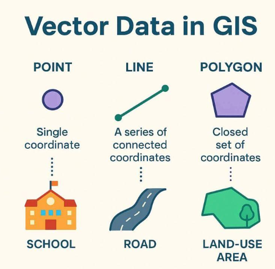
*Dados vetoriais*

Representam objetos geográficos por meio de pontos, linhas e polígonos.

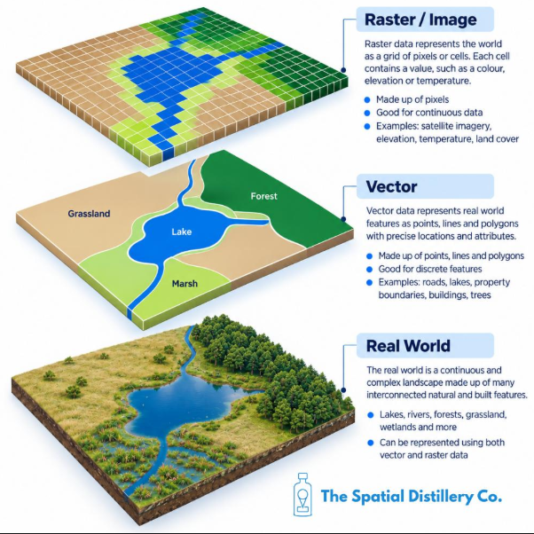
*Dados matriciais (raster)*

Representam fenômenos espaciais por uma matriz de células ou pixels associados a valores.

### Dados vetoriais

O modelo vetorial é especialmente adequado à representação de objetos geográficos com geometria identificável.

| Geometria | Característica                    | Exemplo                   |
| --------- | --------------------------------- | ------------------------- |
| Ponto     | Identifica uma localização        | Hospital, escola, estação |
| Linha     | Representa um percurso ou conexão | Rua, ferrovia, rio        |
| Polígono  | Delimita uma região               | Bairro, município, imóvel |

Cada geometria pode ser associada a atributos descritivos. Um polígono correspondente a um município, por exemplo, pode conter informações sobre população, área territorial, renda média e indicadores socioeconômicos.

### Dados matriciais

O modelo matricial organiza o território em uma grade regular. Cada célula possui um valor relacionado ao fenômeno representado.

Entre as aplicações mais comuns estão mapas de temperatura, imagens de satélite, modelos digitais de elevação e índices de vegetação.

Uma característica importante desse modelo é a resolução espacial, que determina a dimensão do território representada por cada célula. Quanto menor a área representada por um pixel, maior tende a ser o nível de detalhe espacial, embora isso também dependa da qualidade da fonte.

### Integração entre modelos

Na prática, vetores e rasters são frequentemente utilizados em conjunto. Um mapa de risco de inundação pode ser representado como raster, enquanto as escolas, hospitais e edifícios expostos a esse risco são representados como pontos ou polígonos.

Essa integração permite realizar operações de sobreposição, proximidade e interseção espacial.

## As nove categorias de dados baseados em geolocalização

A classificação apresentada pela SafeGraph contempla nove categorias que descrevem diferentes aspectos do território. Elas não são mutuamente exclusivas: representam perspectivas complementares de um mesmo espaço geográfico.

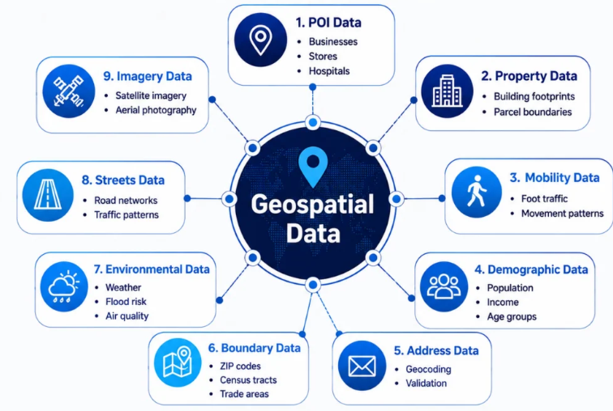
*[storymaps.arcgis.com](https://storymaps.arcgis.com/stories/0d5fbf2fd22d450c82f6abdb7929594d)*

Camadas temáticas podem representar estabelecimentos, construções, deslocamentos, população, infraestrutura e condições ambientais.

### Pontos de interesse (POI — Points of Interest)

Os Pontos de Interesse são locais físicos que possuem relevância para determinadas atividades humanas, comerciais, institucionais ou sociais.

Um ponto de interesse pode corresponder a um supermercado, hospital, restaurante, escola, parque, universidade ou estação de transporte.

A principal característica desse tipo de dado é sua capacidade de associar uma localização a uma entidade identificável.

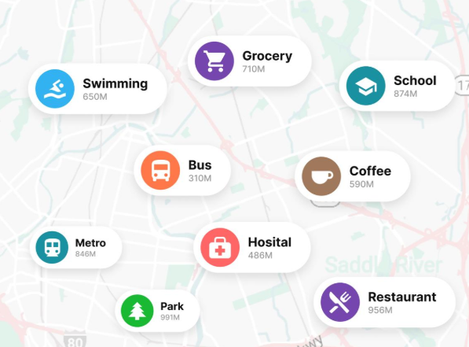

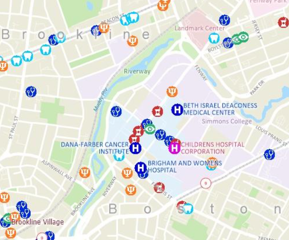

Um registro de POI normalmente contém nome do estabelecimento, categoria, endereço, latitude, longitude e, eventualmente, informações adicionais como horário de funcionamento, telefone e vínculo com uma organização.

Na análise espacial, esses registros permitem identificar concentrações comerciais, avaliar áreas de atendimento e reconhecer regiões com maior ou menor oferta de serviços.

Aplicações práticas: uma rede de farmácias pode identificar bairros com alta densidade populacional e baixa cobertura de estabelecimentos do setor. Outra aplicação consiste em medir a distância entre escolas e unidades de saúde.

Critérios de qualidade: cobertura geográfica, atualização dos estabelecimentos, classificação consistente das categorias e precisão das coordenadas.

### Dados de propriedades e edificações

Os dados de propriedades descrevem as características físicas e espaciais das construções existentes em determinado território.

Diferentemente dos POIs, que frequentemente identificam uma localização pontual, esses dados podem representar a geometria completa de uma edificação por meio de polígonos.

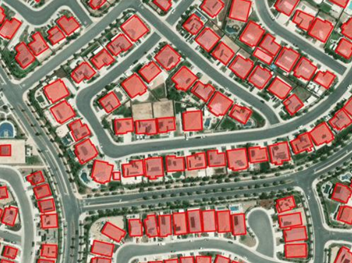
*[learn.arcgis.com](https://learn.arcgis.com/es/projects/extract-high-resolution-land-cover-with-geoai)*

Um edifício comercial, por exemplo, pode conter diversas lojas e escritórios, cada qual identificado por um POI diferente. Entretanto, todos podem compartilhar a mesma estrutura física.

A representação geométrica da edificação permite distinguir sua área ocupada, suas relações com construções vizinhas e a distribuição dos espaços internos.

Aplicações práticas: planejamento urbano, avaliação imobiliária, estudos de densidade construtiva, análise de exposição a riscos ambientais e mapeamento de instalações.

Critérios de qualidade: precisão dos contornos, atualização de construções e demolições, identificação de unidades internas e compatibilidade com dados de POIs.

### Dados de mobilidade

Os dados de mobilidade descrevem padrões de deslocamento de pessoas, veículos e outros elementos que circulam pelo espaço geográfico.

Esses registros podem ser obtidos de sistemas de transporte, sensores de tráfego, levantamentos origem-destino e, mediante condições adequadas de privacidade, dados agregados de localização de dispositivos.

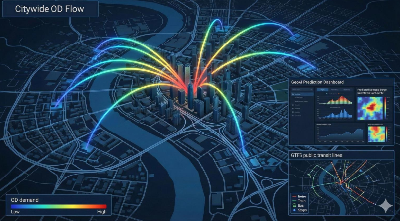
*[bsmaenterprises.com](https://bsmaenterprises.com/blog-1/f/mobility-gtfs-geoai-od-matrices-demand-and-urban-flow-intel)*

Entre os principais indicadores utilizados estão o número de deslocamentos, o tempo de permanência em determinado local, a frequência de visitas, o fluxo entre regiões e a distribuição temporal das viagens.

Uma análise de mobilidade pode revelar, por exemplo, quais regiões concentram maior movimento durante os horários de entrada e saída do trabalho.

Aplicações práticas: planejamento do transporte público, avaliação da demanda por estações, análise de fluxo comercial, identificação de áreas de congestionamento e estudos de acessibilidade.

Critérios de qualidade: representatividade da amostra, precisão temporal e espacial, confiabilidade dos indicadores e proteção contra a identificação de indivíduos.

> Observação metodológica: dados de mobilidade coletados por dispositivos não representam automaticamente toda a população. Diferenças de acesso à tecnologia e de cobertura da amostra podem produzir vieses importantes. A agregação também precisa ser suficientemente robusta para proteger a privacidade.

### Dados demográficos

Os dados demográficos descrevem as características das populações distribuídas por diferentes áreas geográficas.

Normalmente, essas informações são obtidas por censos, pesquisas amostrais e registros estatísticos oficiais. Quando associadas a unidades territoriais, tornam-se fundamentais para analisar desigualdades, características socioeconômicas e padrões de ocupação do espaço.

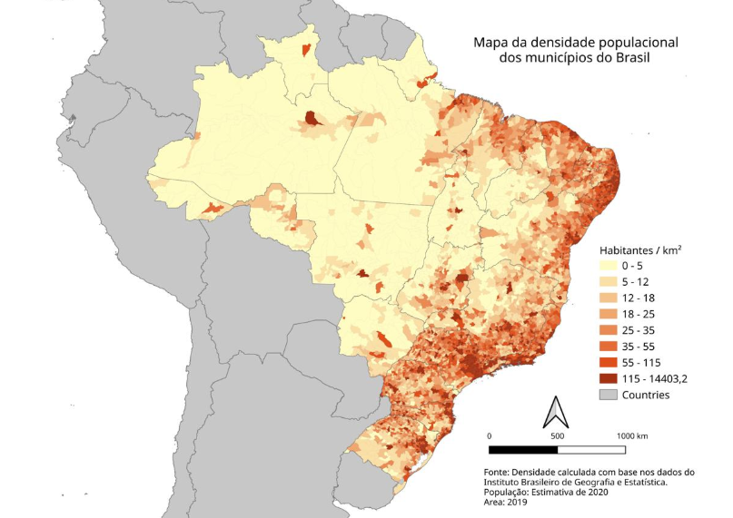
*[commons.wikimedia.org](https://commons.wikimedia.org/wiki/File%3APopulation_density_Brazil_2020.svg)*

Os dados demográficos incluem indicadores como população residente, faixa etária, escolaridade, renda, situação ocupacional e composição dos domicílios.

Uma característica importante é que essas informações normalmente são associadas a unidades territoriais, como municípios, bairros ou setores censitários. Assim, o dado não representa necessariamente a localização de cada pessoa, mas uma medida estatística referente a determinada região.

Aplicações práticas: identificação de áreas com carência de serviços públicos, planejamento de novas escolas, estudos de mercado, análise de desigualdade socioeconômica e avaliação do acesso a equipamentos urbanos.

Critérios de qualidade: ano de referência, resolução geográfica, metodologia de coleta, disponibilidade de indicadores e compatibilidade com outros conjuntos de dados.

No contexto brasileiro, o Instituto Brasileiro de Geografia e Estatística (IBGE) é uma das principais fontes de dados demográficos territorializados.

### Dados de endereços

Os dados de endereços permitem estabelecer uma correspondência entre identificadores de localização utilizados no cotidiano e posições geográficas representadas por coordenadas.

Um endereço pode ser composto por logradouro, número, complemento, bairro, município, unidade federativa e CEP.

Entretanto, para utilização geoespacial, é necessário que essas informações estejam padronizadas e, quando possível, associadas a uma localização geográfica válida.

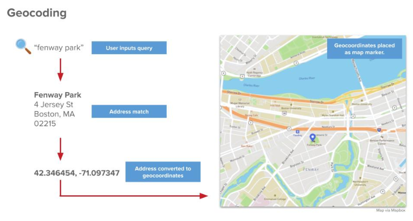
*[pubnub.com](https://www.pubnub.com/learn/glossary/what-is-geocoding-and-reverse-geocoding)*

Um dos processos mais importantes relacionados a essa categoria é a geocodificação, que consiste na conversão de um endereço textual em coordenadas geográficas.

O processo inverso, chamado de geocodificação reversa, identifica um endereço ou referência territorial a partir de coordenadas conhecidas.

Essas operações permitem integrar cadastros administrativos, informações logísticas e bases de clientes a sistemas de informação geográfica.

Aplicações práticas: localização de entregas, organização de rotas logísticas, saneamento de cadastros, planejamento de áreas de atendimento e representação espacial de estabelecimentos.

Critérios de qualidade: padronização dos logradouros, completude dos registros, precisão da geocodificação e atualização da malha de endereços.

É importante considerar que uma coordenada geocodificada pode representar o centro de uma rua, um segmento de logradouro ou o acesso efetivo de uma edificação. Essas diferenças influenciam análises que exigem precisão.

### Dados de limites territoriais

Os dados de limites representam divisões espaciais utilizadas para organizar, administrar e analisar o território.

Essas delimitações podem corresponder a fronteiras políticas, regiões administrativas, áreas estatísticas, zonas de planejamento e territórios definidos por critérios específicos.

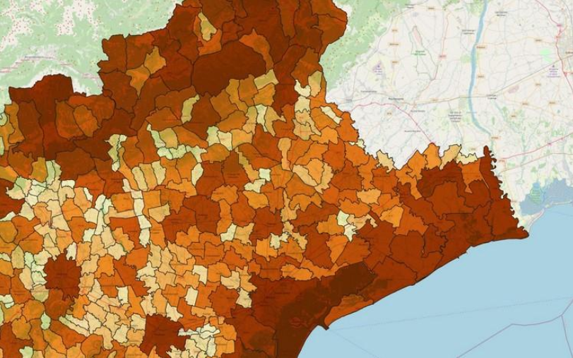
*[geocorsi.it](https://www.geocorsi.it/272/GS/1/qgis-open-source-geographic-information-system.html)*

Entre as representações mais comuns estão limites municipais, estaduais, distritais, bairros, setores censitários, áreas escolares e regiões de atendimento.

Esses dados são frequentemente representados por polígonos que delimitam cada unidade territorial.

Uma de suas principais aplicações é permitir que diferentes indicadores sejam organizados segundo uma mesma divisão geográfica.

Por exemplo, dados de população, renda e número de estabelecimentos podem ser associados aos mesmos limites municipais, permitindo análises comparativas.

Aplicações práticas: produção de mapas coropléticos, gestão territorial, planejamento de políticas públicas, distribuição regional de recursos e identificação de áreas de influência.

Critérios de qualidade: consistência topológica, atualização dos limites, compatibilidade dos sistemas de referência e adequação da escala territorial.

Uma questão metodológica importante é que resultados estatísticos podem mudar conforme as unidades geográficas utilizadas. Esse fenômeno é conhecido como Problema da Unidade de Área Modificável (MAUP).

### Dados ambientais

Os dados ambientais representam fenômenos e características relacionados às condições naturais do território.

Essas informações podem descrever elementos relativamente estáveis, como relevo e tipos de solo, ou fenômenos dinâmicos, como temperatura, precipitação, qualidade do ar e condições meteorológicas.

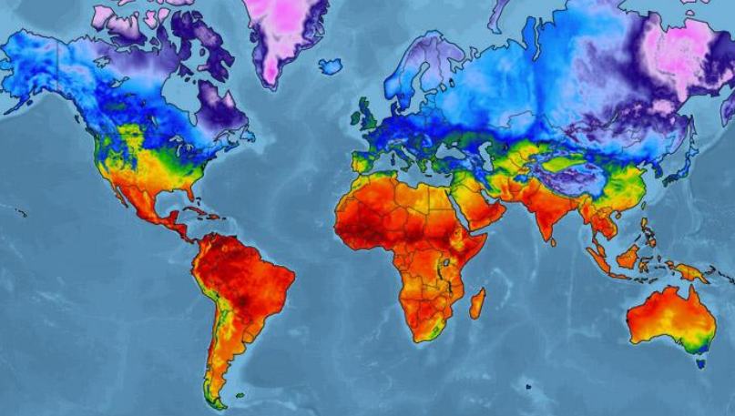
*[xweather.com](https://www.xweather.com/blog/harnessing-global-temperature-mapping)*

Uma característica dessa categoria é a diversidade de escalas espaciais e temporais. Enquanto um mapa de relevo pode permanecer relevante durante períodos extensos, medições meteorológicas podem exigir atualizações frequentes.

Os dados ambientais também são utilizados para modelar riscos associados a inundações, incêndios florestais, deslizamentos e eventos climáticos extremos.

Aplicações práticas: planejamento de ocupação do solo, monitoramento agrícola, prevenção de desastres, estudos de sustentabilidade, avaliação de riscos imobiliários e planejamento de infraestrutura.

Critérios de qualidade: resolução espacial, precisão dos sensores, qualidade dos modelos, periodicidade da coleta e validade temporal das estimativas.

Uma aplicação importante consiste em sobrepor dados ambientais com outras camadas geográficas. Por exemplo, um mapa de áreas suscetíveis a inundações pode ser combinado com a localização de hospitais e escolas para identificar instalações potencialmente expostas.

### Dados de vias e redes de transporte

Os dados de vias descrevem a infraestrutura utilizada para deslocamentos terrestres, incluindo ruas, avenidas, rodovias, caminhos e conexões entre diferentes pontos da rede.

Além de sua localização, esses dados podem incluir características como sentido de circulação, limite de velocidade, tipo de pavimentação e restrições de conversão.

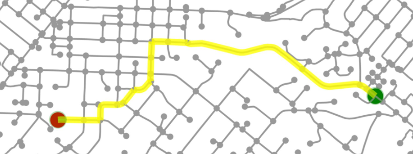
*[medium.com](https://medium.com/the-downlinq/spacenet-road-detection-and-routing-challenge-part-i-d4f59d55bfce)*

Do ponto de vista computacional, uma rede viária pode ser representada por um grafo, no qual os nós representam interseções ou pontos de conexão, enquanto as arestas representam segmentos de vias.

Essa estrutura permite aplicar algoritmos de roteamento, cálculo de distâncias e identificação de caminhos eficientes.

A distância geográfica entre dois pontos nem sempre corresponde à distância real de deslocamento. Obstáculos, sentidos de circulação, restrições e condições de tráfego podem alterar significativamente o percurso necessário.

Aplicações práticas: roteirização de entregas, planejamento do transporte coletivo, cálculo de áreas acessíveis por tempo de viagem, análise de congestionamentos e localização de equipamentos públicos.

Critérios de qualidade: conectividade da rede, atualização das vias, precisão dos atributos, presença de restrições de tráfego e compatibilidade com sistemas de roteamento.

O OpenStreetMap constitui uma importante fonte aberta de dados de redes viárias e outros elementos cartográficos.

### Dados de imagens geográficas

Os dados de imagens compreendem representações visuais da superfície terrestre obtidas por satélites, aeronaves, drones e outros dispositivos de observação.

Esses registros são fundamentais para identificar características físicas e acompanhar transformações espaciais ao longo do tempo.

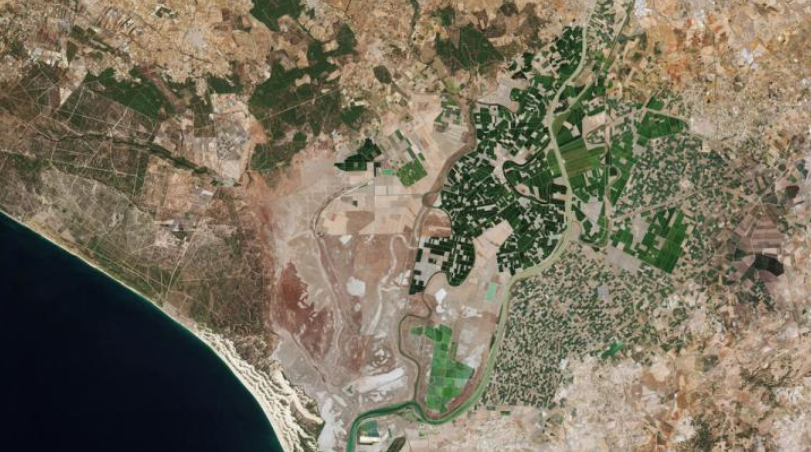

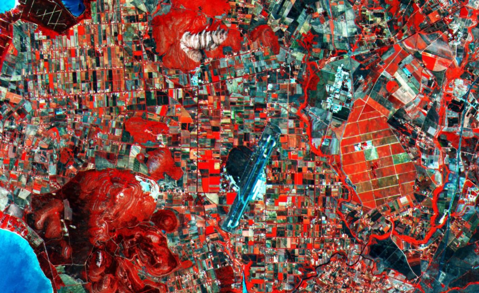

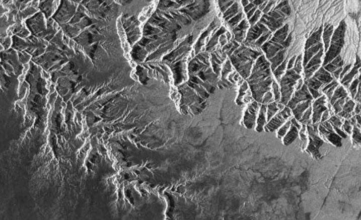

As imagens podem ser classificadas conforme suas características de captura.

| Tipo de imagem         | Característica                                                                   | Aplicação                            |
| ---------------------- | -------------------------------------------------------------------------------- | ------------------------------------ |
| Óptica                 | Registra radiação em faixas do espectro eletromagnético, incluindo a luz visível | Uso e cobertura do solo              |
| Multiespectral         | Registra diversas bandas espectrais                                              | Agricultura e vegetação              |
| Radar                  | Utiliza sinais de micro-ondas                                                    | Monitoramento com presença de nuvens |
| Fotografia aérea       | Capturada por aeronaves ou drones                                                | Cartografia detalhada                |
| Imagem ao nível da rua | Mostra a perspectiva observada na superfície                                     | Inspeção de infraestrutura           |

As imagens de satélite tornam possível comparar um território em diferentes períodos, identificando expansão urbana, desmatamento, mudanças em corpos d'água e alterações na ocupação do solo.

Aplicações práticas: análise da evolução urbana, monitoramento ambiental, avaliação de danos após desastres, classificação do uso do solo e inspeção de infraestruturas.

Critérios de qualidade: resolução espacial, resolução temporal, resolução espectral, condições atmosféricas e profundidade da série histórica.

A interpretação desses dados pode exigir técnicas de processamento digital de imagens, classificação supervisionada e aprendizado de máquina.

## Comparação entre as categorias de dados geoespaciais

As nove categorias apresentam diferenças quanto à natureza da informação, representação espacial e finalidade analítica.

| Categoria            | Representação comum                   | Principal finalidade                  |
| -------------------- | ------------------------------------- | ------------------------------------- |
| Pontos de interesse  | Pontos e polígonos                    | Identificar locais e atividades       |
| Propriedades         | Polígonos                             | Descrever construções e áreas físicas |
| Mobilidade           | Fluxos, matrizes e trajetos agregados | Analisar deslocamentos                |
| Demográficos         | Indicadores associados a áreas        | Caracterizar populações               |
| Endereços            | Pontos e registros estruturados       | Identificar localizações              |
| Limites territoriais | Polígonos                             | Delimitar regiões                     |
| Ambientais           | Raster, pontos e polígonos            | Caracterizar condições naturais       |
| Vias e redes         | Linhas e grafos                       | Representar a conectividade           |
| Imagens geográficas  | Raster                                | Observar o território                 |

A representação indicada corresponde ao formato mais comum, mas não é exclusiva. Dados ambientais, por exemplo, podem ser representados por estações de medição pontuais ou por superfícies contínuas.

## Integração de dados e inteligência geográfica

O verdadeiro potencial analítico dos dados geoespaciais frequentemente surge quando diferentes categorias são combinadas.

Considere o problema de identificar a melhor localização para instalar uma nova unidade de atendimento de saúde.

Uma análise limitada aos pontos de interesse permitiria identificar os hospitais e postos de saúde existentes. Entretanto, essa informação isolada seria insuficiente para estimar as necessidades da população.

A integração com outras categorias permite construir uma perspectiva mais completa.

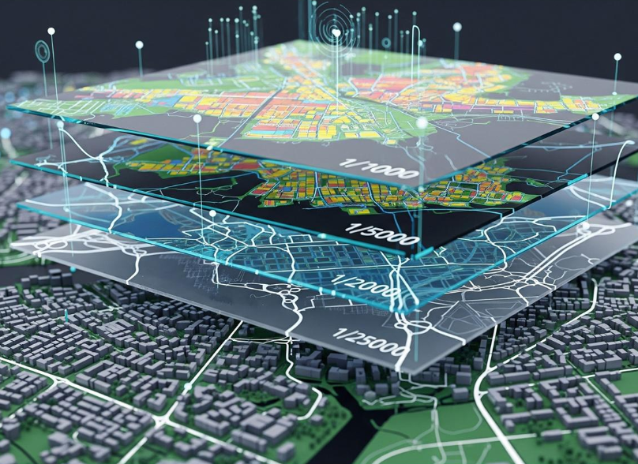
*[mega.melikgazi.bel.tr](https://mega.melikgazi.bel.tr)*

Exemplo: planejamento de uma nova unidade de saúde

1. Dados demográficos: identificar população residente e faixas etárias.
2. Pontos de interesse: localizar unidades de saúde já existentes.
3. Redes de transporte: calcular tempos de deslocamento.
4. Limites territoriais: organizar a análise por bairros e distritos.
5. Dados de propriedades: identificar imóveis disponíveis e suas dimensões.
6. Dados ambientais: verificar restrições e riscos físicos do território.

A combinação dessas camadas possibilita identificar regiões onde existe maior demanda potencial, menor oferta de serviços e condições adequadas para novas instalações.

Esse processo demonstra que o valor dos dados geoespaciais não está apenas na localização dos objetos, mas também na compreensão das relações espaciais entre diferentes fenômenos.

## Como avaliar a qualidade dos dados geoespaciais

A utilização adequada de informações geográficas exige atenção à qualidade dos conjuntos de dados.

Dados incompletos, imprecisos ou desatualizados podem produzir mapas aparentemente convincentes, mas analiticamente incorretos.

Quatro dimensões merecem atenção especial.

**Precisão**

- Proximidade entre a localização registrada e a posição real do objeto.

**Atualização**

- Tempo decorrido desde a coleta e frequência de renovação dos registros.

**Cobertura**

- Extensão do território, população ou conjunto de objetos representados.

**Conformidade**

- Adequação às regras de privacidade, licenciamento e padrões técnicos aplicáveis.

Além dessas dimensões, recomenda-se avaliar a resolução espacial e temporal, a procedência dos dados, a consistência dos sistemas de coordenadas e a possibilidade de integração com outras fontes.

Por exemplo, ao relacionar duas bases por município, é necessário verificar se ambas utilizam a mesma versão dos limites administrativos e identificadores compatíveis.

Quando o dado envolve mobilidade de pessoas ou localização de dispositivos, também é essencial considerar princípios de privacidade e a legislação aplicável, inclusive a Lei Geral de Proteção de Dados Pessoais (LGPD), no Brasil.

## Onde obter dados geoespaciais

A escolha da fonte depende do tipo de informação necessária, da região de interesse, da periodicidade de atualização e das condições de utilização.

A tabela apresenta exemplos de fontes mencionadas no artigo original e outras relevantes no contexto brasileiro.

| Categoria            | Exemplos de fontes                                 |
| -------------------- | -------------------------------------------------- |
| Pontos de interesse  | SafeGraph Places, OpenStreetMap                    |
| Propriedades         | SafeGraph Geometry, bases cadastrais municipais    |
| Mobilidade           | Veraset, Unacast, pesquisas origem-destino         |
| Demográficos         | IBGE, Esri Business Analyst                        |
| Endereços            | SafeGraph Address, bases oficiais de endereçamento |
| Limites territoriais | IBGE, Mapbox Boundaries, CARTO                     |
| Ambientais           | INPE, INMET, Ambee                                 |
| Vias e redes         | OpenStreetMap, StreetLight Data                    |
| Imagens geográficas  | Copernicus, USGS, Planet Labs                      |

A disponibilidade, abrangência geográfica e política de acesso dessas fontes variam. Nem todos os serviços comerciais oferecem a mesma cobertura para o Brasil.

### Fontes públicas relevantes no Brasil

#### IBGE

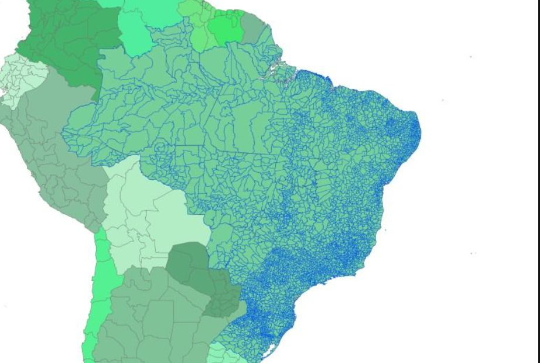

Informações demográficas, malhas territoriais, setores censitários e dados estatísticos associados ao território brasileiro.

[Portal do IBGE](https://www.ibge.gov.br/)

#### Instituto Nacional de Pesquisas Espaciais (INPE)

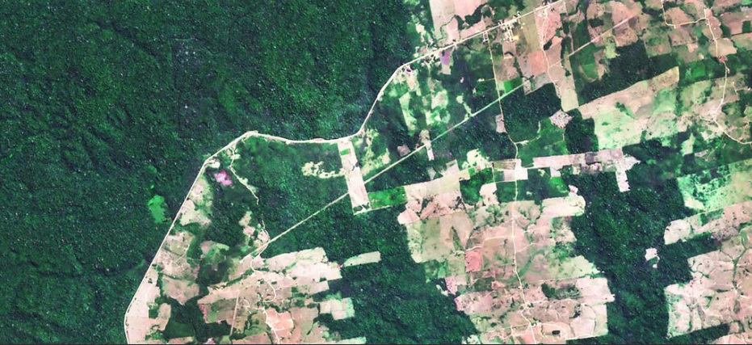

Informações de sensoriamento remoto, monitoramento ambiental e observação da superfície terrestre.

[Portal do INPE](https://www.gov.br/inpe/pt-br)

#### OpenStreetMap

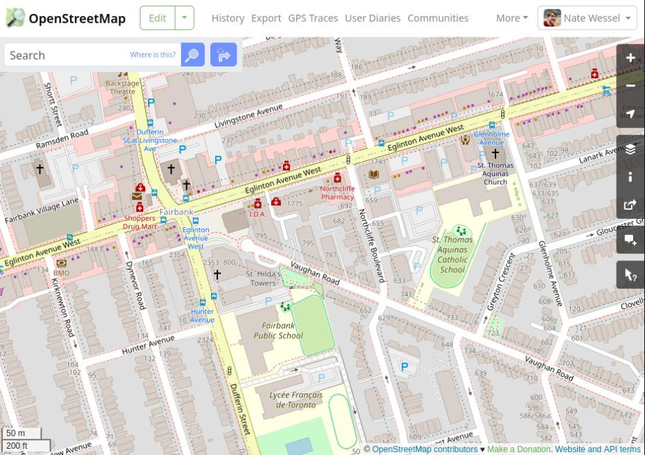

Base cartográfica colaborativa com vias, edificações, pontos de interesse e outras feições espaciais.

[Acessar OpenStreetMap](https://www.openstreetmap.org)

#### Copernicus

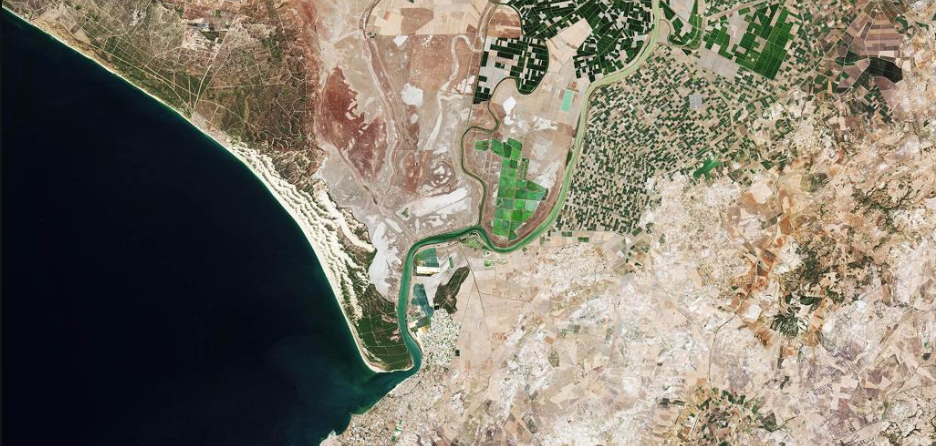

Programa europeu de observação da Terra com imagens de satélite e produtos ambientais.

[Copernicus Data Space](https://dataspace.copernicus.eu)

-----------------------------------

Os dados geoespaciais constituem um recurso essencial para compreender a organização do território e as relações entre atividades humanas, infraestrutura e condições ambientais.

Sua relevância não se limita à elaboração de mapas. Esses dados permitem desenvolver análises estatísticas territorializadas, identificar padrões, avaliar acessibilidade, investigar relações espaciais e apoiar decisões em diferentes setores.

Do ponto de vista da visualização de dados, a geolocalização introduz uma dimensão analítica adicional: a posição e a distribuição espacial da informação.

A escolha da representação visual depende da natureza dos dados e da pergunta analítica. Pontos podem evidenciar concentrações de estabelecimentos, mapas coropléticos permitem comparar indicadores regionais, redes representam conectividade e mapas de fluxo evidenciam movimentos entre localidades.

O aspecto fundamental é compreender que cada categoria geoespacial descreve uma perspectiva específica do território e que sua combinação, quando metodologicamente adequada, permite gerar interpretações mais completas e fundamentadas.
