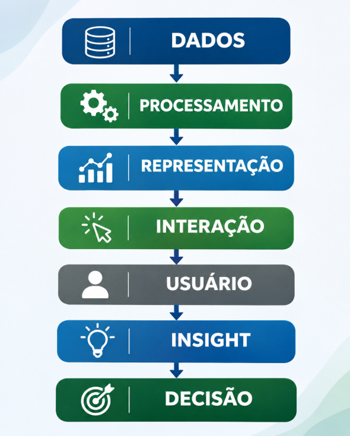
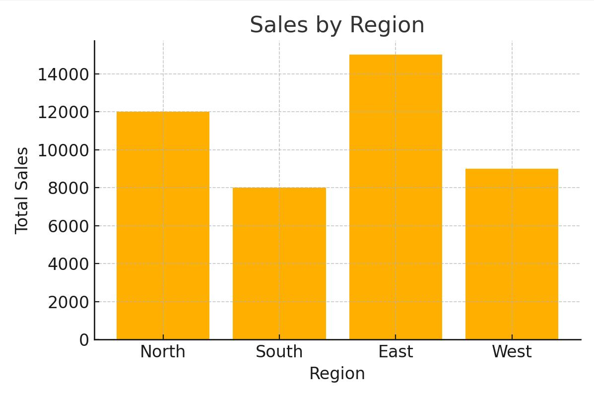
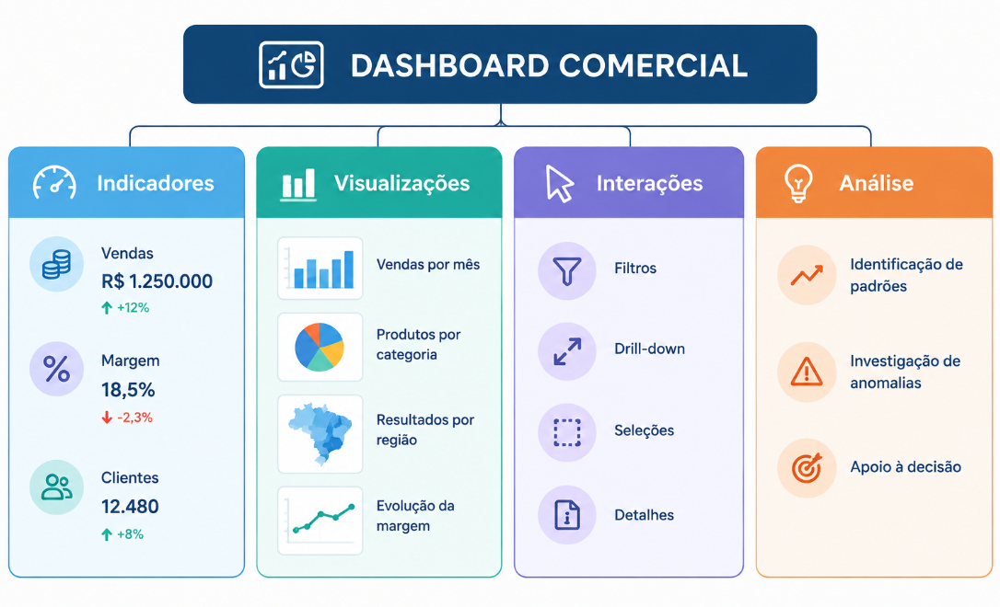
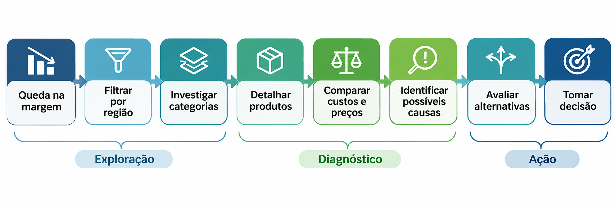

Sistemas de Visualização de Dados
----------------------------------

## Conceito

Um **Sistema de Visualização de Dados** é um ambiente computacional que integra processos de aquisição, tratamento, transformação, representação e exploração interativa de dados, permitindo que usuários identifiquem padrões, tendências, relações e anomalias para apoiar processos analíticos e decisões.

Diferentemente de um gráfico isolado, um sistema de visualização combina múltiplos componentes técnicos, visuais e cognitivos.

Uma maneira didática de representar seu funcionamento é:

Esse fluxo é uma simplificação conceitual. Na prática, o processo é iterativo: o usuário pode retornar às representações, modificar filtros, explorar novas hipóteses e solicitar outros tratamentos dos dados.

**A finalidade do sistema não é apenas apresentar informações visualmente, mas permitir que o usuário explore os dados e construa conhecimento a partir deles.**

## Componentes de um sistema de visualização

| Componente | Função | Exemplo |
|---|---|---|
| Dados | Fornecer a matéria-prima da análise | Vendas, clientes, produtos e regiões |
| Processamento | Preparar e transformar os dados | Limpeza, agregação, normalização e cálculos |
| Representação | Codificar informações em elementos visuais | Gráficos, tabelas, mapas e diagramas |
| Interação | Permitir exploração e manipulação das visualizações | Filtros, zoom, seleção e drill-down |
| Usuário | Interpretar os resultados conforme objetivos e conhecimentos | Analista, gestor, pesquisador |
| Insight | Identificar descobertas relevantes | Redução da margem em determinada região |
| Decisão | Utilizar as descobertas para orientar ações | Rever preços ou estratégias comerciais |

### Dados e processamento

Os dados podem ter origem em bancos relacionais, arquivos CSV, APIs, sensores, aplicações corporativas e outras fontes.

Antes de serem visualizados, frequentemente passam por operações como filtragem, correção de inconsistências, agregação e cálculo de indicadores.

A qualidade dessas operações influencia diretamente a confiabilidade das visualizações.

### Representação visual

A representação transforma atributos e relações dos dados em propriedades perceptíveis, como posição, comprimento, área, cor e tamanho.

Por exemplo:

- Gráficos de barras permitem comparar categorias.
- Gráficos de linhas mostram comportamentos temporais.
- Diagramas de dispersão ajudam a investigar relações entre variáveis.
- Mapas representam distribuições espaciais.
- Treemaps apresentam estruturas hierárquicas.

A escolha da representação deve considerar os tipos de dados, a tarefa analítica e as características perceptivas do usuário.

### Interação

A interação diferencia muitos sistemas analíticos de representações estáticas.

Ela permite que o usuário formule perguntas durante a exploração, modifique perspectivas e investigue informações detalhadas.

Entre as técnicas mais comuns estão:

| Técnica | Descrição |
|---|---|
| Filtragem | Restringe os dados segundo critérios selecionados |
| Zoom | Amplia determinada área da visualização |
| Drill-down | Navega de informações agregadas para níveis detalhados |
| Drill-up | Retorna a níveis superiores de agregação |
| Brushing | Seleciona visualmente subconjuntos de elementos |
| Linking | Coordena seleções entre diferentes visualizações |
| Tooltips | Exibem informações adicionais sobre elementos |
| Ordenação | Reorganiza os elementos segundo atributos |

Essas funcionalidades transformam a visualização em um instrumento de investigação.

## Diferença entre gráfico e sistema de visualização

Um **gráfico** é uma representação visual específica dos dados.

Por exemplo, um gráfico de barras pode apresentar as vendas realizadas em cada região.

Esse gráfico responde principalmente à pergunta:

*Como as vendas variaram em cada região?*

Um **sistema de visualização**, por sua vez, pode integrar diversas representações, mecanismos de interação e recursos de processamento em um ambiente analítico.

### Comparação

| Critério | Gráfico | Sistema de visualização |
|---|---|---|
| Escopo | Representação específica | Ambiente analítico integrado |
| Objetivo | Comunicar ou explorar determinados dados | Apoiar múltiplas tarefas analíticas |
| Visualizações | Uma representação | Pode integrar várias representações |
| Interação | Pode ser estático ou interativo | Geralmente oferece mecanismos de exploração |
| Processamento | Pode ocorrer externamente | Pode integrar operações de transformação |
| Navegação | Limitada à representação | Pode permitir diferentes níveis e perspectivas |
| Integração | Não é obrigatória | Pode conectar fontes e componentes distintos |
| Tomada de decisão | Fornece evidências | Organiza recursos para investigação e decisão |

É importante destacar que um gráfico também pode ser interativo e que nem todo dashboard constitui um sistema analítico completo. A diferença fundamental está na integração de funcionalidades e na capacidade de apoiar tarefas de análise.

## Exemplo prático: sistema de análise comercial

Considere uma empresa que deseja investigar a redução de sua margem de lucro.

Em um relatório tradicional, o gestor poderia consultar um gráfico que apresentasse a evolução mensal da margem.

Em um sistema interativo, a investigação poderia ocorrer em etapas:

1. O usuário identifica uma redução na margem geral.
2. Filtra os resultados por região.
3. Descobre que a queda está concentrada em determinada localidade.
4. Executa um drill-down para visualizar as categorias de produtos.
5. Identifica os produtos que mais contribuíram para a redução.
6. Compara o comportamento de custos, preços e descontos.
7. Formula hipóteses e propõe ações corretivas.

O diferencial está na capacidade de passar de uma observação geral para uma investigação detalhada.

### Da observação à decisão

O sistema não garante que as conclusões estejam corretas. Ele fornece meios para investigar evidências, testar hipóteses e fundamentar decisões.

## Características de um bom sistema de visualização

Um sistema de visualização deve considerar princípios técnicos, perceptivos, cognitivos e funcionais.

Entre os requisitos mais importantes estão:

- **Clareza:** as representações devem facilitar a interpretação.
- **Consistência:** cores, escalas, unidades e padrões de interação devem manter significados coerentes.
- **Explorabilidade:** o usuário deve conseguir investigar diferentes perspectivas.
- **Desempenho:** as interações devem apresentar tempos de resposta adequados.
- **Acessibilidade:** as informações não devem depender exclusivamente de cores ou de um único canal perceptivo.
- **Confiabilidade:** os dados e seus tratamentos precisam ser rastreáveis e compreensíveis.
- **Adequação às tarefas:** as funcionalidades devem responder às necessidades reais dos usuários.

A qualidade de um sistema não deve ser avaliada apenas por sua aparência, mas também por sua capacidade de apoiar a compreensão e a análise.

## Visualização como processo cognitivo

Os sistemas de visualização estabelecem uma conexão entre processamento computacional e percepção humana.

O computador executa operações de armazenamento, cálculo, transformação e representação.

O ser humano utiliza mecanismos perceptivos, memória, conhecimento prévio e raciocínio para interpretar os resultados.

Essa relação pode ser expressa conceitualmente por:

**Computação → Representação → Percepção → Cognição → Conhecimento → Decisão**

A interpretação também depende do contexto: diferentes usuários podem formular hipóteses distintas diante de uma mesma visualização.

Assim, o sistema deve favorecer a exploração, a comparação, a identificação de padrões e a validação de hipóteses.

## Referências para aprofundamento

### IBM — Data Visualization

https://www.ibm.com/br-pt/think/topics/data-visualization

Apresenta fundamentos de visualização de dados, tipos de gráficos, aplicações e sua relação com a análise e a comunicação de informações.

### Tableau — Visual Best Practices

https://help.tableau.com/current/blueprint/en-us/bp_visual_best_practices.htm

Aborda boas práticas de visualização e interatividade em dashboards, incluindo filtros, ações, destaques e exploração orientada ao usuário.

### Tableau — Learning Resources

https://www.tableau.com/learn/articles

Reúne conteúdos sobre visualização, business intelligence, análise de dados e exemplos de aplicações interativas.

### Interaction Design Foundation — Interaction Design

https://assets.interaction-design.org/literature/topics/interaction-design

Discute princípios de design de interação e as relações entre elementos visuais, comportamento dos sistemas e experiência do usuário.

Essas obras oferecem fundamentos sobre sistemas de visualização, percepção, interação e processos analíticos.

## Resumindo

Um gráfico representa dados, enquanto um sistema de visualização organiza recursos computacionais, representacionais e interativos para apoiar um processo de análise.

A principal contribuição desses sistemas não está apenas em tornar os dados visualmente compreensíveis, mas em permitir que os usuários formulem perguntas, explorem hipóteses, identifiquem relações e produzam conhecimento.

Portanto, **a visualização não deve ser compreendida apenas como um produto gráfico, mas como parte de um processo interativo de construção de conhecimento e apoio à decisão**.