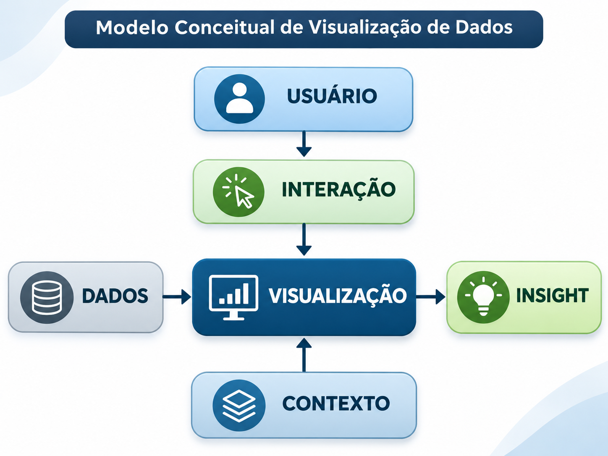
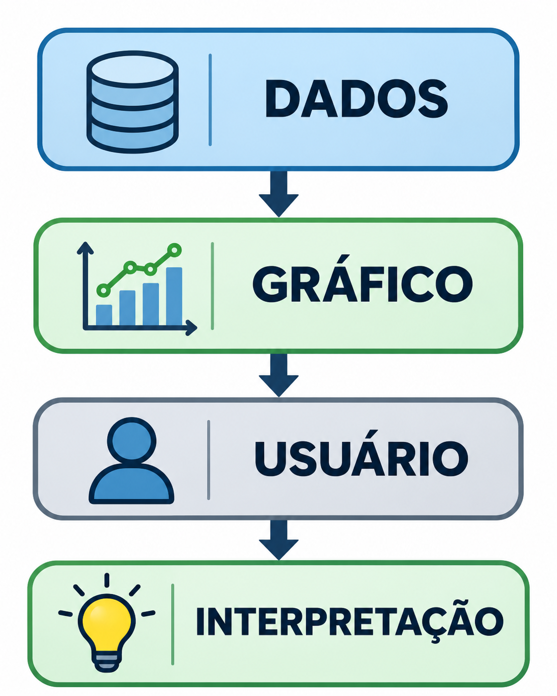
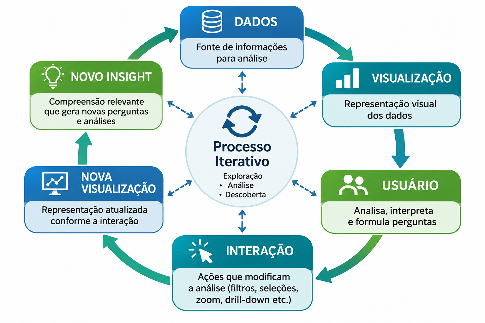
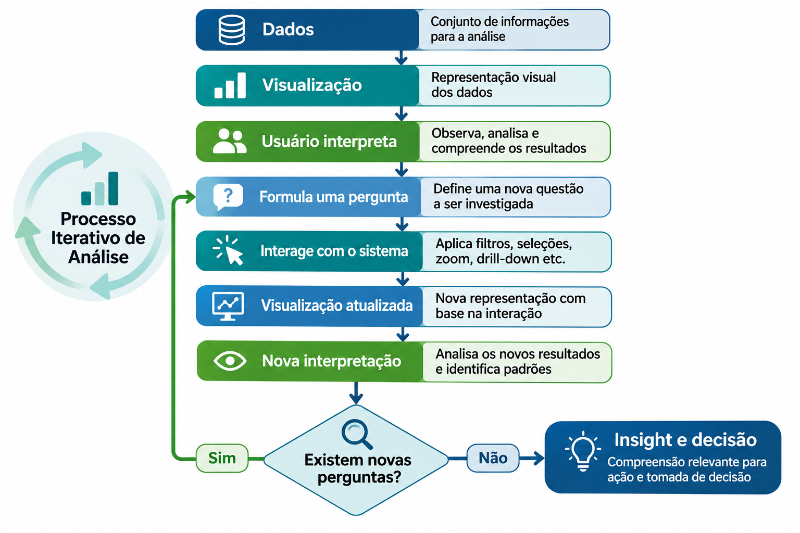
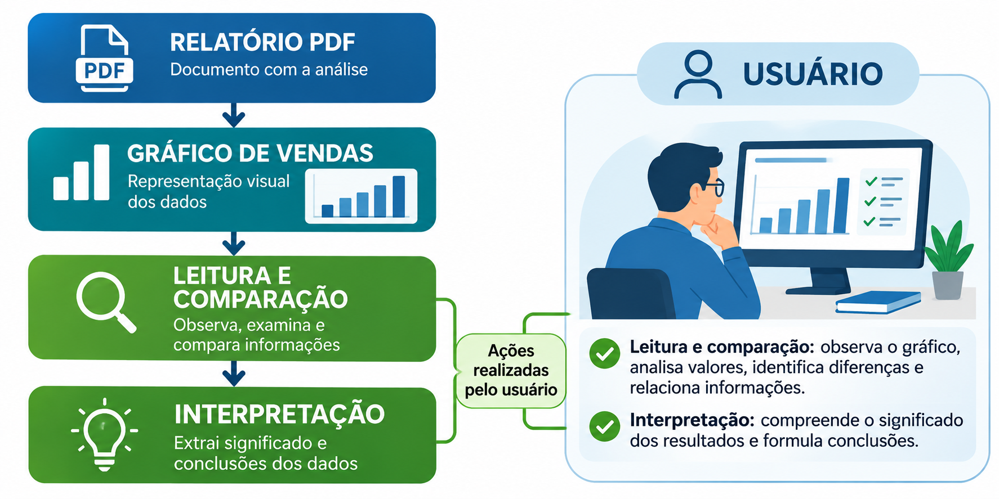
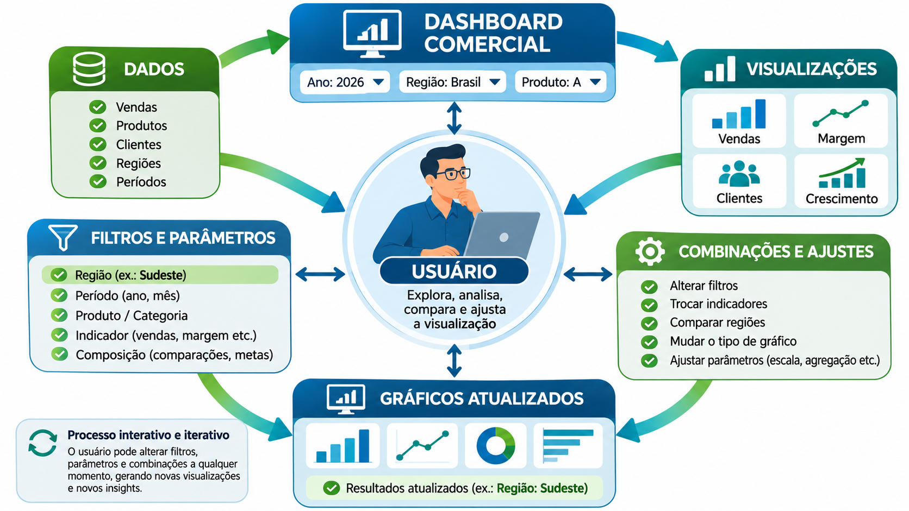
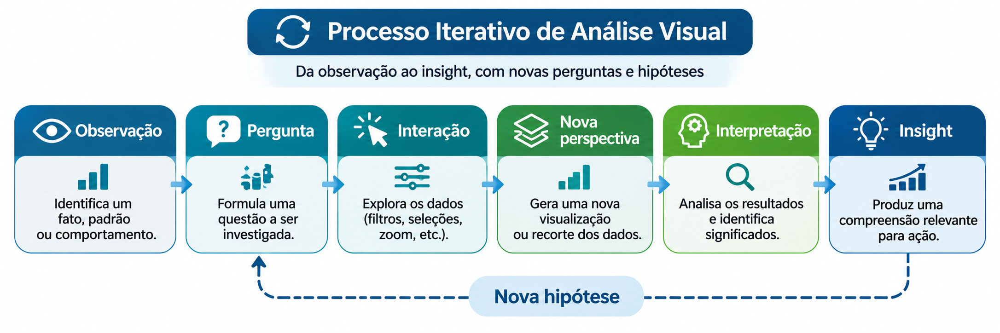

Visualização de Dados Estática e Interativa
------------------------------------------

## Introdução

A visualização de dados constitui um conjunto de métodos e técnicas para representar informações por meio de elementos visuais, como gráficos, mapas, tabelas e diagramas, com o objetivo de facilitar a compreensão de padrões, tendências, relações e anomalias.

Entretanto, nem toda visualização apresenta as mesmas características de funcionamento.

Uma distinção fundamental está entre:

- **Visualização estática:** apresenta uma representação previamente definida, com conteúdo visual fixo.
- **Visualização interativa:** permite que o usuário realize operações que modifiquem a representação, a perspectiva ou o conjunto de dados apresentado.

Essa distinção envolve mais do que características tecnológicas. Ela está relacionada às possibilidades cognitivas, às tarefas analíticas e ao papel exercido pelo usuário durante a interpretação dos dados.

Enquanto a visualização estática normalmente prioriza a **comunicação de informações**, a visualização interativa frequentemente enfatiza a **exploração e a investigação**.

Entretanto, as duas abordagens podem ser utilizadas tanto para análise quanto para comunicação, dependendo de seu projeto e de seu contexto.

---

## Modelo conceitual de visualização de dados

Um sistema de visualização pode ser compreendido como uma estrutura que conecta dados, representações, usuários e processos de interpretação.

Um modelo conceitual simplificado é:

Nesse modelo, a visualização não é compreendida apenas como um produto gráfico, mas como um elemento de um processo analítico mais amplo.

### Elementos do modelo

| Elemento | Função | Exemplo |
|---|---|---|
| Dados | Fornecer informações para análise | Registros de vendas |
| Visualização | Representar atributos e relações visualmente | Gráfico de barras |
| Usuário | Interpretar e investigar as informações | Analista comercial |
| Interação | Modificar perspectivas ou parâmetros da visualização | Selecionar uma região |
| Contexto | Fornecer conhecimentos, objetivos e condições de interpretação | Sazonalidade das vendas |
| Insight | Produzir compreensão relevante a partir da análise | Identificar uma queda regional |

### O papel do contexto

O contexto representa um elemento fundamental na interpretação das informações.

Considere um gráfico que apresenta uma queda de 20% nas vendas de determinado produto.

Isoladamente, essa informação pode sugerir um desempenho negativo.

Entretanto, a interpretação pode mudar quando são consideradas outras informações:

- O produto possui comportamento sazonal?
- Houve redução temporária de estoque?
- A empresa interrompeu uma campanha promocional?
- O mesmo comportamento ocorreu em outras regiões?
- O mercado apresentou uma redução semelhante?

Portanto, **um mesmo conjunto de dados pode produzir interpretações diferentes quando analisado em contextos distintos**.

### O papel da interação

Em sistemas interativos, o usuário deixa de ser exclusivamente um observador das representações disponibilizadas.

Ele passa a exercer influência sobre aquilo que está sendo apresentado, utilizando mecanismos para modificar escalas, selecionar categorias, aplicar filtros, consultar detalhes e comparar informações.

A interação torna-se, assim, um componente do próprio processo de análise.

---

## Visualização como produto e como processo

Uma distinção importante está na maneira como a visualização participa da construção do conhecimento.

Na visualização estática, a representação costuma ser apresentada como um produto previamente elaborado.

Na visualização interativa, a representação pode ser continuamente modificada durante a investigação.

### Visualização estática

Nesse modelo, o autor da visualização realiza antecipadamente escolhas relacionadas aos dados apresentados, à escala, às cores, ao tipo de gráfico e à organização dos elementos.

O usuário recebe uma representação visual já definida.

Isso não significa que sua interpretação seja passiva. O observador continua realizando operações cognitivas, como comparação, reconhecimento de padrões e formulação de hipóteses.

Entretanto, ele não modifica diretamente a representação disponibilizada.

### Visualização interativa

Nesse modelo, as operações realizadas pelo usuário podem alterar aquilo que está sendo visualizado.

O processo pode envolver diferentes ciclos de exploração:

Esse comportamento caracteriza a natureza **iterativa da exploração visual**.

O usuário interpreta uma representação, formula uma pergunta, modifica parâmetros e observa os resultados.

A resposta obtida pode conduzir a novas perguntas, dando continuidade ao processo de investigação.

---

## Visualização estática

A visualização estática é caracterizada por apresentar uma composição visual previamente estabelecida, que não pode ser modificada diretamente pelo usuário durante sua consulta.

Ela pode ser distribuída por diferentes meios, como:

- Documentos PDF.
- Relatórios impressos.
- Artigos científicos.
- Livros e materiais acadêmicos.
- Apresentações.
- Imagens PNG, JPEG ou SVG não interativas.
- Infográficos.

### Exemplo conceitual

Considere um relatório corporativo contendo um gráfico com as vendas mensais de uma empresa.

O autor define quais meses serão apresentados, quais métricas serão utilizadas e como os valores serão representados.

O leitor pode observar os resultados e identificar tendências, mas não consegue modificar os filtros diretamente no gráfico.

### Vantagens da visualização estática

| Vantagem | Descrição |
|---|---|
| Simplicidade | Geralmente exige poucos conhecimentos técnicos do usuário |
| Distribuição | Pode ser compartilhada por documentos, imagens e apresentações |
| Consistência | Todos os leitores recebem uma mesma composição visual |
| Narrativa | Permite controlar a sequência de apresentação das informações |
| Reprodutibilidade visual | Facilita preservar uma versão específica da representação |
| Desempenho | Não exige processamento interativo durante a consulta |
| Documentação | É adequada para relatórios, publicações e registros históricos |

### Limitações

A principal limitação da visualização estática está na ausência de mecanismos para modificar diretamente a representação.

Por exemplo, ao observar um gráfico de vendas nacionais, o usuário pode desejar investigar apenas os resultados de São Paulo.

Se essa informação não estiver contemplada na representação original, será necessário consultar outro gráfico, outra tabela ou solicitar uma nova análise.

Isso reduz a flexibilidade da exploração.

Entretanto, essa limitação pode ser aceitável quando o objetivo principal é comunicar uma conclusão específica com clareza.

---

## Visualização interativa

A visualização interativa é caracterizada pela possibilidade de o usuário realizar ações que alteram a representação ou a perspectiva dos dados.

Essas ações podem envolver modificações no conjunto de dados, na escala, nos parâmetros de visualização ou no nível de detalhamento apresentado.

### Exemplo conceitual

Considere um dashboard comercial com os seguintes controles:

Nesse exemplo, uma alteração realizada pelo usuário modifica o conjunto de informações apresentado.

A visualização não precisa ser reconstruída manualmente: o próprio sistema executa o processamento necessário para apresentar a nova perspectiva.

### Principais mecanismos de interação

| Mecanismo | Descrição | Exemplo |
|---|---|---|
| Filtragem | Seleciona subconjuntos dos dados | Visualizar somente determinada região |
| Zoom | Modifica a escala de observação | Ampliar um intervalo temporal |
| Pan | Desloca a área visualizada | Navegar por um mapa |
| Drill-down | Apresenta níveis mais detalhados | País → Estado → Cidade |
| Drill-up | Retorna a níveis superiores | Cidade → Estado |
| Brushing | Seleciona elementos diretamente na representação | Marcar pontos de um scatter plot |
| Linking | Coordena seleções entre diferentes gráficos | Selecionar uma categoria e destacar os dados relacionados |
| Tooltip | Apresenta informações adicionais sob demanda | Consultar o valor exato de um indicador |
| Ordenação | Modifica a organização dos elementos | Ordenar produtos por faturamento |
| Alteração de parâmetros | Permite modificar variáveis da análise | Selecionar um indicador diferente |

### Vantagens da visualização interativa

A visualização interativa oferece vantagens relevantes quando o objetivo envolve investigação e descoberta.

**Exploração:** o usuário pode examinar diferentes subconjuntos de dados e investigar novas perguntas.

**Descoberta:** a possibilidade de modificar perspectivas favorece a identificação de padrões e relações que poderiam não estar evidentes inicialmente.

**Personalização:** diferentes usuários podem ajustar a visualização conforme seus interesses e necessidades.

**Investigação:** recursos de filtragem e detalhamento permitem examinar hipóteses e buscar possíveis explicações para os fenômenos observados.

**Flexibilidade:** um mesmo ambiente pode apoiar diferentes tarefas analíticas sem exigir a criação manual de novas representações.

### Limitações

A interatividade também apresenta desafios:

- Pode aumentar a complexidade da interface.
- Exige mecanismos de navegação compreensíveis.
- Pode introduzir tempos de resposta.
- Depende de implementação e manutenção adequadas.
- Pode dificultar a reprodução de um estado específico da análise.
- Pode gerar sobrecarga cognitiva quando oferece controles excessivos.

Assim, o valor da interatividade deve ser avaliado em relação às tarefas que ela efetivamente permite realizar.

---

## Comparação entre visualização estática e interativa

| Critério | Visualização estática | Visualização interativa |
|---|---|---|
| Natureza | Representação previamente definida | Representação modificável |
| Participação do usuário | Interpretação e análise visual | Interpretação e manipulação da representação |
| Atualização visual | Depende de nova publicação ou geração | Pode ocorrer mediante interação |
| Exploração | Limitada às perspectivas apresentadas | Permite diferentes perspectivas |
| Narrativa | Geralmente mais controlada pelo autor | Pode ser conduzida pelo usuário |
| Personalização | Limitada | Geralmente mais ampla |
| Complexidade técnica | Frequentemente menor | Frequentemente maior |
| Distribuição | Geralmente simples | Pode depender de aplicações ou plataformas |
| Reprodução de resultados | Facilitada por uma representação fixa | Pode exigir registro de filtros e parâmetros |
| Investigação de hipóteses | Depende das informações disponíveis | Pode incorporar diferentes ciclos exploratórios |
| Aplicações típicas | Relatórios, artigos e apresentações | Dashboards, plataformas analíticas e mapas interativos |

As diferenças apresentadas representam tendências gerais, não regras absolutas.

Uma visualização estática pode ser sofisticada e cognitivamente exigente, enquanto uma visualização interativa pode ser simples e possuir poucos controles.

---

## Interatividade e descoberta de conhecimento

A exploração interativa está fortemente relacionada ao processo de descoberta de conhecimento.

Considere um analista investigando o desempenho de uma rede de transporte público.

Inicialmente, ele visualiza o volume de passageiros por estação.

Em seguida, identifica uma estação com volume significativamente superior às demais.

Para investigar o fenômeno, realiza operações sucessivas:

1. Seleciona a estação.
2. Consulta o número de funcionários disponíveis.
3. Compara a relação entre passageiros e funcionários.
4. Examina indicadores de limpeza e segurança.
5. Analisa a satisfação dos usuários.
6. Compara os resultados com outras estações.
7. Formula uma hipótese sobre a distribuição operacional de recursos.

O processo pode ser representado por:

Nesse caso, a interatividade não é apenas uma funcionalidade adicional.

Ela participa diretamente da construção do conhecimento, permitindo que novas perguntas sejam formuladas a partir dos resultados encontrados.

---

## Interatividade não é automaticamente melhor

Uma questão pedagógica importante é compreender que **a presença de mecanismos interativos não significa, necessariamente, uma visualização de maior qualidade**.

Considere a seguinte pergunta:

> Um gráfico interativo é sempre melhor que um gráfico estático?

**A resposta é não.**

A qualidade de uma visualização depende de sua adequação aos dados, às tarefas, aos usuários e ao contexto em que será utilizada.

### Quando a interatividade pode prejudicar

| Problema | Consequência |
|---|---|
| Interação sem propósito | Adiciona funcionalidades que não contribuem para a análise |
| Controles pouco evidentes | Dificulta descobrir como utilizar o sistema |
| Complexidade excessiva | Aumenta a carga cognitiva |
| Muitas opções simultâneas | Dificulta identificar quais ações são relevantes |
| Navegação confusa | Prejudica a orientação do usuário |
| Falta de resposta visual | Torna difícil perceber o resultado de uma ação |
| Interações inconsistentes | Reduz a previsibilidade do sistema |
| Dependência de interação | Pode esconder informações que deveriam estar imediatamente disponíveis |

### Exemplo comparativo

Imagine a necessidade de comunicar que o faturamento de uma empresa cresceu 15% em determinado período.

Se o objetivo é apresentar essa conclusão em um relatório executivo, um gráfico estático bem elaborado pode comunicar a informação de maneira direta.

Adicionar filtros, seleções, menus e mecanismos de navegação pode introduzir complexidade sem produzir benefícios relevantes.

Por outro lado, se o objetivo é descobrir por que o faturamento cresceu, quais produtos contribuíram para o resultado e quais regiões apresentaram melhor desempenho, recursos interativos podem ser úteis.

Portanto, a escolha depende da natureza da tarefa.

### Princípio fundamental

**Toda interação deve possuir uma finalidade analítica ou comunicacional claramente identificável.**

Antes de incorporar um mecanismo interativo, o engenheiro deve perguntar:

- Qual pergunta o usuário pretende responder?
- Que operação será necessária para responder a essa pergunta?
- A interação facilita a interpretação?
- O mesmo resultado poderia ser comunicado de forma mais simples?
- O benefício justifica a complexidade adicionada?

Essas questões ajudam a evitar que a interatividade seja utilizada apenas como um recurso estético ou tecnológico.

---

## Critérios para selecionar o tipo de visualização

A escolha entre uma visualização estática e uma interativa deve considerar diferentes fatores.

| Situação | Abordagem geralmente recomendada | Justificativa |
|---|---|---|
| Relatório executivo com conclusões definidas | Estática | Favorece comunicação direta |
| Artigo científico impresso | Estática | Facilita publicação e reprodução visual |
| Apresentação acadêmica | Estática ou combinação | Permite controlar a narrativa |
| Investigação exploratória de dados | Interativa | Facilita formular e investigar hipóteses |
| Monitoramento operacional | Interativa | Permite examinar indicadores e períodos |
| Dashboard gerencial | Interativa | Integra diferentes perspectivas |
| Infográfico informativo | Estática | Prioriza clareza e comunicação |
| Análise geoespacial exploratória | Interativa | Permite filtros, navegação e detalhamento |

Uma estratégia importante é combinar as duas abordagens.

Por exemplo, um analista pode utilizar um dashboard interativo para investigar determinado fenômeno e, posteriormente, produzir uma visualização estática para comunicar os resultados da investigação.

Nesse cenário, a visualização interativa apoia a descoberta, enquanto a representação estática contribui para a apresentação das conclusões.

---

## Visualização exploratória e visualização explicativa

A distinção entre visualização estática e interativa apresenta relação com duas finalidades importantes: exploração e explicação.

### Visualização exploratória

A visualização exploratória é utilizada quando o analista ainda está investigando os dados.

Seu objetivo envolve descobrir padrões, identificar anomalias, examinar relações e formular hipóteses.

A interatividade frequentemente contribui para essas tarefas, pois permite modificar perspectivas durante a investigação.

### Visualização explicativa

A visualização explicativa busca comunicar uma descoberta, uma conclusão ou uma mensagem previamente identificada.

Nessa abordagem, o autor pode organizar elementos visuais de forma a orientar a interpretação do leitor.

Representações estáticas são frequentemente utilizadas para essa finalidade, embora sistemas interativos também possam oferecer experiências explicativas.

### Relação entre as abordagens

| Finalidade | Pergunta principal | Característica |
|---|---|---|
| Exploratória | O que os dados podem revelar? | Investigação aberta |
| Explicativa | O que precisamos comunicar sobre os dados? | Comunicação orientada |
| Estática | Como apresentar uma visão definida? | Representação fixa |
| Interativa | Como permitir diferentes formas de exploração? | Representação modificável |

É importante não confundir essas classificações.

**Estática e interativa descrevem características de funcionamento da representação. Exploratória e explicativa descrevem finalidades de utilização.**

Uma visualização pode ser estática e exploratória, ou interativa e explicativa.

---

## Fundamentos teóricos

### Ben Shneiderman — Information Seeking Mantra

Shneiderman propôs, em 1996, uma orientação para o projeto de sistemas de visualização interativa:

*[Overview first, zoom and filter, then details-on-demand.](https://www.computer.org/csdl/proceedings-article/vl/1996/75080336/12OmNA14A55)*

Em português:

**Visão geral primeiro; depois, zoom e filtros; por fim, detalhes sob demanda.**

O princípio destaca a importância de permitir que o usuário compreenda inicialmente a estrutura geral das informações e, posteriormente, investigue subconjuntos específicos.

### Tamara Munzner — Visualization Analysis and Design

[Munzner](https://scholar.google.com/citations?user=c2Att08AAAAJ&hl=en) destaca que o projeto de visualizações deve considerar os dados, as tarefas analíticas, as escolhas de representação e interação e os mecanismos computacionais.

Sua abordagem enfatiza que as decisões de projeto devem ser avaliadas em relação aos problemas que o sistema pretende resolver.

### Colin Ware — Percepção e visualização

[Ware](https://scholar.google.com/citations?user=e6C_dHAAAAAJ&hl=en) investiga a relação entre percepção humana, atenção visual e representação de informações.

Seus estudos ajudam a compreender como escolhas visuais e mecanismos de interação podem influenciar o desempenho cognitivo dos usuários.

### Jeffrey Heer e colaboradores — Interação e visualização

Pesquisas de [Jeffrey Heer](https://scholar.google.com/citations?user=vlgs4G4AAAAJ&hl=en) e colaboradores abordam o projeto e a avaliação de sistemas interativos, incluindo mecanismos de seleção, coordenação entre visualizações e ferramentas de exploração.

Essas contribuições demonstram que a interatividade deve ser compreendida como parte do processo de raciocínio apoiado por representações visuais.

---

## Resumindo

As visualizações estáticas e interativas representam abordagens complementares para a apresentação e análise de informações.

A visualização estática favorece a comunicação controlada de resultados, oferecendo simplicidade, consistência e facilidade de distribuição.

A visualização interativa amplia as possibilidades de exploração, permitindo que o usuário modifique perspectivas, investigue hipóteses e produza novas interpretações durante o processo analítico.

Entretanto, a interatividade não representa um indicador absoluto de qualidade.

A escolha da abordagem deve considerar os objetivos analíticos, as características dos dados, as necessidades dos usuários e a complexidade das tarefas.

**Uma visualização eficiente não é necessariamente aquela que oferece mais recursos, mas aquela que permite compreender os dados e realizar as tarefas pretendidas com clareza, precisão e esforço adequado.**