Edward R. Tufte
-------------------------


Edward R. Tufte, sua trajetória acadêmica, contribuições para a visualização de informações, princípios de design gráfico, principais publicações, conceitos fundamentais e exemplos de aplicação.


# Edward R. Tufte: fundamentos da visualização de dados e do design da informação

##  Quem é Edward R. Tufte?

Edward Rolf Tufte é estatístico, professor emérito, pesquisador e artista norte-americano, reconhecido internacionalmente por suas contribuições ao campo da visualização de dados (Data Visualization) e do design da informação (Information Design).

Seu trabalho investiga como representar informações quantitativas e qualitativas de maneira visualmente eficiente, precisa e intelectualmente honesta.

Tufte defende que uma boa visualização deve permitir que o observador compreenda os dados, identifique padrões, compare informações e construa interpretações sem ser induzido ao erro por escolhas gráficas inadequadas.

Sua produção acadêmica e editorial estabeleceu importantes referências para:

- Visualização de dados estatísticos.
- Representação gráfica de informações multidimensionais.
- Design de tabelas, mapas e diagramas.
- Comunicação visual de evidências.
- Integridade e clareza na apresentação de dados.
- Relação entre percepção visual, raciocínio e interpretação.

Tufte estudou Estatística na Universidade Stanford, onde obteve graduação e mestrado, e concluiu seu doutorado em Ciência Política na Universidade Yale, em 1968. Lecionou em Princeton e Yale, tendo atuado em áreas como Ciência Política, Estatística e Ciência da Computação.


##  A contribuição de Tufte para a visualização de dados

Antes da popularização das ferramentas digitais de visualização, grande parte da produção de gráficos estava associada à apresentação de informações de maneira essencialmente ilustrativa.

Tufte ajudou a consolidar uma abordagem mais analítica: os gráficos não deveriam apenas ilustrar números, mas funcionar como instrumentos de investigação, comparação e descoberta.

Essa perspectiva estabelece uma relação direta entre três elementos:


A representação gráfica, portanto, não é apenas uma etapa estética. Ela participa diretamente do processo de análise e construção do conhecimento.

##  Os principais livros de Edward Tufte

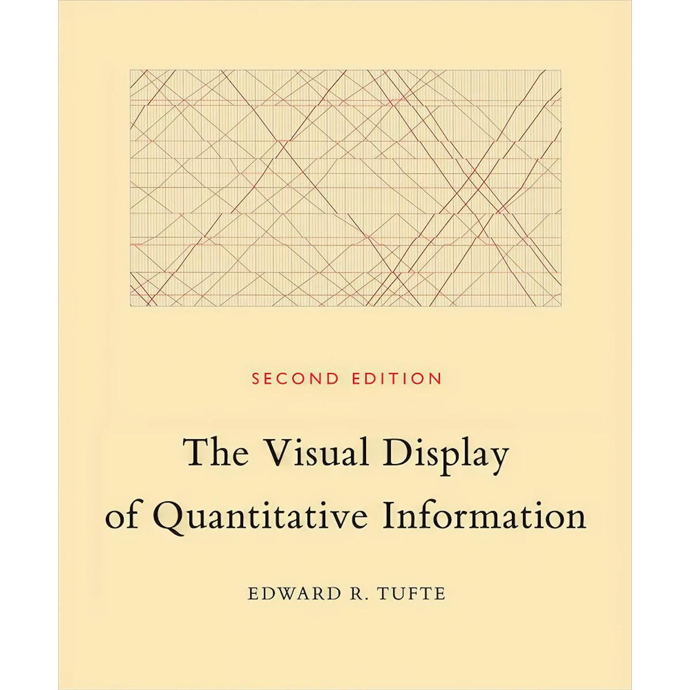

### The Visual Display of Quantitative Information (1983)

Considerado seu trabalho mais conhecido, apresenta fundamentos para a representação gráfica de dados quantitativos.

Aborda:

- Integridade estatística dos gráficos.
- Densidade de informação.
- Comparações visuais.
- Séries temporais.
- Qualidade das representações gráficas.


### Envisioning Information (1990)

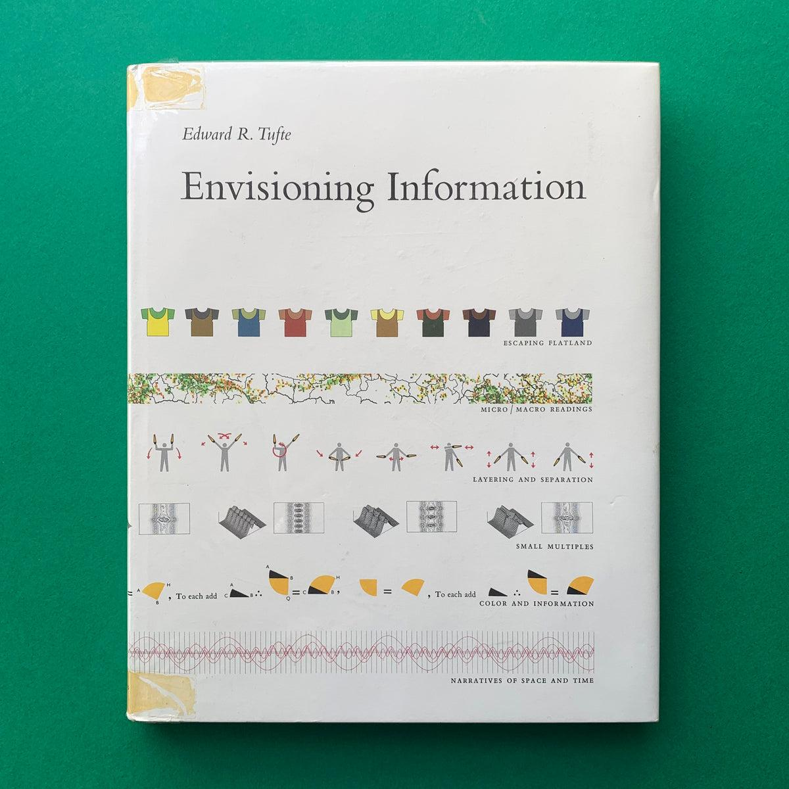

Explora como organizar e representar informações complexas em espaços visuais bidimensionais.

Aborda:

- Mapas e informações geográficas.
- Representações multidimensionais.
- Camadas de informação.
- Uso de cores.
- Diagramas e estruturas visuais.


### Visual Explanations (1997)

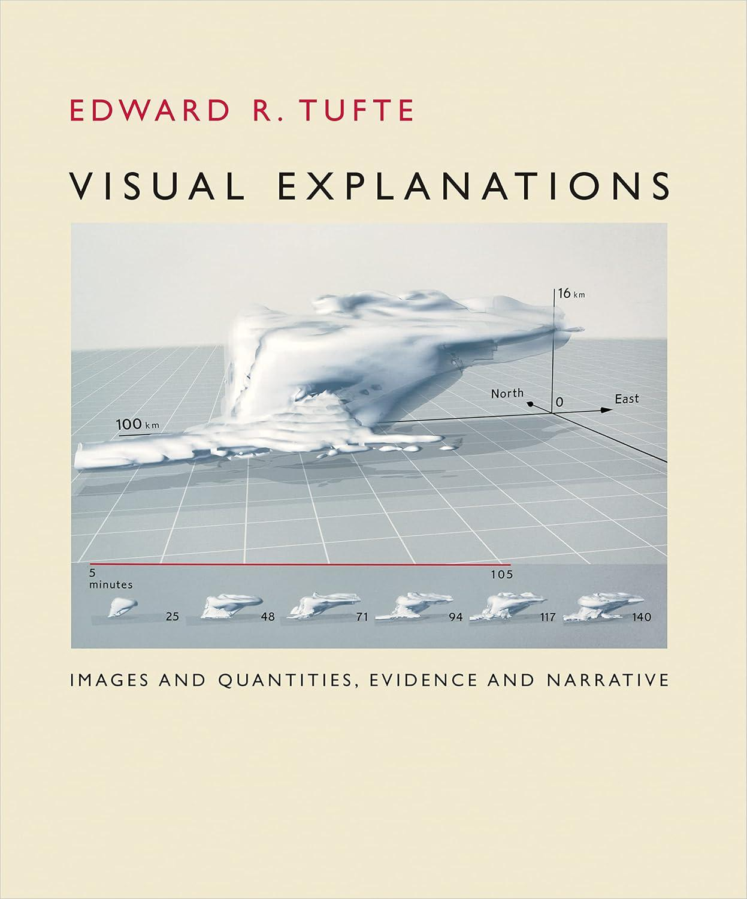


Investiga como imagens e gráficos podem explicar fenômenos, demonstrar evidências e comunicar relações de causa e efeito.

Aborda:

- Narrativas visuais.
- Representação de fenômenos.
- Explicação de processos.
- Evidências científicas.
- Sequências temporais.

### Beautiful Evidence (2006)

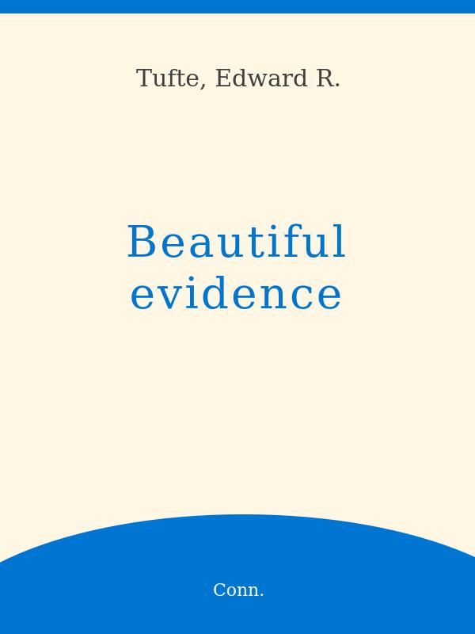

Discute a relação entre evidências, documentação, apresentação e raciocínio visual.

Aborda:

- Evidências e demonstrações.
- Documentação visual.
- Integração entre texto e imagem.
- Apresentações analíticas.
- Comunicação de descobertas.


### Seeing with Fresh Eyes: Meaning, Space, Data, Truth

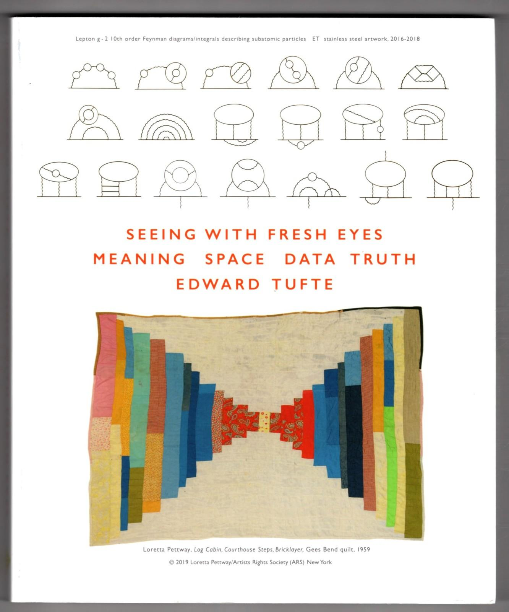

Obra mais recente, amplia suas reflexões sobre percepção, significado, representação e verdade.

Aborda:

- Observação e percepção.
- Relação entre espaço e informação.
- Representações visuais.
- Conhecimento e interpretação.

As publicações e suas descrições podem ser consultadas no site oficial do autor.&#x20;

##  Princípios fundamentais de Tufte

A contribuição de Tufte é particularmente importante porque estabelece critérios para avaliar se uma representação gráfica comunica informações de maneira adequada.

###  Acima de tudo, mostre os dados (Above All Else, Show the Data)

O objetivo principal de um gráfico deve ser apresentar os dados de maneira que suas características sejam percebidas e analisadas.

Elementos decorativos não devem competir com a informação.

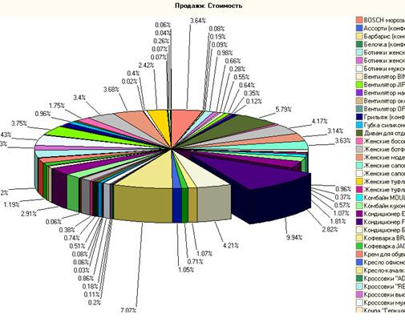

````text
Representação inadequada

Efeitos tridimensionais e decoração dificultam a comparação.
````

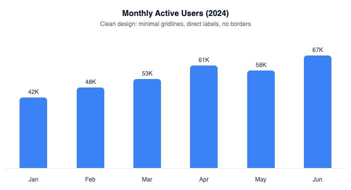
````text
Representação mais eficiente

Os dados recebem destaque e facilitam a interpretação.
````


###  Maximizar a proporção entre informação e elementos gráficos

O conceito conhecido como data-ink ratio propõe que a representação utilize seus elementos gráficos prioritariamente para comunicar dados.

A ideia é evitar que grandes quantidades de tinta, pixels ou espaço visual sejam consumidas por elementos sem contribuição informativa.

Exemplos de elementos que podem ser desnecessários:

- Bordas excessivamente destacadas.
- Grades muito fortes.
- Sombras e efeitos tridimensionais.
- Ilustrações decorativas.
- Repetição de informações já apresentadas.

É importante observar que isso não significa eliminar todos os elementos auxiliares. Grades, rótulos e legendas podem ser essenciais para a interpretação.

###  Eliminar elementos gráficos desnecessários (Chartjunk)

Chartjunk é a expressão utilizada por Tufte para caracterizar elementos gráficos que prejudicam a comunicação da informação.

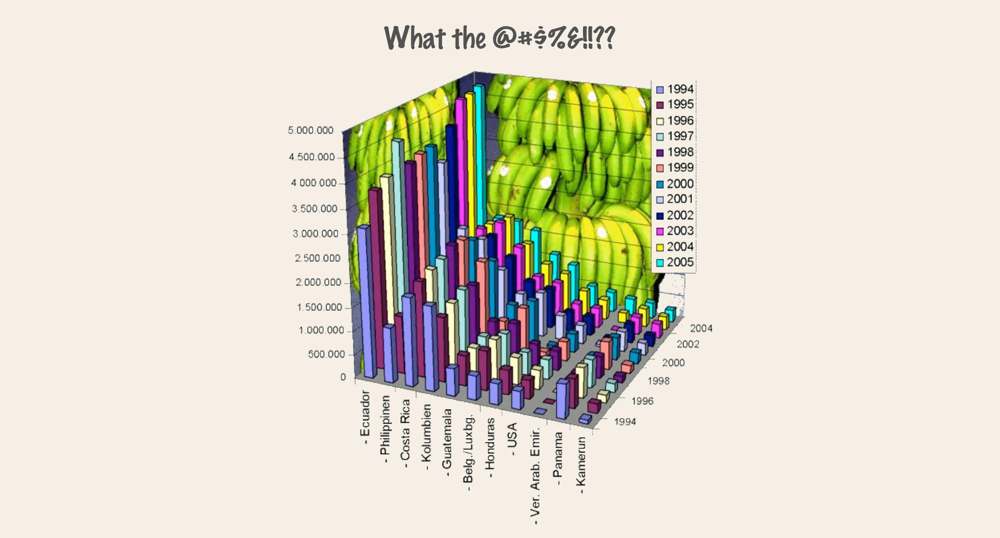

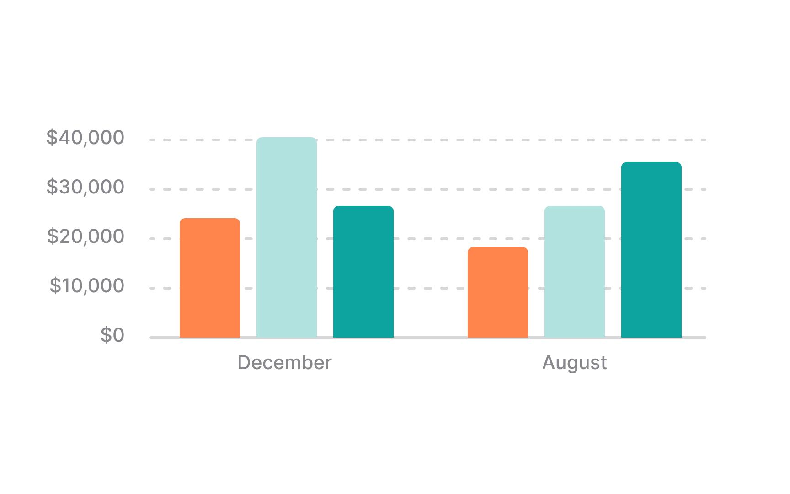

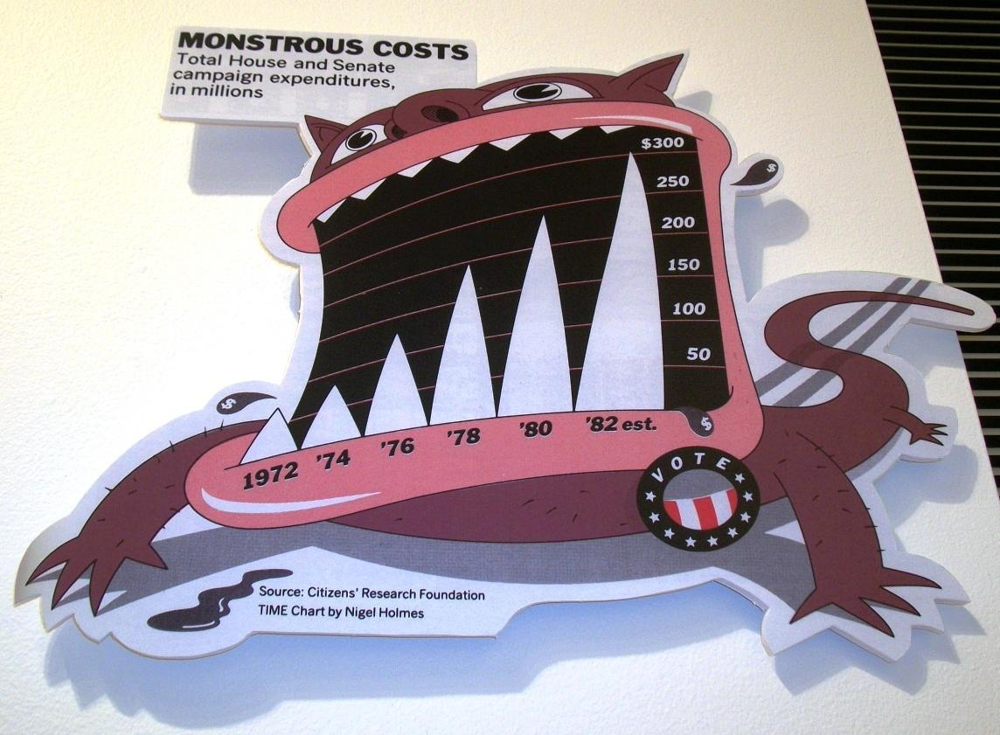


Exemplos:

- Gráficos tridimensionais sem justificativa analítica.
- Texturas e imagens de fundo.
- Ornamentação excessiva.
- Ícones que não acrescentam informação.
- Efeitos visuais que dificultam a comparação.

A finalidade não é produzir gráficos necessariamente simples, mas gráficos em que cada elemento tenha uma função comunicativa.

###  Evitar a redundância visual

A repetição de elementos gráficos pode ocupar espaço e dificultar a leitura.

Um exemplo seria apresentar simultaneamente valores completos, rótulos repetidos e elementos visuais que já comunicam exatamente a mesma informação.

A redundância, entretanto, pode ser útil quando reforça a compreensão ou melhora a acessibilidade. O problema está na repetição sem benefício interpretativo.

###  Revisar e aperfeiçoar continuamente (Revise and Edit)

Uma visualização deve passar por um processo de revisão.

É importante verificar:

- Se os dados estão corretos.
- Se a escala está adequada.
- Se as comparações são possíveis.
- Se existem distorções visuais.
- Se os elementos gráficos são necessários.
- Se a mensagem está clara.

##  Conceitos importantes associados ao trabalho de Tufte

| Conceito              | Descrição                                                                               | Aplicação                                       |
| --------------------- | --------------------------------------------------------------------------------------- | ----------------------------------------------- |
| Data-Ink Ratio        | Relação entre os elementos gráficos que representam dados e o total de tinta utilizado. | Reduzir elementos decorativos.                  |
| Chartjunk             | Elementos visuais desnecessários que prejudicam a compreensão.                          | Eliminar ornamentação excessiva.                |
| Lie Factor            | Relação entre o efeito visual apresentado e a magnitude real dos dados.                 | Identificar distorções gráficas.                |
| Small Multiples       | Pequenos gráficos organizados em uma estrutura comparativa.                             | Comparar categorias, períodos e regiões.        |
| Sparklines            | Pequenos gráficos de alta densidade informacional, incorporados ao texto ou a tabelas.  | Apresentar tendências em dashboards.            |
| Graphical Integrity   | Integridade na representação gráfica dos dados.                                         | Evitar escalas e proporções enganosas.          |
| Multivariate Displays | Representações que permitem observar múltiplas variáveis simultaneamente.               | Investigar relações entre diferentes dimensões. |

###  Lie Factor: quando um gráfico distorce a realidade

O Lie Factor é um conceito importante para avaliar a integridade de uma representação gráfica.

Sua formulação compara a variação visual percebida com a variação numérica efetivamente existente.

$$
 Lie\ Factor = \frac{\text{Efeito visual apresentado}} {\text{Efeito numérico nos dados}}
$$

Um valor muito diferente de 1 indica que a representação pode estar exagerando ou minimizando a variação.

Por exemplo, se um indicador aumenta de 100 para 110, o crescimento real é de 10%. Uma representação que sugira visualmente um aumento de 50% apresenta uma distorção.

###  Small Multiples: comparação por repetição organizada

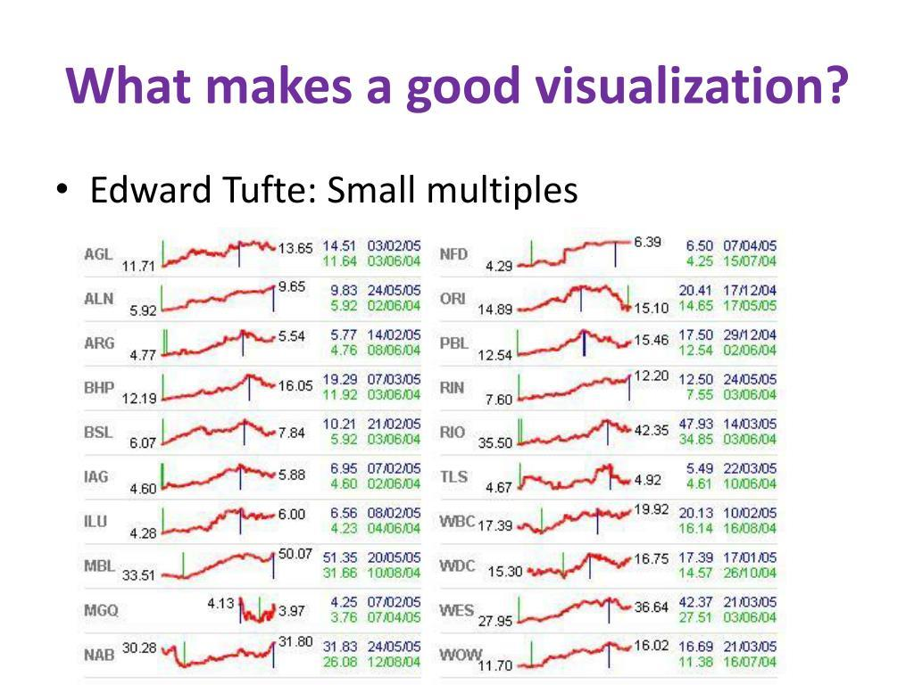


Os Small Multiples consistem na utilização de vários gráficos pequenos, construídos segundo uma estrutura visual consistente.

Cada gráfico representa uma categoria, período ou região.

Essa técnica facilita:

- Comparações entre períodos.
- Identificação de padrões.
- Comparação entre diferentes grupos.
- Identificação de comportamentos excepcionais.

O principal benefício é permitir que o observador compare informações sem precisar interpretar gráficos completamente diferentes.

###  Sparklines: gráficos incorporados ao contexto

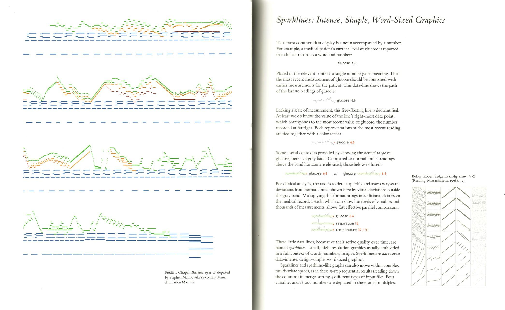


As Sparklines são pequenos gráficos que apresentam tendências e variações diretamente dentro de textos, tabelas ou indicadores.

São particularmente úteis em:

- Relatórios gerenciais.
- Dashboards.
- Indicadores de desempenho.
- Relatórios financeiros.
- Acompanhamento de séries temporais.

Por exemplo, uma tabela de indicadores pode apresentar o valor atual de cada indicador acompanhado de uma pequena linha que demonstra sua evolução histórica.

## Integridade e qualidade das visualizações

Um dos aspectos mais relevantes do trabalho de Tufte é a preocupação com a integridade das representações.

Uma visualização pode ser visualmente atraente e, ainda assim, transmitir uma interpretação incorreta.

Algumas práticas que merecem atenção:

| Problema                                                    | Consequência                            |
| ----------------------------------------------------------- | --------------------------------------- |
| Cortar o eixo de um gráfico de barras sem deixar isso claro | Exagerar diferenças.                    |
| Utilizar áreas desproporcionais                             | Distorcer comparações quantitativas.    |
| Escolher escalas inadequadas                                | Ocultar tendências ou variações.        |
| Utilizar cores sem significado consistente                  | Dificultar a interpretação.             |
| Omitir informações relevantes                               | Produzir conclusões incompletas.        |
| Misturar períodos diferentes                                | Criar comparações inválidas.            |
| Utilizar gráficos tridimensionais sem necessidade           | Comprometer a percepção das magnitudes. |

Princípio central: a visualização deve representar as evidências disponíveis, e não manipular a percepção do observador para sustentar uma conclusão previamente escolhida.

## Aplicações práticas na visualização de dados

Os princípios de Tufte podem ser aplicados em diferentes contextos profissionais e acadêmicos.

### Business Intelligence

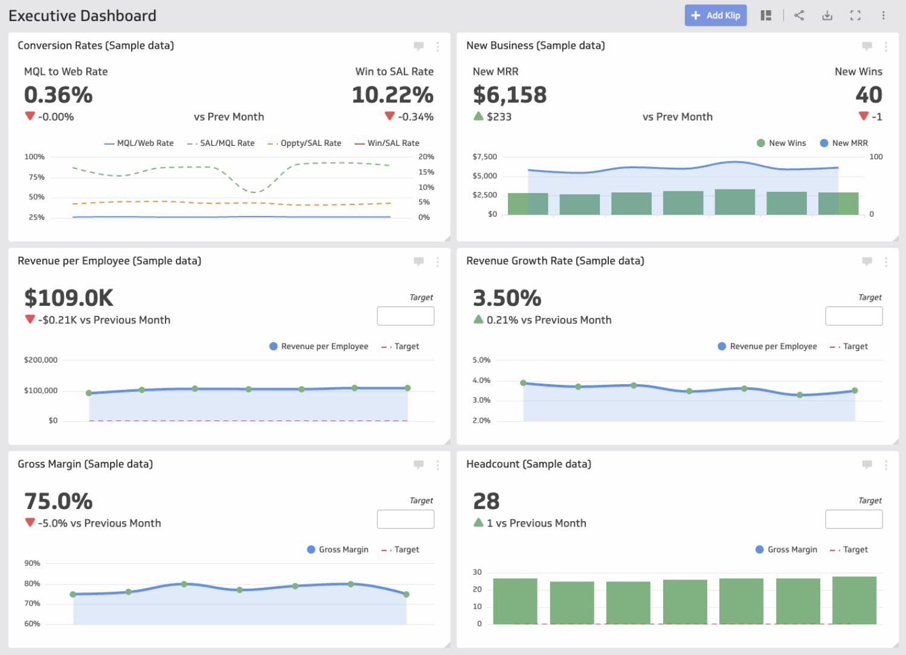


Construção de dashboards com indicadores relevantes, comparação de resultados e redução de elementos desnecessários.

### Pesquisa científica

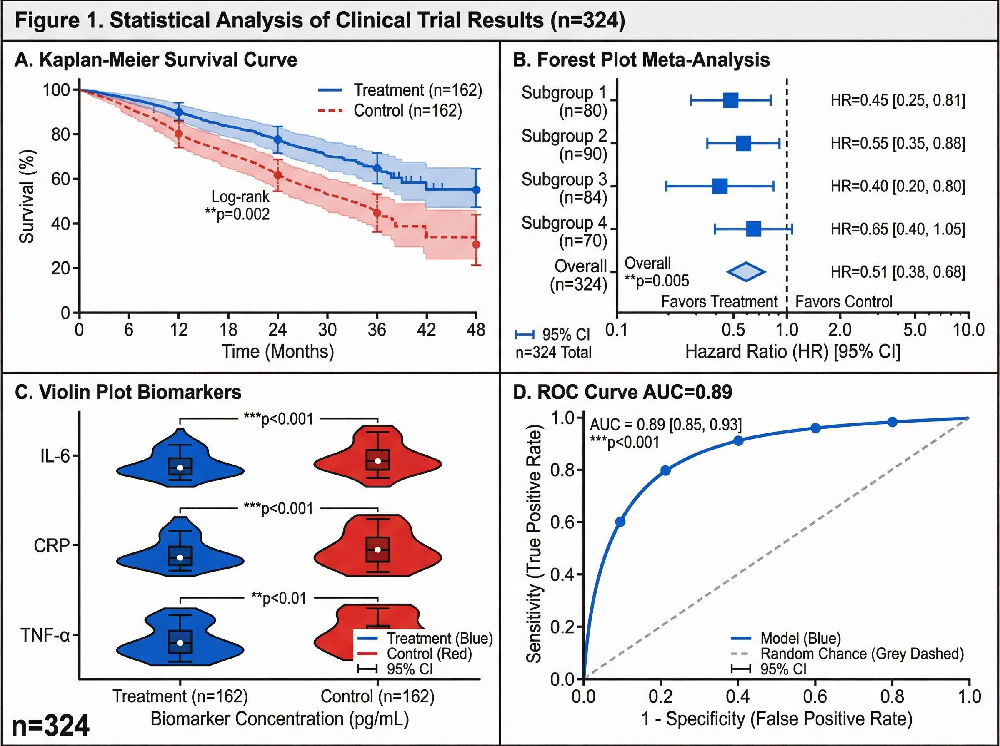


Representação de evidências, relações estatísticas, resultados experimentais e séries temporais.

### Visualização geográfica

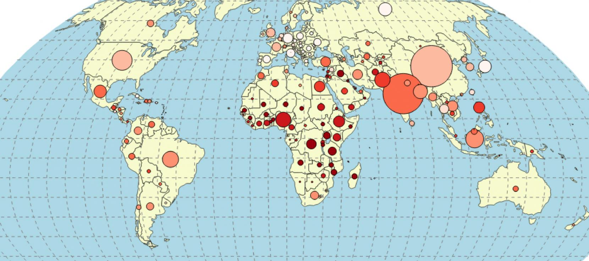


Representação de informações espaciais, mapas temáticos e distribuição territorial.

### Análise financeira

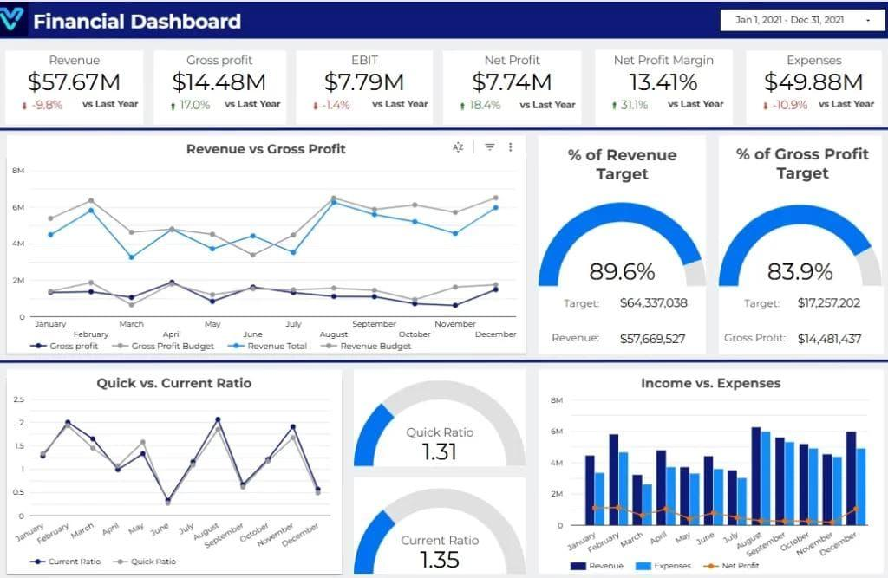


Comparação de indicadores, identificação de tendências e acompanhamento de variações.


### Engenharia de dados

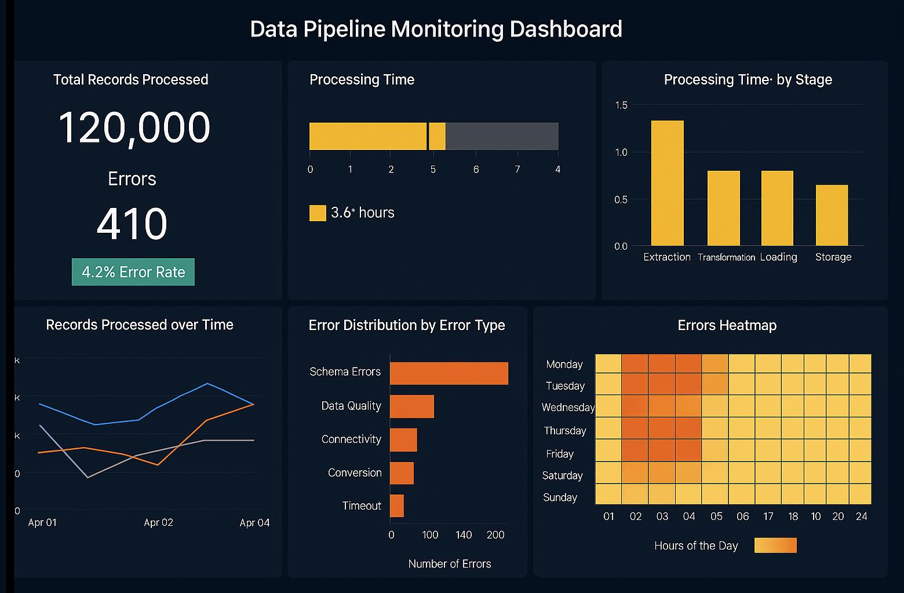


Monitoramento de indicadores operacionais, qualidade dos dados, desempenho de pipelines e evolução de métricas.

##  trabalho de Tufte: exemplos e estudos originais

O site oficial de Edward Tufte possui uma coleção de artigos, experimentos, exemplos históricos e estudos sobre representação gráfica.

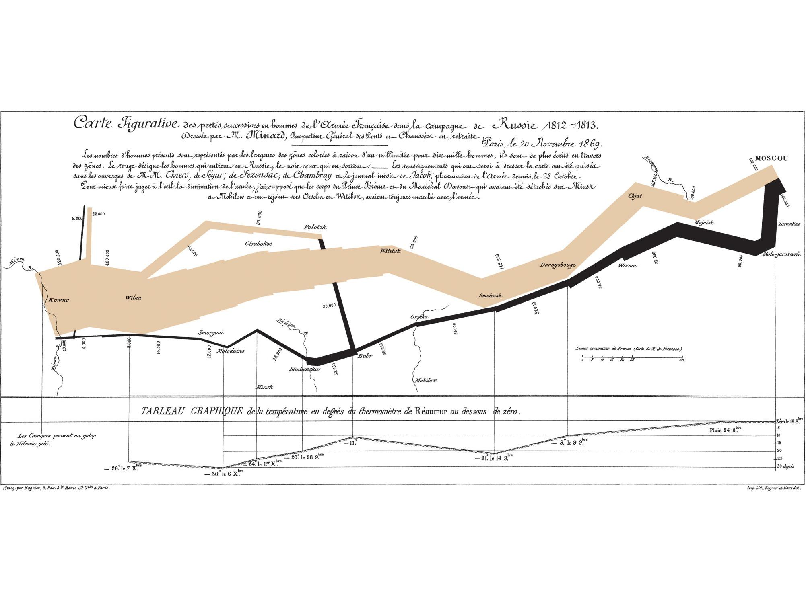
````text
Exploratory data analysis (EDA) | Multivariate Statistics
````
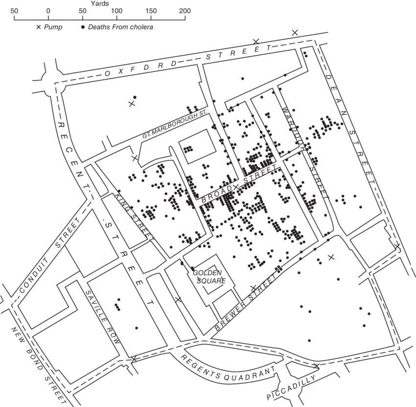
````text
How often does data visualised in the right manner change the course of history?  Quite often.  In 1854, there was a outbreak of cholera in London in which 600 people died in a span of 10 days.  The… | Arun A.
````

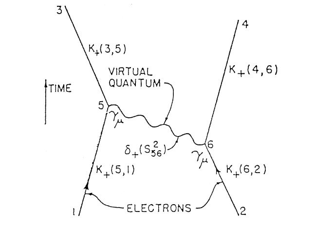
````text
Feynman and the Bomb | Restricted Data
````


Alguns temas particularmente interessantes para estudo:

| Tema                                    | Contribuição para o aprendizado                        |
| --------------------------------------- | ------------------------------------------------------ |
| Mapa da campanha de Napoleão, de Minard | Integração de localização, tempo, direção e magnitude. |
| Gráficos de séries temporais            | Representação de tendências e variações.               |
| Mapas e informações geográficas         | Integração de múltiplas dimensões espaciais.           |
| Diagramas científicos                   | Representação de fenômenos e relações complexas.       |
| Gráficos comparativos                   | Identificação de diferenças e padrões.                 |
| Visualização de evidências              | Relação entre dados, representação e argumentação.     |

O arquivo de estudos e anotações do autor é especialmente interessante para explorar exemplos reais.

Referências para exploração:

- [Edward Tufte – Notebooks and Sketches](https://www.edwardtufte.com/notes-sketches/): coleção de estudos e exemplos.
- [Edward Tufte – Notebooks Archive](https://www.edwardtufte.com/notebook/): arquivo de publicações e reflexões.
- [The Visual Display of Quantitative Information – Citation Classic](https://www.edwardtufte.com/wp-content/uploads/2024/10/Citation-Classic-Current-Contents-Dec.14-1992.pdf): documento histórico sobre a publicação e sua influência.
- [The Work of Edward Tufte – Site oficial](https://www.edwardtufte.com/): livros, cursos, trabalhos e projetos.

##  Relação entre Tufte e outros autores da visualização de dados

Para compreender melhor o campo da visualização de dados, é interessante relacionar as ideias de Tufte com outros pesquisadores.

| Autor             | Principal contribuição                     | Relação com Tufte                                 |
| ----------------- | ------------------------------------------ | ------------------------------------------------- |
| Jacques Bertin    | Semiologia gráfica e variáveis visuais.    | Fundamentação da codificação visual.              |
| William Cleveland | Percepção gráfica e métodos estatísticos.  | Eficiência da interpretação visual.               |
| Colin Ware        | Percepção visual e cognição.               | Relação entre percepção e interpretação.          |
| Stephen Few       | Dashboards e comunicação analítica.        | Aplicação dos princípios de clareza e eficiência. |
| Alberto Cairo     | Visualização de dados e jornalismo visual. | Comunicação e interpretação de evidências.        |

Essa comparação ajuda a compreender que a visualização de dados é um campo interdisciplinar, envolvendo Estatística, Design, Computação, Psicologia Cognitiva e Comunicação.

##  Referências bibliográficas

Obras de Edward Tufte

1. TUFTE, Edward R. The Visual Display of Quantitative Information. Graphics Press, 1983.
2. TUFTE, Edward R. Envisioning Information. Graphics Press, 1990.
3. TUFTE, Edward R. Visual Explanations: Images and Quantities, Evidence and Narrative. Graphics Press, 1997.
4. TUFTE, Edward R. Beautiful Evidence. Graphics Press, 2006.
5. TUFTE, Edward R. Seeing with Fresh Eyes: Meaning, Space, Data, Truth. Graphics Press.

Referências complementares

6. BERTIN, Jacques. Semiology of Graphics: Diagrams, Networks, Maps. University of Wisconsin Press, 1983.
7. CLEVELAND, William S. The Elements of Graphing Data. Hobart Press, 1994.
8. WARE, Colin. Information Visualization: Perception for Design. Morgan Kaufmann.
9. FEW, Stephen. Information Dashboard Design. Analytics Press, 2006.
10. CAIRO, Alberto. The Functional Art: An Introduction to Information Graphics and Visualization. New Riders, 2012.

##  Edward Tufte e a disciplina de Visualização de Dados

O trabalho de Tufte oferece uma base conceitual para compreender que a qualidade de uma visualização não depende somente da escolha correta de um tipo de gráfico ou de uma ferramenta tecnológica.

Uma boa visualização deve considerar simultaneamente:

- Precisão: representar corretamente os valores e suas proporções.
- Clareza: permitir a compreensão das informações.
- Eficiência: utilizar adequadamente o espaço visual.
- Comparabilidade: facilitar a identificação de diferenças e semelhanças.
- Integridade: evitar distorções e interpretações enganosas.
- Densidade informacional: apresentar informações relevantes sem sobrecarregar a leitura.

Esses princípios podem ser utilizados como critérios de avaliação de gráficos, mapas, tabelas, dashboards e sistemas de visualização.

##  Fontes oficiais e materiais para consulta

 - **Edward Tufte** – Official Website [Acessar o portal oficial](https://www.edwardtufte.com/)

 - **Notebooks and Sketches** [Consultar artigos, estudos e exemplos](https://www.edwardtufte.com/notes-sketches/)

 - **Notebooks Archive** [Consultar o arquivo de trabalhos](https://www.edwardtufte.com/notebook/)

 - **Yale University** 
[Consultar a trajetória acadêmica](https://news.yale.edu/2000/11/01/pioneer-information-design-speak-yale)

 - **Stanford University** – ASBS [Consultar perfil e referências acadêmicas](https://casbs.stanford.edu/people/edward-tufte)

